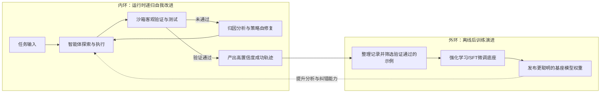
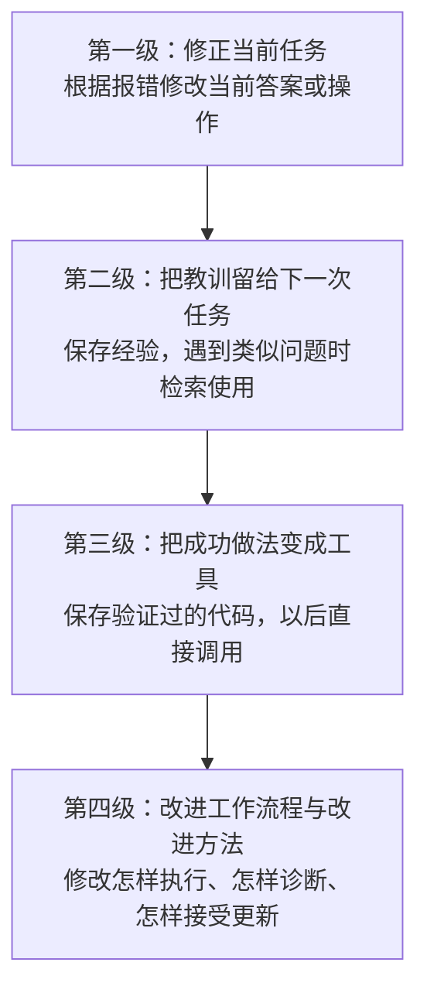
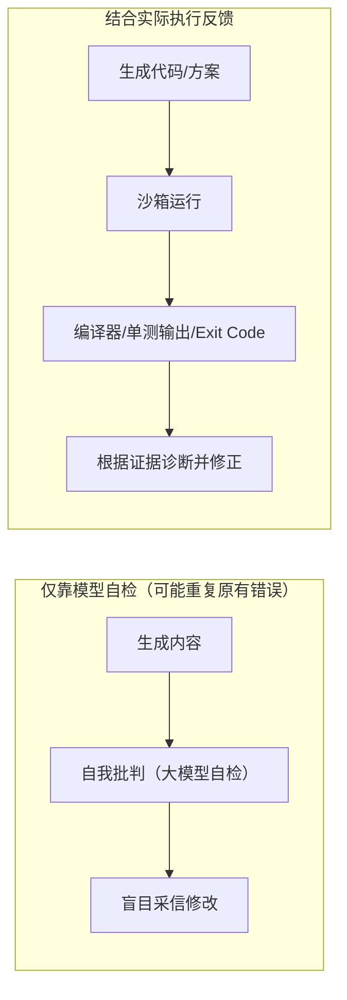
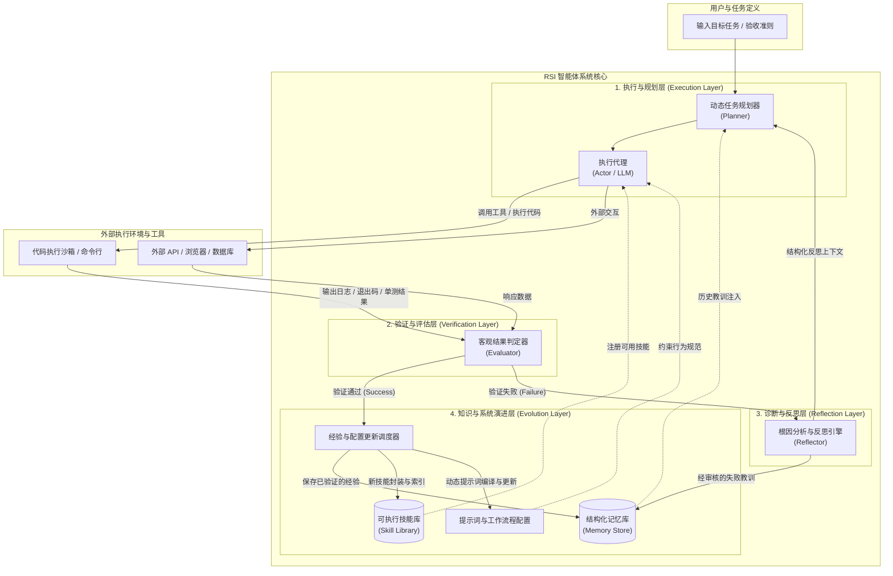
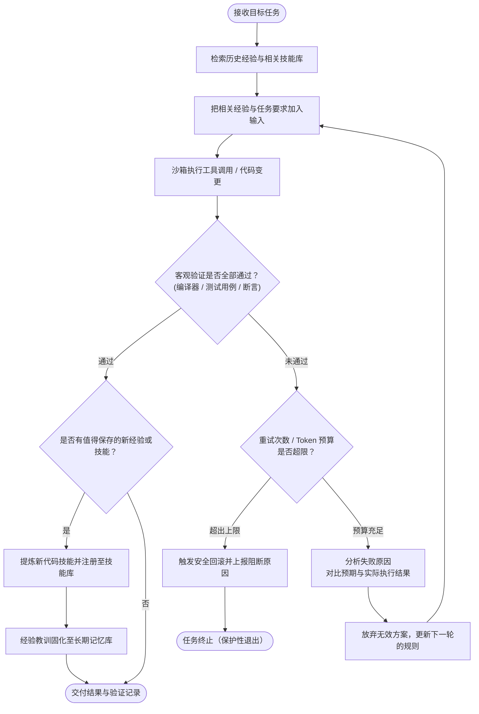

## 智能体为什么需要自我进化

### 静态智能体的能力边界与现实困境

大语言模型（`Large Language Model, LLM`）是能够理解和生成文本的模型。**智能体（`Agent`）则是在模型之外，加上工具、任务流程和记忆，让它能够围绕目标执行操作的系统**。打个比方：模型像负责分析问题的工程师，智能体则是给这位工程师配上电脑、操作手册和工作记录。

在传统开发方式中，开发者通常采用“静态配置”：预先写好系统提示词（`System Prompt`，规定模型的角色、规则和行为的说明），接入工具（`Tools`，如文件读取器、浏览器），并注册应用编程接口（`API`，软件之间约定好的调用入口，如查询订单的接口）。这些配置就像一份固定的岗位说明书，任务变了，说明书却未必会变。

常见的执行方式之一是`ReAct`，名称来自推理（`Reasoning`）与行动（`Acting`）。它让智能体交替进行“判断下一步做什么 → 调用工具 → 查看结果”。例如，排查程序故障时，先判断要读日志，再调用工具读取日志，最后根据报错决定下一步。

当智能体从简单演示走向需要许多步骤的实际任务（如软件开发、系统运维、复杂数据分析）时，固定配置的局限就会变得明显：

- **策略僵化与环境漂移**：所谓“环境漂移”，就是原先成立的条件变了。例如，接口升级后不再接受旧参数，智能体却一直照着旧说明重复调用，如同导航只认旧地图，遇到封路仍坚持走原路线。
- **幻觉与错误累积**：“幻觉”是模型给出了看似可信、实际上没有依据的内容，例如编造一个并不存在的接口参数。复杂任务可能需要几十甚至上百步操作；如果后续步骤都以这个错误为前提，任务就会越走越偏。
- **缺乏跨任务经验复用**：没有持久记忆的智能体，像一位做完项目就丢掉笔记的工程师。即使昨天解决了依赖冲突（例如两个组件需要同一个库的不同版本），今天仍可能从零摸索。这里经常用`Token`衡量模型读写文本的规模：它是模型处理文本的基本单元，可能是一段词语、一个字或一个符号，并不固定等于一个汉字或一个单词。

因此，智能体要长期适应不断变化的任务，就需要**发现错误、修正做法、保存经验，并在后续任务中利用这些经验**。这就是本文所说的自适应与持续演进。

### 智能体能力演进的两条核心技术路径

从“主要改进什么”来看，可以先把智能体的能力提升理解为两条路径：

1. **后训练演进（Post-training Evolution）**：通过进一步训练，改变模型的参数权重。权重是决定模型如何处理输入和生成输出的大量数值，可以类比为训练后形成的“内在习惯”。这条路径像让工程师参加专项培训，把新的解题方法练熟。
2. **递归自我改进（Recursive Self-Improvement, RSI）**：让智能体根据执行结果改进自己的工作方法。本文重点讨论保持模型权重不变、主要改进周边软件的做法：修改操作规则、保存失败教训、增加工具，甚至调整任务流程。这像让工程师边工作边完善自己的手册和工具箱；更进一步，还能改进“怎样复盘和更新手册”这套方法。

两条路径可以配合使用。严格说，`RSI`也可以包含模型训练；这里为了方便比较，将“训练模型本身”和“改进智能体周边系统”分开讨论。

## 智能体的两大演进范式：后训练与递归自我改进

### 什么是后训练演进

“预训练”像让模型先读大量通用资料，获得基础能力；“后训练”则像上岗前的专项培训。**基座模型**就是提供这些基础能力的大模型，**微调**是在已有模型上继续训练，**对齐**则是让输出更符合目标要求，例如更可靠地调用工具、遵守安全规则。

典型的方法包括：

- **监督微调（Supervised Fine-Tuning, SFT）**：给模型看高质量的示范，让它学习“遇到这种任务，应当怎样处理”。执行轨迹就是从开始到结束的操作记录，像一道题的完整解题步骤，包含工具调用和返回结果。例如，可以收集`SWE-bench`（用真实软件仓库问题评测修复能力的基准）上的排错记录，或`ToolBench`（面向工具调用的数据集与评测基准）中的调用示例。
- **强化学习（Reinforcement Learning, RL）**：让模型尝试不同做法，根据结果给奖励（`Reward`），再调整权重，使有效做法更容易出现。这像练习投篮：进球得到正反馈，逐渐调整动作。只在任务结束时评分叫“稀疏奖励”，中间步骤也评分叫“密集奖励”。试验可以在沙箱中进行；沙箱是一种隔离运行环境，像专门的试验台，减少试错对正式系统的影响。
- **人类反馈强化学习（Reinforcement Learning from Human Feedback, RLHF）与直接偏好优化（Direct Preference Optimization, DPO）**：两者都利用“哪个回答更好”的偏好数据。`RLHF`通常先训练一个评分模型，再用它指导强化学习；`DPO`则直接根据优劣回答对来调整模型，省去显式训练奖励模型这一步。可以类比为：前者先培养一位评分教练，后者直接拿“好答案与差答案”的对照来练习。

强化学习还需要规定“每轮怎样调整权重”。近端策略优化（`Proximal Policy Optimization, PPO`）会约束更新幅度，像练动作时每次只作适度调整；组相对策略优化（`Group Relative Policy Optimization, GRPO`）则比较同一问题的一组候选答案，依据组内相对表现来更新。理解本文时，先记住它们都是训练方法，不必先掌握算法公式。

#### 后训练演进的优势

- **把常用方法练成习惯**：通过更新权重，模型可能更熟练地选择工具和组织步骤，减少每次都要重新解释规则的需要。
- **减少输入说明的开销**：行为模式已经学进模型后，就可能少放一些提示词（`Prompt`，本次发给模型的任务、背景和要求）及少样本示例（`Few-Shot`）。`Few-Shot`的意思是“先给几个示范，再让模型照着做”：例如，先提供“‘物流很快’ → 正面评价”“‘包装破损’ → 负面评价”，再让它判断新评论。它像答题前看到两道例题，通常不需要修改模型权重，但示例每次放入输入都会占用`Token`。
- **可能提升处理新问题的能力**：这种能力叫“泛化”，像学会解题方法后，能做没见过的新题。训练还可能改善模型分步骤推理、检查错误的表现，常被类比为系统二（`System 2`）思考：看到`2 + 2`会立刻回答，类似快速直觉；计算`17 × 24`时先拆成`17 × 20 + 17 × 4`，再核对结果，则类似较慢、审慎的系统二思考。这个词借自认知心理学，描述的是行为类比，并不表示模型真的拥有一个人类的“第二套思维系统”，也不保证训练后一定能可靠反思。

#### 后训练演进的局限性

- **训练与工程成本可能较高**：大规模训练，尤其是强化学习，往往需要许多图形处理器（`GPU`，擅长并行计算、常用于训练模型的芯片）和配套试验环境。不过，小模型或小范围微调也可以较轻量，成本取决于训练规模。
- **更新通常比改配置慢**：线上接口突然变动后，训练方案往往还要经历数据整理、训练、回归测试（检查新改动是否破坏旧能力）和重新部署，难以像修改一条调用规则那样立刻生效。
- **灾难性遗忘风险**：这是指模型学会新任务时，丢失了部分旧能力。可以类比为专项训练后，原本熟练的动作反而生疏了；因此，不能只测新任务，还要复查通用问答、代码编写等原有能力。
- **难以直接定位错误规则**：权重是大量相互作用的数值，并不是一本能逐条修改的操作手册。模型出错时，工程师通常无法找到“负责这次错误的某一个参数”并直接修好。

### 什么是递归自我改进（RSI）

在现代智能体系统中，自我改进意味着：**把自己的执行记录和外部反馈作为材料，找出不足，再修改下一次使用的规则、记忆、工具或工作流程**。系统由模型、脚手架（`Harness`）、数据记忆和改进机制等部分组成。这里的“脚手架”不是建筑设备，而是围绕模型搭建的控制软件：它决定给模型什么提示、允许调用哪些工具、失败后是否重试，以及何时结束任务。

例如，某接口原先按`page`（页码，如第2页）获取数据，新版本改用`cursor`（游标，像书签一样标记“下一批从哪里开始取”）。智能体发现这个变化后，只改正当前调用，是一次纠错；把新规则保存下来供以后使用，是经验积累；进一步修改“如何检测接口变化、如何验证新规则”的流程，就开始触及递归自我改进。**“递归”的重点是：改进自身的方法，也能成为被改进的对象。**

本文关注的改进主要发生在**非参数化的系统层**，也就是不改模型权重，而改外部规则与资产。它常用到测试时计算（`Test-Time Compute, TTC`）：模型已经训练好后，在处理当前任务时，多花计算资源来尝试、检查和修正。这里的“测试时”指使用模型的阶段，并不专指运行软件测试；类比考试，就是不重新上课，而在答题时多花时间验算。

#### 递归自我改进的核心优势

- **规则更新可以很快生效**：找到正确的接口调用方式后，系统可把新规则写入记忆或工具配置，后续步骤就能使用。是否立即用于所有任务，还要经过必要验证。
- **入门成本相对较低**：不更新模型权重的方案主要消耗模型调用与试验环境资源，小型系统可在单机上实践；但大量重试和并行探索仍可能很贵。
- **改进内容容易检查**：产物可以是反思笔记（`Reflections`）、提示词、可执行技能（`Skills`，如一个经过验证的日志解析函数）或工作流程。它们像能翻阅的维修手册，工程师可以检查，并用`Git`（记录文件版本和修改历史的工具）保存或回退。
- **避免直接覆盖模型的旧能力**：权重不变，就不会因这次系统更新而直接造成参数层面的遗忘。不过，错误记忆、冲突规则或有缺陷的新工具，仍可能让整体表现变差。

#### 递归自我改进的局限性

- **受限于分析自身错误的能力**：这常被称为“元认知”，可以理解为“检查自己是怎样思考的”。如果模型看不懂报错，就可能为错误找理由，像把没完成任务归咎于工具，却不检查自己是否用错了工具。
- **增加任务耗时与费用**：反思、重试和分支搜索（尝试几个不同方案再比较）都要额外消耗`Token`和运行时间。
- **依赖可信的判定依据（Ground Truth）**：它指用于判断结果是否正确的事实或参考标准，像考试的答案与评分规则。在代码任务中，编译报错、测试结果和断言（例如规定“返回列表必须有三条记录”）提供可检验的证据。但有限的测试不等于完整真相；对于写作等主观任务，还需要人工评审或明确的质量标准。

### 演进范式深度对比

为了清晰呈现后训练演进与递归自我改进的技术差异，下表对两者的关键维度进行了系统化对比：

| 对比维度 | 后训练演进（Post-training Evolution） | 递归自我改进（Recursive Self-Improvement, RSI） |
| :--- | :--- | :--- |
| **更新对象** | 模型参数权重（`Weights`） | 提示词、记忆库、技能函数、系统编排代码（`Harness`） |
| **迭代周期** | 通常先训练、验证，再部署，周期取决于规模 | 单次规则修改可快速生效，全局更新仍需验证 |
| **计算资源需求** | 大规模训练通常较高，小范围微调可较低 | 起步较低，多轮重试和并行探索会增加成本 |
| **可解释性与可控性** | 较难从权重变化直接看出行为为什么改变 | 可检查具体的规则、代码和记忆，支持版本管理 |
| **旧能力退化风险** | 可能因权重更新而遗忘旧能力 | 不直接改变权重，但错误规则或记忆仍可能拖累系统 |
| **核心能力来源** | 从示范和奖励中学到的模型能力 | 已有模型的分析能力，加上环境反馈与可复用经验 |
| **适用场景** | 提升通用能力、练熟高频工具调用 | 适应接口变化、复杂调试、积累工具、长任务纠错 |

### 双环飞轮：后训练与RSI的协同共生关系

后训练与`RSI`可以组成一个**双环飞轮（Dual-Loop Flywheel）**。“飞轮”在这里比喻两套循环相互推动：工作时解决难题并留下记录，训练时把好记录变成模型能力，再用更强的模型解决下一批难题。它像“现场实践 → 整理教材 → 培训提升 → 再去实践”的循环。



- **内环（运行时改进）**：在当前任务中多次尝试、检查结果并修正，再把有用经验留下。测试时搜索与修复（`Test-Time Search & Repair`）说的就是“答题时多试几条路，依据反馈改答案”。单纯重试本身还不等于完整的递归自我改进。
- **外环（离线后训练）**：定期筛选高质量记录，再训练模型。例如，`STaR`（`Self-Taught Reasoner`，自学推理方法）让模型生成解题过程，把得到正确答案的过程用于后续训练。“拒绝采样”是把不符合标准的候选丢掉，保留通过筛选的示例；把这些经验训练进权重，可通俗地理解为将工作笔记变成内在能力。
- **相互促进**：更强的模型可能更善于分析失败，进而产生更好的实践记录。不过，循环能否改善能力，仍取决于数据质量和评估方法。

## 深入理解Agent递归自我改进（RSI）

### RSI的理论渊源与现代智能体定义

**递归自我改进**的思想常被追溯到计算机科学家`I. J. Good`在`1965`年提出的“智能爆炸”猜想：如果系统能设计出更强的系统，后者又能继续改进，能力提升就可能不断加速。这是一种理论设想，并不是当前智能体已经实现的事实。

Jürgen Schmidhuber在2000年代初提出的**哥德尔机（Gödel Machine）**，则设想让程序先用形式化定理证明，确认某次自我修改能提高预设目标下的效用，再执行修改。“形式化证明”类似数学证明，要求按明确规则推出结论。可以把它想象成一位改造机器的工程师：不仅提出方案，还要在既定假设下证明改造值得做。这种理论要求，比现代智能体依靠测试结果决定是否接受修改更严格。

在现代智能体研究中，可以用下面的状态元组描述系统的组成（如Liu等人2026年的综述《The Path to Recursive Self-Improving Agents》所讨论的框架）。**“元组”就是把几个相关项目按顺序放在一起，像一张系统快照**：

`x_t = (M_t, H_t, D_t, T_t, Imp_t)`

这里的`t`表示第几轮；`x_t`表示第`t`轮时系统的整体状态。括号里依次列出五个组成部分：

- `M_t`（**基础模型，Foundation Model**）：负责理解与推理，像工程师已有的知识和能力。多模态模型还能处理图像、音频等不同类型的输入。
- `H_t`（**控制脚手架，Agent Harness**）：规定怎样工作，像操作手册与调度程序。包括提示词模板、工具清单和流程代码；其中“状态机”可以理解为切换工作阶段的规则，例如“执行失败后转入诊断，验证成功后结束”。
- `D_t`（**数据与记忆，Data & Memory**）：保存当前任务记录和历史经验，像工作笔记与案例档案。
- `T_t`（**训练器，Agent Trainer**）：负责更新模型权重，像安排专项培训的设施；不训练权重的方案可以不用这一部分。
- `Imp_t`（**改进机制，Improvement Mechanism**）：决定怎样发现问题、提出修改并验证，像一套复盘与改进规程。

更严格意义上的**递归（Recursive）**，关键在于`Imp_t`本身也能被改进。例如，系统发现“每次只看错误日志的最后一行”容易误判，于是把诊断流程改成“同时检查调用参数、接口版本和完整报错，再验证原因”。这不只是修好一个接口调用，而是改进了今后怎样找错、怎样修错的方法。

### RSI能力的分级演化

为了方便理解，可以把相关技术按改进范围分成四个层级。下面是一种讲解用的划分，并非统一的行业标准；前几级是自我改进的基础，也不必然具备“改进自身的改进机制”这种严格递归能力。



#### 第一级：单任务上下文自修正（In-Context Self-Refinement）

这是最基础的自修正形态：执行后发现错误，在当前会话里再改一次。例如，接口提示“不支持`page`参数”，智能体查阅当前文档后，改用`cursor`并重新调用。任务结束后，如果没有保存经验，下次仍可能犯同样的错。

**上下文窗口（Context Window）**是模型一次能处理的输入与生成内容的容量上限，可以类比为大小有限的工作台：当前指令、历史消息、工具结果都占用空间。`Self-Refine`是一类“生成 → 反馈 → 修改”的方法，反馈可以来自模型；代码智能体（`Coding Agent`，能读写代码、调用终端的智能体）还可以利用编译或运行错误，例如`SyntaxError`表示代码语法有误。

#### 第二级：跨任务经验与反思沉淀（Cross-Task Memory & Reflection）

这一层像写复盘笔记。例如，把“某接口的新版本不支持`page`；调用前检查版本，按文档使用`cursor`”保存下来，并记录适用版本与验证证据。新任务开始时，系统查找相关笔记，再交给模型参考。`Reflexion`（用反思文本帮助后续尝试的方法，后文会展开）、`CLIN`和`ExpeL`等研究都涉及这类经验积累。

一种常见存储方式是**向量记忆库**：先把文字的含义编码成一组数值，再根据数值的接近程度寻找相关内容。它像按“意思相近”查笔记，而不只匹配完全相同的字。例如，新问题写的是“安装失败”，系统仍可能找到标题为“依赖版本冲突”的旧记录。检索结果只是参考，仍需检查是否适用于当前环境。

#### 第三级：工具与技能库自积累（Skill Library Evolution）

这一层像把手工操作做成专用工具。智能体把验证成功的步骤封装为**可执行代码技能（Executable Code Skills）**，并记录参数、返回结果和使用条件。例如，生成一个`fetch_all_orders()`函数，内部处理`cursor`翻页，今后获取全部订单时就不必从头编写同样的逻辑。`Voyager`是这类技能积累的代表研究，后文会介绍。

技能还可以组合使用，例如“拉取订单 → 检查重复项 → 生成报表”。工具数量增加不代表能力一定提高，重复或过时的工具也需要维护和清理。

#### 第四级：系统架构与代码自重写（Harness Meta-Optimization）

这一层开始改造“组织工作的方式”。智能体获准修改自身的控制代码（`Agent Scaffolding Code`），例如任务分配、重试规则、多个智能体的协作顺序，以及生成改进方案的流程。“元优化（Meta-Optimization）”可以理解为**优化那套负责优化的方法**。

继续用接口例子：系统发现大量失败都来自旧接口信息，便把工作流程改为“先检查版本并读取当前文档，再生成调用代码”，随后用一组代表性任务（基准测试集）检验整体效果。若它还改进了“怎样选择诊断证据、怎样比较候选修改”，就触及了改进机制本身。能够修改自己的代码，并不意味着每次修改都会让系统更好。

### 研究与工程实践中的五类相关技术

理解上述层级后，再看五类代表性做法。它们分别解决“怎样确认做对了”“怎样记住教训”“怎样复用工具”“怎样优化提示”和“怎样组织代码修改”的问题，既有研究方法，也有代码智能体中的工程模式；并不是每一项都构成完整的`RSI`系统。

#### 确定性执行反馈闭环（Verification with Execution Ground Truth）

自我纠错（`Self-Correction`）的一种简单做法，是让模型检查自己的答案。但如果没有新证据，它可能只是重新组织原来的解释，甚至把错误答案改得更像真的。这就像做题的人自己检查，却仍使用同一个错误公式。

更可靠的做法，是**让实际执行结果参与判断**，把“提出方案 → 执行 → 检查 → 修改 → 再执行”连成闭环，也就是把检查结果送回下一轮决策：

- **编译与静态检查**：编译器可以发现语法、类型等问题；静态检查工具（`Linter`，如`ruff`、`eslint`）则像代码的校对员，在不实际运行程序的情况下查找部分错误和不规范写法。
- **单元测试与断言**：单元测试是给小块功能出几道检查题；`pytest`、`jest`是运行这些检查题的工具。断言则是必须满足的条件，例如“订单总数应等于三”，不满足就报错。
- **浏览器与接口状态**：网页文档对象模型（`DOM`）是浏览器表示页面元素的树状结构，可以检查“提交后是否真的出现新记录”。`HTTP 200/404/500`分别通常表示请求成功、资源未找到、服务器出错。但`200`只说明请求层面成功，业务结果是否正确仍要检查返回内容。

图中的退出码（`Exit Code`）是程序结束时交给操作系统的状态值，通常`0`表示正常结束，非`0`表示错误。它和测试结果一样，是判断依据之一，不能单独保证任务目标已经完成。



#### Reflexion反思记忆架构

`Reflexion`是Shinn等人提出的一种反思记忆方法，称为言语强化学习（`Verbal Reinforcement Learning`）。这个名称容易让人误以为它在训练模型权重；实际上，它把反馈写成**自然语言反思笔记**，放进后续尝试的输入，而不通过这套机制直接更新模型权重。类比来说，普通数值反馈是“这题得了0分”，反思笔记则是“我使用了旧版本参数，下次先查接口版本”。

- **执行者（Actor）**：负责尝试完成任务，留下操作记录。
- **评估者（Evaluator）**：对执行结果进行客观评估，打上成功/失败标签。
- **自我反思者（Self-Reflection）**：在遇到失败时，深入分析轨迹，用自然语言回答：“我原本的假设是什么？现实结果为什么偏差？下一次我应该避免什么动作？”
- **记忆区（Memory Buffer）**：像一个有限的复盘笔记本，保存反思内容，供后续尝试参考；保存范围与时间取决于具体实现，不会自动变成永久记忆。

这类方法的价值是帮助智能体减少重复犯错。效果仍取决于反馈是否可靠、反思是否找对原因，以及后续是否用上了记录；一段听起来合理的复盘，并不等于已经验证的知识。

#### 以Voyager为代表的技能库自积累机制

`Voyager`是在《Minecraft》游戏环境中持续探索、积累代码技能的智能体研究。“终身学习”在这里指任务进行过程中不断积累并复用技能，并不是说模型权重一直在训练。这种思路也可借鉴到软件工程，但需要重新设计验证方式和权限边界：

1. **技能代码化**：通过尝试与执行，把操作步骤写成代码。`Voyager`使用游戏环境中的代码技能；工程系统也可保存`Python`等语言的函数。
2. **环境验证**：代码必须在真实环境中运行成功并达成特定目标（如“制作一把铁镐”或“自动化拉取并解析特定格式的日志”）。
3. **记录用法并入库**：保存代码、功能说明、参数和验证记录，加入技能库（`Skill Library`）。检索通常根据技能说明寻找合适工具，再取出相应代码使用。
4. **组合调用**：新任务可以复用旧技能，像搭积木一样组合“采集材料”和“制作工具”。工程中也可组合“拉取日志”和“解析日志”。这种用已有能力构建新能力的过程称为“自举”，但组合后的结果仍需验证。

#### 基于DSPy与TextGrad的提示词与工作流自动编译优化

提示词工程（`Prompt Engineering`）就是设计给模型的说明和示例，使它更好地完成任务。除了人工修改，也可以自动产生候选提示、运行评测，再选择更好的版本。`DSPy`与`TextGrad`提供了两种不同思路：

- **DSPy**：开发者先定义模块的输入、输出和连接方式。例如，“输入客服留言，输出问题类别”，再把分类模块接到处理模块。优化器根据示例任务和评分标准，尝试调整指令或`Few-Shot`示例，选择表现更好的组合。这像用同一套考试题比较几版教学讲义。这里的“编译”主要是把抽象的任务定义优化为具体的模型调用配置；不同优化器的做法不同，也不保证找到全局最优方案。
- **TextGrad**：借鉴反向传播（`Backpropagation`）的思路。神经网络训练中的反向传播，会把结果误差沿计算流程往回传，计算各个参数对误差的影响；`TextGrad`则用模型生成文字反馈，再把反馈传回相关提示词或代码。“文本梯度（Textual Gradients）”可以理解为修改建议，例如“分类指令没区分退款与退货，应补充判断规则”；这些建议是文字反馈，不是训练中那种用于调整参数的数值梯度。整个过程像老师批改最终答案后，指出前面哪一步的说明需要改进。

这些工具可以用于离线优化。只有进一步接入智能体的执行反馈、更新与验证流程，才会成为自我改进系统的一部分。

#### 商业编码智能体（Devin、Claude Code）中的工程实践

`Devin`、`Claude Code`等代码智能体让“修改 → 运行 → 反馈”这种工作方式更容易落地。下面是设计可靠代码智能体时常用的工程模式，并不表示所有产品都采用完全相同的内部机制：

- **先确认问题能复现**：先运行已有测试，或编写最小复现脚本（`Reproduction Script`，用尽可能少的代码稳定触发问题）。这样才能判断改动究竟修好了什么。
- **小步修改，及时检查**：每次修改一小块，用`Git Diff`（展示修改前后差异的命令）检查变更，再运行验证脚本，减少一次引入太多问题。
- **保留回滚路径**：回滚（`Rollback`）就是撤回改动，恢复到之前保存的状态，像撤销一次失败的编辑。如果连续修改使失败测试增多，就可以回退并换方案。触发条件应按任务设置；回滚文件也未必能撤回已经发送的请求或其他外部副作用。

## RSI技术的核心原理与系统架构

### RSI系统的核心架构解剖

可以把系统拆成四个职责不同、相互传递结果的部分。它们像一个团队中的执行、验收、排错和知识维护岗位，不一定要各配一个独立模型：

1. **执行层（Execution Layer / Actor）**：像动手工作的工程师，把目标拆成步骤，读取资料、修改代码并调用工具。
2. **验证与评估层（Verification & Evaluation Layer / Critic）**：像验收员，收集运行结果并对照验收条件。标准输出（`stdout`）是程序通常用来输出结果的信息通道，标准错误（`stderr`）则通常用于错误和诊断信息；还需结合退出码与测试内容判断任务是否完成。
3. **诊断与反思层（Diagnosis & Reflection Layer / Reflector）**：像排错员，分析预期与实际的差异。根因诊断（`Root-Cause Diagnosis`）就是追查问题的来源：例如，“订单没取全”是现象，“翻页仍使用旧参数”才是可能的原因，随后还要用文档和运行结果验证。
4. **知识与系统演进层（Evolution & Memory Layer / Meta-Optimizer）**：像维护手册和工具箱的人，把经过验证的规则、经验和代码保存下来，并管理适用条件、版本与更新流程。

### 系统的分层架构图

下图展示上述组件如何协作。规划器负责决定下一步，调度器负责安排经验和工具的更新；箭头表示信息或控制指令的流向。



### 递归自我改进的全流程拆解

下面以“修复订单接口的翻页代码”为例，把一次执行、纠错和经验保存拆成六步。这个例子展示的是自我改进基础循环；如果系统还能优化这六步的组织方式，就进一步涉及递归改进。

#### 步骤一：任务解析与经验检索

先明确验收条件（`Success Criteria`），也就是“做到什么才算完成”。例如：已知测试数据有三页订单，修复后应全部取回、没有重复，无订单时返回空列表。然后按含义的相近程度（语义相似度）检索历史笔记，找出与接口版本、翻页方式有关的经验，检查适用条件后交给模型参考。

#### 步骤二：假设生成与动作执行

执行层先形成可检验的假设，再实际操作。例如，它根据旧代码假设接口仍接受`page`，在测试环境运行后收到“不支持该参数”的错误。

操作应尽量在隔离环境进行。`Docker`是打包与运行容器的工具，容器可理解为带有程序和依赖的独立运行空间。它便于准备试验环境，但安全程度还取决于权限、挂载目录和网络等配置，不能只因“用了容器”就认为没有风险。

#### 步骤三：客观事实比对与断言检验

评估层检查实际结果，而不只看模型是否说“已经修好了”：

- 翻页代码是否真的发生了预期修改？
- 程序能否运行，是否还有语法、类型或接口错误？
- 三页订单是否全部取回，重复记录与空结果等情况是否符合断言？

测试命令通常以`Exit Code == 0`报告成功，但还应确认正确的测试确实运行了，且测试覆盖了目标行为。

#### 步骤四：根因反思与差分对比（若失败）

失败后进入诊断分支：

- 查看报错堆栈（错误发生时的函数调用路径，像故障留下的路线记录），找出相关调用和参数。
- 查阅当前版本文档，验证接口已改为`cursor`翻页；记录“错误假设、支持证据、下一步修改”，而不是只写“要更加小心”。
- 把这份报告加入下一轮输入，让执行层修改调用，并补查终止翻页的条件。

#### 步骤五：分支重试与收敛判定

系统改用`cursor`后重新执行。如果仍失败，就继续收集证据；如果只是重复相同操作，或者超过重试次数、费用与时间上限，就应停止，保留现场并寻求进一步诊断。

这里的“收敛”可以理解为逐步接近满足验收条件的方案，而不是无休止地尝试。安全检查点则像游戏存档：保存一个已知状态，失败时可恢复相关文件与配置，再换路线。

#### 步骤六：经验泛化与能力沉淀（若成功）

验证通过后，再判断哪些内容值得留下：

- 将翻页逻辑封装成函数，写明参数、接口版本、调用样例和测试记录，经过检查后加入技能库。
- 保存知识卡片，例如“该接口某版本使用`cursor`翻页；取下一页前检查游标，游标为空时结束”。知识卡片应记录来源与适用范围，避免把某个接口的规则误当成所有接口的规则。

“经验泛化”就是从一次成功中提炼可复用方法；“持久化”则是把内容保存到文件或数据库，让当前会话结束后仍能使用。

### 递归改进机制的流程图



### 核心演进机制的形式化建模

下面的公式只是把前面的流程写得更紧凑。先按一句话理解即可：**依据当前配置执行，检查结果，分析错误，保存有用记录，再提出下一版配置。**

下标`t`表示第`t`轮，`t+1`表示下一轮。这里假设模型`M`保持不变，只更新记忆`D`与脚手架`H`。`I`是输入任务，`A_t`是本轮要做的动作；`Planner(...)`表示规划器的处理过程：

```text
A_t = Planner(M, H_t, D_t, I)
```

把动作交给环境`Env`执行，得到观测结果`O_t`。例如，动作是调用订单接口，观测结果是返回的数据或报错：

```text
O_t = Env(A_t)
```

评估器`Evaluator`把结果与目标`Target`比较，输出验证信号`V_t`和反馈`F_t`。布尔值就是“是或否”两种状态，这里用`1`表示通过、`0`表示失败；例如，反馈可以是“只取回第一页，缺少后两页订单”：

```text
(V_t, F_t) = Evaluator(O_t, Target)
```

当`V_t = 0`（验证未通过）时，反思器`Reflector`生成反思文本`R_t`：

```text
R_t = Reflector(A_t, O_t, F_t)
```

以失败分支为例，将任务、动作、结果和反思作为一条记录加入记忆。下面的`+`表示追加记录，并不是对文字做数学加法：

```text
D_{t+1} = D_t + {(I, A_t, O_t, R_t)}
```

实际系统应区分临时记录、未经证实的判断和已验证经验；不能把每一次反思都直接当成长期规则。成功分支也可保存经过验证的解法与适用条件。

积累足够的可靠记录后，元优化器`MetaOptimizer`提出新的脚手架配置。经过验证后接受更新，可以简写为：

```text
H_{t+1} = MetaOptimizer(H_t, D_{t+1})
```

这条公式描述的是“用现有规则与新记录生成下一版规则”，并不证明新版本一定更好。只有在代表性任务上验证有效，才应正式采用；否则保留旧版本。持续积累可靠经验，才可能降低类似任务中的失误率。

## 工业落地中的关键工程考量与风险防御

自我改进也可能越改越差。例如，智能体把一次偶然成功的做法推广到所有任务，或在两个无效方案之间来回切换。用于实际服务时，需要以下四类约束，让改动可验证、成本有上限、失败能恢复。

### 让自检结合证据，建立可信的验收标准

**不要仅凭模型说“我认为正确”就接受修改。**模型自检可以帮助发现问题，但应结合外部证据。“证实偏差（Confirmation Bias）”是偏向寻找支持已有判断的证据，像认定代码没问题后，只关注通过的用例而忽略失败的用例。自我检查也可能存在类似倾向。

因此，要尽量采用**可复查、与目标相关的验证信号**：

- 代码任务可使用编译、类型检查、单元测试和实际运行结果。确定性检查是指相同条件下应得到相同判定，例如某个断言返回`True/False`（真/假）；但判定再稳定，若检查题设计错了，也不能证明程序正确。
- 写作或设计任务可用模型裁判（`LLM-as-a-Judge`，让另一次模型调用按标准评审），并结合人工抽查。评分规约（`Rubrics`）像作文评分表，明确事实正确性、结构、表达等维度；还应提供好坏示例，并检查评分与人工判断的一致性。采用独立模型可以降低部分偏差，但不会自动消除误判。
- 验收标准应独立于被修改的方案。如果智能体同时修改业务代码和测试，不能因为“改完测试就通过了”便接受结果，还需检查测试是否仍保留了原来的要求。

### 引入多重截断机制，遏制Token消耗膨胀

反复自修正可能消耗大量计算资源。例如，智能体一直在“改用参数A”和“改回参数B”之间切换，问题没解决，调用费用却不断增加。

可以设置多种停止条件。表中的数字仅是示例，需按任务、模型费用与运行环境调整，并不是通用阈值。

| 防御层级 | 监控指标 | 触发阈值建议 | 应对策略 |
| :--- | :--- | :--- | :--- |
| **单任务重试深度** | 针对同一报错的连续修复轮次 | 不超过 3 至 5 轮 | 判定当前假设路径失效，强制切换全新思路或向用户求助 |
| **单任务Token限额** | 累计输入输出`Token`总量，以及实际费用 | 按复杂度设定，例如20万`Token`并另设费用上限 | 自动停止继续调用，保存当前结果与未解决问题 |
| **重复动作探测** | 连续操作是否几乎相同，且结果没有改善 | 例如连续3次重复同类无效操作 | 提示当前路径无效，改用其他方案或停止 |
| **单步执行超时** | 从命令开始到结束实际经过的时间 | 例如60至180秒，长任务单独设置 | 终止超时进程，保存日志供诊断 |

这种到达阈值就自动停止的机制也叫“熔断”，可以类比为电路过载时断开开关，防止问题继续扩大。

### 防御策略退化（Regression Protection）

允许智能体修改提示词模板或新增公共技能时，有一种风险：**新规则修好了当前任务，却让原先能完成的任务失败了。**例如，把“必须使用`cursor`”写成全局规则，就会影响仍使用`page`的其他接口。

为了减少“越改越差”的情况：

- **回归测试集（Regression Suite）**：把过去的重要任务保留为检查题，每次更新都重新做一遍，确认旧能力仍在。持续集成（`Continuous Integration, CI`）就是把这种自动检查接入改动合并流程。验收不仅看总通过率，还应确保关键场景没有退步。
- **配置与资产版本管理（Git-backed State）**：用`Git`记录提示词、流程代码和技能的历史。一次提交（`Commit`）就像为一组相关改动拍一张带说明的快照，出现问题时可以找出改了什么、恢复哪些文件。生产恢复还要考虑数据迁移与外部操作，不能只依赖代码回退。

### 沙箱安全隔离与权限边界

高阶智能体能够编写并执行代码，因此需要明确“能改哪些文件、能访问哪些服务、最多能用多少资源”。沙箱像试验室的隔离区，允许试错，同时限制错误影响到正式系统。

- **限制权限和资源**：尽量在隔离环境中运行探索代码，避免管理员权限，限制文件挂载、网络访问、内存和处理器（`CPU`）用量。Linux的控制组（`cgroups`）可用于设置资源配额；需要更强隔离时，可评估`gVisor`（增加系统调用隔离的容器运行时）或`Firecracker`（运行轻量虚拟机的技术）。这些机制需要根据部署环境正确配置。
- **使用可丢弃的工作副本**：在独立工作区测试，确认后再合并变更。写时复制（`Copy-on-Write`）是先共享原始内容，仅在写入时保存修改部分，像在透明描图纸上修改图稿；失败时可以丢弃修改层。它能帮助恢复文件，但不能撤销已经发送的邮件、接口请求或数据库写入，这些操作应另外设置权限与确认机制。

## 总结与未来展望

### 从硬编码工作流到自演进系统的范式转移

从工作方式看，可以把这些做法理解为三种模式，它们也可以同时存在：

- **模式一：主要依赖固定提示词**。像只给工程师一份岗位说明书，效果主要取决于模型能力与说明是否合适。
- **模式二：固定工作流编排**。用代码规定各步骤与分支，例如“先查文档，再写代码，失败则重试”。这种直接写进代码的规则叫“硬编码”；图（`Graph`）编排则用节点表示步骤、连线表示下一步。它像固定的办事流程，容易检查，但新情况可能需要人工调整。
- **模式三：允许受控的自我改进**。除了执行流程，还提供**提出修改、验证效果、管理版本和保留经验的机制**。这种管理智能体自身工作方式的外层框架，也可称为元脚手架（`Meta-Harness`）。它像允许工程师改进手册，但要求每次更新都有证据、有检查、能回退。

### 核心结论

1. **训练能力与改进工作方法可以相互配合**：后训练像专项培训，把方法学进模型；本文重点讨论的系统层自我改进像维护手册、笔记和工具箱，让经验能被复用。更严格的递归改进，还要触及“怎样改进自身”的机制。
2. **反思必须接受证据检验**：编译、测试、运行结果与人工评审可以提供不同类型的依据。任何一种检查都有覆盖范围，不能把一句自我肯定或一次测试通过当成全部正确的证明。
3. **多花计算资源，只有用得有效才有价值**：测试时计算可以用于分步骤推理、尝试多个方案（并行采样）、比较结果和修复错误。但它本身不等于`RSI`；只有留下可靠经验，或更新系统与改进机制，才可能让下一次任务也受益。

值得追求的方向，是让智能体**做完任务后，不只是留下答案，还能留下经过验证、下次用得上的经验和工具**。至于它是否真的进步，应通过后续任务的表现来检验，而不是由系统自己宣布。
