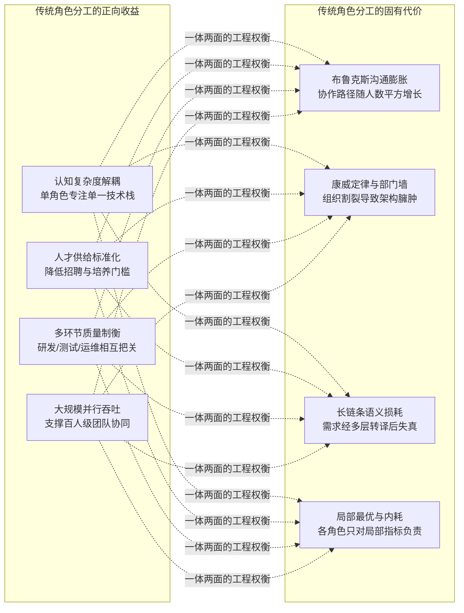
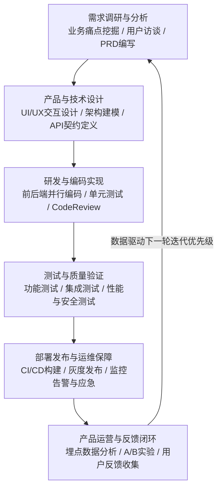
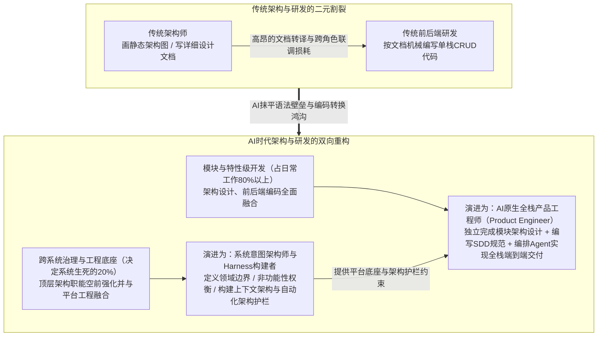
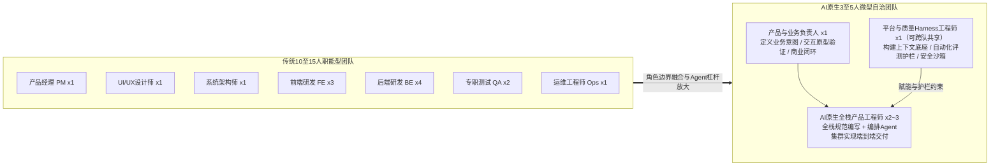
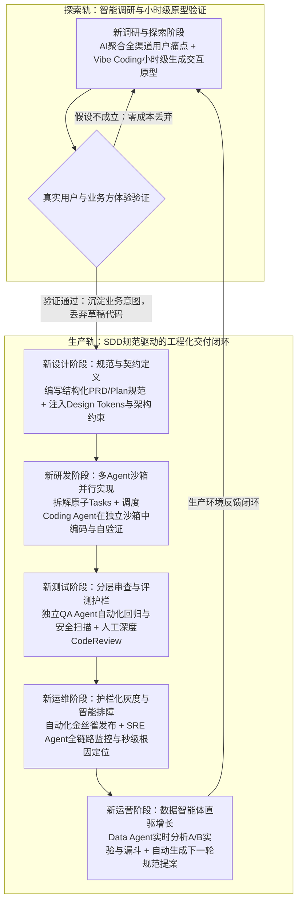
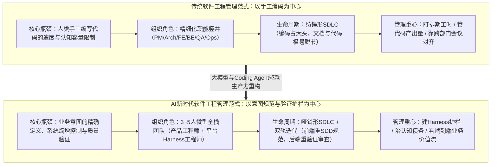

## 前言

在过去的半个多世纪里，软件工程管理的核心命题始终围绕着一个基本事实展开：**人类的认知容量是有限的，而手工编写高质量代码的成本是极其高昂的**。无论是瀑布模型（`Waterfall`）、敏捷开发（`Agile`）、`Scrum`迭代，还是精细化的产品、架构、前后端研发、测试与运维角色分工，本质上都是为了在“人类手工编码能力有限”这一约束条件下，通过社会化大生产的分工与流水线机制，解决大规模复杂软件系统的确定性交付问题。

然而，随着大语言模型（`LLM`）与自主编程智能体（`Coding Agent`，如`Claude Code`、`Cursor`、`GitHub Copilot`等）的跨越式演进，这一延续了数十年的底层前提被彻底打破。代码生成的边际成本正在呈指数级下降，过去需要数天编写的业务代码、接口联调与单元测试，如今在`AI`的辅助下只需数分钟即可生成初稿。

但与此同时，许多研发团队在引入`AI`工具后却陷入了新的管理困境：个人的编码速度看似提升了数倍，团队整体的需求交付周期却并未等比例缩短，线上故障率、代码返工率与系统维护成本反而出现了反常的攀升。正如`Google DORA`（`DevOps Research and Assessment`）年度研发效能报告所揭示的悖论——**生产力工具已经迈入`AI`时代，而工程组织与管理方式却仍停留在传统工业时代**。

要真正释放`AI`时代的软件生产力，工程管理者和开发者必须回到软件工程的第一性原理，重新审视四个核心问题：

- 传统软件工程为什么要划分如此繁多的专业角色？这种分工背后的底层逻辑、价值收益与固有代价是什么？
- 传统软件生命周期（`SDLC`）与单次迭代周期包含哪些核心环节与环境体系，它们各自承担了怎样的风险过滤职能？
- 当`AI`抹平了专业技术栈壁垒与代码转换鸿沟后，传统的产品、设计、架构、研发、测试、运维与运营等角色分工还有多大价值？
- 在`AI`新时代下，软件研发全流程与工程管理方式会发生哪些深刻变化？新一代研发组织应当关注哪些核心治理维度？

## 传统软件工程的角色划分与分工逻辑

要理解`AI`时代软件工程的变革方向，首先需要理解传统软件工程大厦的基石——为什么软件开发会从早期的“单兵作坊”演化为高度专业化的角色分工体系。

### 为什么传统软件工程必须走向精细化分工

在计算机发展的早期阶段（20世纪50至60年代初），软件开发并不存在所谓的角色划分。一名程序员往往身兼需求调研员、数学建模师、编码员、测试员和操作员数职。然而，随着计算机硬件性能的提升与企业级应用规模的爆发，软件系统的代码量从几千行飙升至数百万行，早期的个人英雄主义开发模式迅速崩塌，导致了历史上著名的“软件危机”（项目严重延期、预算失控、质量低劣甚至彻底无法交付）。

`1968`年`NATO`（北约）软件工程会议正式提出了“软件工程”概念，试图将工业工程的分工与管理思想引入软件生产。从工程学与组织行为学视角来看，传统软件工程之所以必须进行精细化角色划分，源于以下四个不可逾越的客观规律：

**第一，人类大脑的认知负荷极限（`Cognitive Load`）**

图灵奖得主弗雷德·布鲁克斯（`Fred Brooks`）在经典著作《人月神话》（`The Mythical Man-Month`）中指出，软件系统具有不可消除的“本质复杂性（`Essential Complexity`）”。而在现代软件工程经典《团队拓扑》（`Team Topologies`）中，作者马修·斯克尔顿（`Matthew Skelton`）进一步将心理学中的**认知负荷理论**引入工程管理：人类工作记忆的容量是极其有限的。

一个现代企业级软件系统同时涉及商业模式推演、用户体验交互、分布式高并发架构、前端渲染性能、后端领域建模、数据库事务优化、异构环境测试矩阵以及云原生容器编排等十余个专业领域。在没有`AI`辅助的时代，要求同一个大脑同时精通所有领域的语法细节与最佳实践，在生理和精力上都是不可能完成的任务。通过角色划分，将庞大的系统认知拆解为可被单个大脑承载的子域，是应对软件复杂度的首要手段。

**第二，亚当·斯密劳动分工原理与思维模态的正交性**

经济学鼻祖亚当·斯密在《国富论》中阐述了劳动分工提升生产率的三大源泉：劳动者熟练度的提升、减少工作切换的时间损耗、促进专业工具的发明。在软件工程中，不同环节不仅所需的专业技能不同，更关键的是**底层思维模态存在天然的正交甚至对立关系**：

- **产品思维**是同理心驱动与发散性的，核心在于洞察人性与商业机会，关注“做什么（`What`）”和“为什么做（`Why`）”；
- **架构思维**是全局抽象与权衡取舍（`Trade-off`）驱动的，关注系统边界、概念完整性与未来演进；
- **研发思维**是建设性与逻辑确定性驱动的，核心在于如何用严谨的代码将功能构建出来（`How to build`）；
- **测试思维**则是破坏性与批判性驱动的，核心在于寻找边界条件与逻辑漏洞，思考“如何让系统崩溃（`How to break`）”；
- **运维思维**是防御性与保守性驱动的，核心在于控制变更风险、保障线上环境稳定（`How to keep alive`）。

让同一个人在同一时间既保持“快速把代码写完上线”的建设冲动，又保持“挑剔审视每一处边缘异常”的破坏心态，在心理机制上极难兼顾。专业化分工让不同角色各司其职，大幅提升了单一环节的专业深度。

**第三，规模化并行交付的时间压缩诉求**

商业竞争要求大型软件系统必须在有限的时间窗口内交付。如果采用单人串行开发，一个百万行代码级的系统可能需要数十年才能完成。通过将系统横向切分为产品、设计、开发、测试、运维等流水线阶段，纵向切分为前端、后端、移动端、数据等技术组件，企业才能够将上百名工程师组织起来，在同一时间窗口内实现多线程并行作业。

**第四，质量制衡与风险隔离机制（`Checks and Balances`）**

在工业生产与金融风控中，“制衡原则”是保障质量的核心制度。传统软件工程通过角色分离建立了天然的质量防火墙：产品经理验收研发的功能是否符合业务预期，测试工程师独立验证代码是否存在缺陷，运维工程师把控上线变更是否符合生产规范。这种“运动员与裁判员分离”的机制，有效避免了开发者因思维盲区或进度压力而放过潜在缺陷。

### 传统软件工程的核心角色与职责图谱

在成熟的互联网与企业级软件研发组织中，围绕软件价值交付链条，形成了职责边界清晰的七大核心角色。各角色的定位职责与关键产出物如下表所示：

| 核心角色 | 角色定位与核心职责 | 关键产出制品 |
|---------|------------------|-------------|
| **产品经理（`PM`）** | **业务价值定义者**：负责市场调研、用户痛点挖掘、需求定义与迭代优先级排序 | `BRD`、`MRD`、产品需求文档（`PRD`） |
| **设计师（`UI/UX`）** | **用户体验塑造者**：负责用户旅程规划、信息架构、交互原型绘制与视觉规范制定 | 交互线框图、高保真设计稿（`Figma`）、设计系统 |
| **系统架构师（`Architect`）** | **技术蓝图守护者**：负责技术选型、服务边界拆分、高可用与可扩展设计及跨团队接口规范 | 架构设计文档（`SAD`）、架构决策记录（`ADR`） |
| **研发工程师（`FE`/`BE`）** | **功能逻辑构建者**：负责模块详细设计、业务代码编写、单元测试覆盖、接口联调与缺陷修复 | 业务源代码、单元测试、`API`契约文档 |
| **测试工程师（`QA`）** | **质量门禁守门人**：负责测试策略制定、用例设计、功能/集成/回归测试与性能压测 | 测试计划、测试用例库、缺陷与质量评估报告 |
| **运维工程师（`DevOps`/`SRE`）** | **稳定性底座守护者**：负责基础架构管理、`CI/CD`流水线、可观测性建设与线上故障应急 | 部署流水线、监控告警规则、应急预案（`Runbook`） |
| **产品运营（`Operations`）** | **价值放大与反馈者**：负责产品推广、用户增长触达、`A/B Testing`分析与用户反馈收集 | 运营活动方案、漏斗转化报告、用户反馈需求池 |

### 传统角色分工的价值收益与固有代价

客观评价传统软件工程的角色分工体系，它既有不可磨灭的历史功绩，也伴随着难以根除的组织摩擦。

**传统角色分工的四大价值收益**：

- **实现复杂系统的工业化拆解**：将高不可攀的系统工程转化为普通工程师经过专业训练即可胜任的标准化岗位，使得软件产业能够像现代制造业一样规模化扩张。
- **人才供应链的标准化与可替换性**：企业无需寻找极其罕见的“全能天才”，而是可以按图索骥地招聘前端、后端、测试等专项人才，单点人员流动不会导致整个系统停摆。
- **深耕垂直技术栈的专业红利**：在分工模式下，专职前端可以深入研究浏览器渲染引擎与微前端框架，专职`DBA`与后端可以深耕存储引擎与分布式事务，从而推高了各技术领域的专业上限。
- **构建多道质量防线**：通过需求评审、架构评审、测试验收、上线审批等跨角色交接门禁，将大量人为失误拦截在进入生产环境之前。

**传统角色分工无法回避的四大固有代价**：

- **布鲁克斯法则（`Brooks's Law`）与沟通成本指数级膨胀**：在《人月神话》中，布鲁克斯提出了著名的公式——包含`N`个人的团队，其潜在沟通渠道数量为`N(N-1)/2`。当一个项目涉及产品、`UI`、架构、前端、后端、客户端、测试、运维`8`个角色时，仅一次普通的需求变更就需要产生多达`28`条潜在对齐路径，团队大量精力被消耗在排期对齐会、接口联调会与责任界定会上。
- **康威定律（`Conway's Law`）与组织谷仓效应（`Silos`）**：梅尔文·康威在`1967`年指出：“设计系统的组织，其产生的设计结构等同于组织中的沟通结构。”当研发组织按前后端、中间件、数据库严格划分部门时，每个角色为了保护自身边界，往往会在系统架构中设计出冗余的适配层与繁琐的跨服务接口，形成厚重的“部门墙”。
- **信息传递的漏斗效应与语义失真**：从真实业务痛点出发，经过产品经理提炼为`PRD`（第一次损耗），架构师转化为技术方案（第二次损耗），前后端研发翻译为业务代码（第三次损耗），测试工程师解读为测试用例（第四次损耗）。每一层跨角色交接都是一次“有损压缩”，最终交付的软件往往与最初的业务意图相去甚远。
- **局部最优取代全局最优**：在精细分工下，不同角色背负着不同的`KPI`——产品经理追求上线功能数量，研发追求按时提测，测试追求发现`Bug`数量，运维追求减少变更次数以保稳定。结果往往是“每个角色都完成了自己的指标，但业务价值却迟迟无法顺畅交付”。

## 传统软件生命周期与迭代周期全景拆解

如果说角色划分构建了软件工程的“静态组织骨架”，那么软件生命周期（`SDLC`）与迭代周期则构成了软件工程的“动态运转血液”。

### 宏观视角：软件生命周期的演进脉络

软件生命周期（`Software Development Life Cycle`，简称`SDLC`）描述了一个软件系统从最初的构想萌芽、立项研发、上线运行，直至最终老化退役的全过程。在软件工程半个多世纪的演进中，宏观`SDLC`的组织方式经历了三次关键跃迁：

- **瀑布模型时代（`Waterfall Model`，20世纪70年代起）**：由温斯顿·罗伊斯（`Winston Royce`）提出，将软件开发视为像建造摩天大楼一样的刚性串行工程。必须先花数月完成`100%`的需求冻结，再花数月完成全部架构设计，随后进入长达半年的编码与测试，最后一次性交付。这种模式在需求绝对稳定的军工与航天领域行之有效，但在商业市场中却屡遭滑铁卢——当软件历时一年终于研发完成时，市场需求早已面目全非。
- **敏捷与迭代开发时代（`Agile & Iterative`，2001年敏捷宣言发布后）**：为了对抗瀑布模型对变化的脆弱性，以`Scrum`、极限编程（`XP`）为代表的敏捷方法论将漫长的宏观生命周期切分为一个个固定时长（通常为`1`至`4`周）的微循环——即**迭代周期（`Iteration` / `Sprint`）**。每个迭代都包含需求、设计、编码、测试的完整闭环，强调“小步快跑、持续交付可用软件、拥抱需求变化”。
- **`DevOps`与持续交付时代（2010年代起）**：敏捷解决了“产品与研发”之间的反馈循环，但“研发与运维”之间仍隔着一堵高墙。`DevOps`通过自动化`CI/CD`流水线、容器化（`Docker`/`Kubernetes`）与基础设施即代码（`IaC`），将测试、部署与线上监控无缝整合进日常迭代，实现了从代码提交到生产环境发布的端到端贯通。

### 微观视角：单次软件迭代周期的六大核心环节

在现代敏捷与`DevOps`融合的传统工程体系中，每一次软件迭代周期都是一场多角色接力的闭环运转，完整涵盖**调研、设计、研发、测试、运维、运营**六大核心环节：

**需求调研与分析（`Discovery & Analysis`）**

一切工程活动的起点是对业务问题的精准定义。在这一阶段，产品经理与业务方协同通过用户访谈、问卷调研、竞品拆解与历史数据分析，识别核心业务痛点并评估投入产出比（`ROI`）。其核心工程动作是将模糊的商业诉求收敛为结构化的产品需求文档（`PRD`）与用户故事（`User Story`），并通过跨角色**需求评审会（`Requirement Review`）**，确保架构、研发、测试对“本次迭代要做什么、验收标准是什么”达成共识。

**产品与技术设计（`Product & Technical Design`）**

需求明确后，进入将“业务语言”翻译为“交互语言与工程语言”的设计阶段，分为两条并行主线：

- **交互与视觉设计**：`UI/UX`设计师输出交互原型与高保真视觉稿，明确页面流转状态、异常空状态与动效细节；
- **架构与详细设计**：架构师与核心研发进行领域建模（如采用领域驱动设计`DDD`）、划分微服务边界、设计核心数据库表结构（`Schema`）、制定缓存与消息队列策略，并编写精确的前后端`API`接口契约（如`OpenAPI`/`Swagger`规范）。重大变更还需通过**技术方案评审（`Design Review` / `RFC`）**，防止引入架构腐化或单点性能瓶颈。

**研发与编码实现（`Development & Coding`）**

这是传统软件迭代中耗时占比最高（通常占整个迭代周期的40%至60%）、人力密度最大的环节。前后端与移动端工程师从`Git`主干拉取特性分支（`Feature Branch`），按照接口契约并行编写业务逻辑代码、数据访问层代码与前端组件，同时编写单元测试（`Unit Test`）。编码完成后，开发者发起合并请求（`Pull Request` / `Merge Request`），由静态代码检查工具（`Linter`/`SonarQube`）与团队资深工程师进行人工**代码审查（`CodeReview`）**，通过后合入集成测试分支并完成前后端接口联调。

**测试与质量验证（`Testing & QA`）**

达到提测标准（`Smoke Test`冒烟测试通过）后，版本正式移交质量保障环节。测试工程师依据需求阶段编写的测试用例与测试计划，依次开展：

- **功能与系统集成测试（`SIT`）**：验证正向业务流、逆向异常流以及跨服务调用的数据一致性；
- **自动化回归测试（`Regression Testing`）**：确保本次新增代码没有破坏既有存量功能；
- **非功能性专项测试**：针对高并发场景开展压力测试与容量水位评估，针对安全合规要求开展渗透测试与漏洞扫描；
- **用户验收测试（`UAT`）**：由产品经理或种子业务方在准生产环境进行最终业务走查。所有阻塞性缺陷（`Blocker`/`Critical Bug`）修复闭环后，方可签发上线准入报告。

**部署发布与运维保障（`Deployment & Operations`）**

版本通过质量门禁后，由`DevOps`/`SRE`体系接管交付。`CI/CD`流水线自动拉取特定`Git Tag`的代码，编译打包为不可变的容器镜像（`Immutable Image`）并推送至制品库。在发布策略上，为规避全量上线风险，通常采用**金丝雀灰度发布（`Canary Release`）**或**蓝绿部署（`Blue-Green Deployment`）**，按`1%→10%→50%→100%`的流量比例逐步放量。运维体系通过可观测性三大支柱——指标（`Metrics`）、日志（`Logs`）与分布式链路追踪（`Traces`）实时盯防接口错误率、延迟分位值（`P95`/`P99`）与资源水位，一旦触发红线立即执行秒级回滚。

**产品运营与反馈闭环（`Product Operations & Feedback`）**

代码成功上线绝非迭代的终点，而是业务价值检验的起点。在运营阶段，产品与运营团队通过前端埋点分析用户的真实点击流与转化漏斗，利用 **`A/B Testing`实验平台** 科学评估新功能对核心业务指标（如留存率、转化率、客单价）的净增量贡献，同时通过客服工单、应用商店评论与用户社群收集定性反馈。这些定量数据与定性洞察将直接回流至需求池（`Product Backlog`），驱动下一轮迭代周期的开启。

### 工程落地的底座：软件交付的多环境隔离体系

为了支撑上述迭代周期从编码到上线的平稳过渡，传统软件工程建立了一套严格的**多环境隔离体系**。不同环境在迭代周期中扮演着不同层级的风险过滤器角色：

| 环境名称与标识 | 数据与环境特征 | 核心角色与迭代职能 |
|--------------|--------------|------------------|
| **本地/开发环境（`Local`/`Dev`）** | 本地`Mock`数据或轻量级开发库，配置高频变动 | **研发工程师**：快速编写代码、单步调试、运行单元测试与初步自测 |
| **集成测试环境（`Test`/`SIT`）** | 构造的合成测试数据集，涵盖各类极端边界条件 | **测试与前后端研发**：前后端联调、多服务集成验证与自动化回归测试 |
| **预发布环境（`Staging`/`UAT`）** | 拓扑与生产一致，连接脱敏仿真数据或镜像库 | **产品、测试与运维**：上线前最终彩排、性能压测与产品`UAT`验收 |
| **灰度环境（`Canary`/`Gray`）** | 共享生产数据库，仅承接1%至5%真实用户流量 | **运维（`SRE`）与运营**：真实流量下验证稳定性，最小化故障爆炸半径 |
| **生产环境（`Prod`）** | `100%`真实业务数据，最高级别安全隔离与高可用冗余 | **最终用户与`SRE`**：正式对外提供稳定商业服务，严禁人工直接修改 |

这套精密的角色、环节与环境体系，共同构成了传统软件工程抵御复杂性与不确定性的坚固防线。然而，当`AI`以颠覆性的力量介入代码生成与工程流转时，这套原本严丝合缝的工业体系开始面临前所未有的结构性冲击。

## AI时代下软件工程全角色分工的价值重估与演进

当`Claude Code`、`Cursor`等具备全局工程感知能力的智能体（`Agent`）全面介入软件生产后，维系传统软件工程七大角色精细分工的底层假设发生了剧烈动摇。在`AI`新时代下，传统的角色分工模式究竟还有多大价值？各个角色之间的职责边界又将如何重构？

### 传统角色分工底层假设的瓦解：哪些价值在缩水，哪些价值在升维

回顾前文所述的传统分工四大动因（认知负荷极限、专业技能正交、规模化并行诉求、质量制衡机制），可以清晰地看到`AI`带来的结构性冲击：**前三大动因中的“机械性技能壁垒”已被`AI`大幅削平，唯有“复杂系统顶层治理”与“独立质量制衡”的价值愈发凸显**。

具体而言，传统角色分工在`AI`时代呈现出明显的 **“价值两极分化”** ：

- **基于“技能壁垒与工序转译”的中间层分工价值急剧萎缩（缩水`80%`以上）**：在传统研发中，之所以需要产品经理画线框图、前端切静态页面、后端写简单`CRUD`接口、测试手工点页面、数据分析师手写基础`SQL`，是因为不同工具与语法的学习成本高昂。而在`AI`时代，从自然语言意图到交互原型、多语言代码、测试脚本与数据查询的**跨栈转换成本趋近于零**。此时若继续维持过细的流水线工种划分，跨角色排期、开会对齐与文档转译的沟通损耗（布鲁克斯法则）将远远超过`AI`直接实现功能的时间。
- **基于“意图定义、系统边界治理与风险制衡”的核心分工价值空前强化**：大模型本质上是局部上下文驱动的概率生成模型，它存在三大固有缺陷——**无法对商业目标与合规风险承担法律责任**、**缺乏跨系统的全局架构演进视野**、**容易产生幻觉（`Hallucination`）与上下文漂移（`Context Drift`）**。因此，围绕“定义精准业务意图”、“构建系统架构护栏”以及“独立验证交付质量”的职能分工不仅没有过时，反而成为了防止`AI`工程失控的生命线。

下面我们沿着软件价值交付链条，逐一剖析传统七大核心角色在`AI`时代的分工演变。

### 产品经理与UI/UX设计师：从“文档与画图交接”走向“意图定义与交互原型直出”

在传统流程中，产品经理（`PM`）与设计师（`UI/UX`）、前端研发之间存在着漫长的串行交接：`PM`撰写静态文字版`PRD`与粗略线框图→交由`UI/UX`设计师绘制高保真`Figma`视觉稿→再交由前端工程师还原为静态页面。这一链条不仅耗时数周，而且文字描述极易产生歧义。

在`AI`时代，产品与设计的分工边界正在深度融合与升维：

- **从“写静态文档”转向“直出可交互原型（`Working Prototype`）”**：借助`AI`生成式设计工具与`Coding Agent`，产品经理不再需要花费数天画低保真线框图，而是可以在几小时内直接生成可点击、带真实交互逻辑的原型系统（`Demo`），直接交由真实用户验证商业假设。
- **产品经理的核心价值升维为“精准规范定义者（`Spec Author`）”**：当“把功能做出来”变得极其容易时，“决定做什么、不做什么”的商业判断力变得无比昂贵。`PM`不能再输出模糊、留待研发自己猜想的粗糙文档，而必须学会编写逻辑严密、边界条件完备、包含明确验收标准（`Acceptance Criteria`）的**可执行规范（`Specification`）**，作为驱动后续`Agent`研发流的源头活水。
- **`UI/UX`设计师转型为“设计系统架构师与体验导演”**：重复性的常规表单、列表页绘制工作被`AI`全面接管。设计师的核心职责转向构建标准化的**设计资产与组件规范库（`Design System` & `Design Tokens`）**，并将其封装为可供`Coding Agent`通过`MCP`直接读取调用的上下文规则，使`AI`生成的界面天然符合品牌视觉规范；同时，设计师将主要精力投入到复杂用户旅程打磨、情感化交互以及全新的人机协同交互范式（`Agentic UX`）设计中。

### 架构师与研发工程师：从“画图与编码分离”走向“系统护栏构建与全栈Agent编排”

在技术实现层，**架构师（`Architect`）与研发工程师（`FE`/`BE`/`Mobile`）的二元分工**首当其冲受到最剧烈的重构。

在传统模式下，受限于概念完整性（`Conceptual Integrity`）与手工编码认知带宽的矛盾，架构师负责绘制静态蓝图与编写详细设计文档，大量前后端研发人员则按图索骥地将其翻译为业务代码。而在`AI`时代，代码生成成本的骤降使这一分工在两个层面上发生了彻底分化：

- **特性与模块级开发（占日常研发`80%`以上）：架构与前后端研发边界消融，合流为“全栈产品工程师（`Product Engineer`）”**。在常规业务特性开发中，传统的“象牙塔架构师（只画`PPT`框图不碰代码）”与“纯`CRUD`编码员（只按文档机械敲语法）”同时失去了生存空间。由于`AI`抹平了`React`、`Go`、`Java`、`SQL`之间的语法隔阂，一名优秀的工程师完全可以在`Coding Agent`辅助下，独立完成从模块架构设计、数据库建模、后端接口实现到前端交互开发的全栈端到端闭环。**每一名一线开发者实质上都成为了指挥`Agent`施工的“微观架构师（`Micro-Architect`）”**。
- **跨系统治理与工程底座（决定系统生死的`20%`）：顶层架构师升级为“系统意图架构师与`Harness`构建者”**。代码分析机构`GitClear`的研究表明，缺乏治理的`AI`编程会导致代码重复率与短期“代码流失率（`Code Churn`）”急剧攀升，加速系统腐化。因为`AI`擅长局部最优，却不懂企业长期的领域边界（`DDD`）、无法为非功能性权衡（如`CAP`定理取舍、延迟与云成本平衡、合规物理隔离）承担责任。因此，顶层架构师不再给研发写局部伪代码，而是专注于**定义跨系统领域边界、设计全局上下文架构（`Context Architecture`），并将架构规范转化为可自动拦截违规代码的工程护栏（`Architectural Fitness Functions` & `Harness`）**。

### 研发与测试工程师（QA）：从“编码与点工测试对立”走向“验证左移与质量评测工程”

在传统迭代中，研发（`Dev`）与测试（`QA`）往往处于线性接力甚至博弈状态：研发写完代码后“扔过墙”提测，测试人员依据`PRD`编写繁琐的测试用例，通过大量手工点击或维护脆弱的`UI`自动化脚本来寻找`Bug`。

在`AI`时代，单元测试、接口集成测试乃至基于`Playwright`的端到端测试脚本，均可由`Coding Agent`在编写业务代码的同时自动生成并执行自验证（**测试大幅左移，`Shift-Left Testing`**）。那么，专职测试角色还有存在价值吗？

答案是：**低价值的“手工点工测试与基础脚本编写员”正在快速消失，但高价值的“独立质量与评测工程专家（`Quality & Evaluation Engineer`）”比以往任何时候都更加重要**。原因在于两项核心工程铁律：

- **生成者与评估者分离原则（`Generator-Evaluator Separation`）**：当同一个`Coding Agent`既负责写业务代码、又负责写单元测试时，如果它对业务需求产生了“幻觉”或错误的边界假设，它生成的测试代码也会完美顺应这一错误假设，从而出现“测试`100%`通过，上线却立即崩溃”的假阳性陷阱。
- **海量生成代码下的验证洪峰**：`AI`让代码产出量暴增数倍，质量风险从“语法拼写错误”转移到了更隐蔽的“复杂状态机并发漏洞、安全权限越界与跨服务数据不一致”。

因此，`QA`角色在`AI`时代实现了彻底的职能跃迁：不再替研发补写基础单测，而是负责**制定严苛的验收契约、构建独立的自动化评测基准集（`Evaluation Harness`）、训练专职的审查与测试智能体（`QA Agent`），并主导混沌工程（`Chaos Engineering`）、极限性能压测与安全红队测试**，成为守护生产质量的独立裁判。

### 运维（DevOps/SRE）与产品运营：从“工单支持与滞后分析”走向“平台工程与数据闭环直驱”

在交付链条的后端，运维工程师（`DevOps`/`SRE`）与产品运营（`Operations`）同样在经历深刻的跨界重构：

- **运维与可靠性工程师（`DevOps`/`SRE`）演进为“平台与`Harness`工程师”**：过去，一线研发需要提工单请运维编写`Dockerfile`、`Kubernetes YAML`清单或配置`CI/CD`流水线；在`AI`时代，这些标准化配置可由`Agent`一键生成。运维角色的核心价值全面转向两个高维方向：一是**向下构建安全沙箱与`Harness`运行底座**，为并行工作的`Coding Agent`提供秒级拉起、权限受控、网络隔离的动态沙箱环境（防止`Agent`误删生产库或泄露密钥）；二是**向上构建智能可观测性与自愈体系（`AIOps`）**，通过部署`SRE Agent`实时关联监控指标（`Metrics`）、日志（`Logs`）、链路追踪（`Traces`）与近期`Git`变更，在故障发生数秒内自动定位根因（`RCA`）并触发灰度回滚。
- **产品运营（`Operations`）演进为“`AI`赋能的增长构建者（`Growth Builder`）”**：传统模式下，运营人员想拉取一份复杂的用户分层漏斗数据，必须排期等待数据工程师写`SQL`；想上线一个营销活动页或调整`A/B Testing`策略，必须等待前后端研发排期。如今，借助企业内部的数据分析智能体（`Data Agent`）与低门槛编程工具，运营人员可以自主通过自然语言完成深度归因分析、快速构建轻量化运营工具，并将清洗后的高价值用户痛点直接转化为结构化需求提案，无缝注入下一轮迭代。

### 传统七大角色在AI时代的演进全景对比

综上所述，`AI`并未消灭软件工程的核心职能，而是将各角色从机械、重复的“工具人操作”中解放出来，推向更高维度的认知与决策层。七大角色的演变全景总结如下表所示：

| 传统工程角色 | `AI`时代加速萎缩的低价值工作 | `AI`时代升维后的角色定位与核心职责 |
|------------|--------------------------|--------------------------------|
| **产品经理（`PM`）** | 撰写冗长模糊的静态文字文档、绘制低保真线框图、催促研发排期 | **业务意图与规范定义者**：借助`AI`直出可交互原型验证商业假设，编写无歧义的可执行规范（`Spec`）与验收标准 |
| **设计师（`UI/UX`）** | 手工绘制大量同质化的常规业务表单、列表页面与切图标注 | **设计系统架构师与体验导演**：构建供`Agent`调用的`Design Tokens`与组件规范，深耕复杂交互与`Agentic UX`体验 |
| **系统架构师（`Architect`）** | 绘制脱离代码的静态`PPT`框图、编写繁琐的模块级伪代码设计 | **系统意图架构师与`Harness`构建者**：定义跨系统领域边界、非功能性权衡、上下文架构与自动化架构护栏 |
| **研发工程师（`FE`/`BE`）** | 局限于单一技术栈、按详细设计文档机械手写`CRUD`业务代码与样板代码 | **`AI`原生全栈产品工程师**：打破前后端壁垒，负责模块微观架构、编排多`Agent`实现端到端全栈交付与深度`CodeReview` |
| **测试工程师（`QA`）** | 手工点击页面执行回归测试、人工编写基础接口与`UI`自动化测试脚本 | **质量与评测工程专家**：构建独立于生成者的自动化评测护栏（`Eval Harness`），主导边界设计、混沌工程与安全审计 |
| **运维工程师（`DevOps`/`SRE`）** | 手工编写常规`CI/CD`脚本、工单式人肉部署、熬夜翻查海量原始日志 | **平台与可靠性护栏工程师**：构建内部开发者平台（`IDP`）与`Agent`安全沙箱底座，编排`SRE Agent`实现智能根因定位与自愈 |
| **产品运营（`Operations`）** | 提单等待研发导出基础报表、手工整理碎片化用户反馈工单 | **数据驱动的增长构建者**：利用`Data Agent`自主完成深度漏斗归因、快速构建增长实验并直接驱动产品规范迭代 |

## AI新时代下软件研发流程与工程管理方式的全面变革

当生产的底层工具从“人工手写代码”演进为“人机协同与`Agent`自主编排”，不仅单个角色的职责边界发生了跃迁，团队的组织拓扑、宏观软件生命周期（`SDLC`）、微观六大研发迭代流程以及工程管理体系也都在经历系统性重构。

### 传统组织形态、生命周期与研发流程的全面演进

面对`AI`浪潮，业界常有两种极端声音：一种认为“传统软件工程已死，以后只需要对着`AI`说自然语言即可”；另一种则认为“`AI`只是更快的自动补全，现有流程无需任何改变”。从严谨的工程实践来看，这两种观点都偏离了事实。真实的演进逻辑是：**软件工程保障确定性、可靠性与可维护性的底层目标从未改变，但实现这一目标的团队拓扑、生命周期重心与研发全流程运转机制已经发生了根本性变形**。

#### 组织拓扑演进：打破职能竖井，走向“3至5人全栈微型团队”

传统的精细化职能竖井（前端只写页面、后端只写接口、测试只点用例）在`AI`时代已经不再适用。过去之所以按技术栈切分岗位，是因为单个大脑装不下多端语法；而在`AI`抹平跨技术栈壁垒后，继续维持过细的岗位切分，只会让团队陷入“编码只需`1`小时，跨岗位排期对齐却要`3`天”的荒诞内耗。

权威研究机构`Gartner`在关于软件工程组织演进的洞察中指出，企业的研发交付单元正在从亚马逊经典的`8`至`12`人“两个披萨团队（`Two-Pizza Team`）”，加速收缩为`3`至`5`人的 **“微型自治团队（`Tiny Teams` / `One-Pizza Pod`）”** 。在这一新组织形态下，多个传统角色收敛重组为三类核心席位：

- **产品与设计融合为“业务与体验负责人”**：直接利用`AI`构建交互原型验证商业想法，向工程侧输出高精度的业务意图与验收契约。
- **架构与前后端研发融合为“全栈产品工程师（`Product Engineer`）”**：作为微型团队的主力，每人配置一组专业化的`Coding Agent`集群（负责前端、后端、单测与重构），独立打通从数据库`Schema`、`API`服务到前端交互界面的全链路特性交付。
- **顶层架构、测试与运维下沉融合为“平台与质量`Harness`团队”**：将架构规范、自动化评测基准集（`Evaluation Harness`）、`CI/CD`流水线与安全沙箱封装为标准化的内部开发者平台（`IDP`），为所有业务微团队提供统一的轨道与护栏。

#### 宏观生命周期（SDLC）重构：从“纺锤形”倒置为“哑铃形”

在宏观软件生命周期（`SDLC`）层面，需求、设计、实现、验证、运维这五个基本阶段依然存在，但`SDLC`内部的**工作量分布结构与权力中心发生了彻底倒置**：

- **传统`SDLC`是“纺锤形（中间重、两头轻）”**：团队把`50%`以上的时间和人力耗费在中间的“手工编码与联调”阶段，前期的需求与设计文档往往仓促应付，且一旦进入编码期，文档立刻与代码脱节而沦为废纸；后期的测试则长期处于被研发延期挤压的被动状态。
- **`AI`时代的`SDLC`是“哑铃形（两头重、中间极轻）”**：随着`Coding Agent`将中间的编码实现阶段压缩了数倍，工程的重心向两端剧烈汇聚——**前端聚焦于高精度的“意图定义与规范工程（`Specification`）”**，因为输入给`AI`的规范越模糊，生成的垃圾代码就越多；**后端聚焦于高强度的“验证审查与可靠性治理（`Verification & Governance`）”**，因为代码生成越廉价，把控质量与架构一致性的门禁就越昂贵。

| `SDLC`阶段 | 传统精力占比 → `AI`时代占比 | 阶段核心矛盾与工作重心的演变 |
|---------|--------------------------|---------------------------|
| **需求与规范定义** | 约`10%~15%` → **约`30%~35%`** | 从编写供人阅读的粗略`PRD`，转向编写供人机共同消费、无歧义的可执行规范（`Spec`） |
| **系统与架构设计** | 约`10%~15%` → **约`20%~25%`** | 从人工绘制静态设计图，转向与`AI`协同探索多方案权衡、定义接口契约与架构约束规则 |
| **编码与单元测试** | **约`45%~55%`** → 约`10%~15%` | 从手工逐行敲击代码，转向通过`SDD`驱动`Coding Agent`并行生成代码与单测 |
| **审查与质量验证** | 约`15%~20%` → **约`25%~30%`** | 从人工排查基础语法与点工测试，转向深度架构与安全`CodeReview`、自动化评测与幻觉拦截 |
| **发布与运维反馈** | 约`5%~10%` → 约`10%~15%` | 从人工值守发布与被动排障，转向`Agent`辅助的智能可观测性诊断、根因定位与规范演进 |

#### 微观研发迭代全流程重塑：双轨制闭环与六大环节的端到端演进

在单次软件迭代周期的微观运转上，传统的“全员齐步走、固定两周一个`Sprint`、线性串行交接”的研发流程，正在演进为 **“探索轨与生产轨双轨并行”的`AI`原生研发流** ，传统的 **调研、设计、研发、测试、运维、运营** 六大环节均发生了质的蜕变：

- **新调研阶段（智能洞察与小时级交互探索）**：在传统调研中，产品经理需要花费数周收集反馈并撰写文档，直到开发上线后才发现用户并不买账。在`AI`原生流程中，首先由智能体自动聚类分析全渠道用户工单、社群评论与竞品动态；随后进入**探索轨（`Exploration Track`）**，产品负责人或工程师直接利用`Vibe Coding`在几小时内生成可运行的交互式原型（`Working Demo`），交由种子用户实测。若方向错误立即丢弃，试错周期从“月”缩短至“小时”。
- **新设计阶段（规范驱动`SDD`与契约先行）**：一旦原型在探索轨验证通过，**严禁将探索阶段的草稿代码直接推入生产**，而是进入严谨的**生产轨（`Production Track`）**。工程师与`AI`协同将验证后的意图转化为版本化的可执行规范（如采用`OpenSpec`或`Spec-kit`），明确业务边界、领域模型、`API`契约与异常兜底策略，同时关联`UI/UX`团队维护的`Design Tokens`组件库，确保后续代码生成具备绝对精确的输入源。
- **新研发阶段（原子任务拆解与动态沙箱并行编排）**：研发不再是人工逐行敲代码，而是将设计规范拆解为高内聚、可并行的原子任务列表（`Tasks`），随后调度多个`Coding Agent`并行施工。在这一环节，传统的四级环境体系（`Local`→`Test`→`Staging`→`Prod`）新增了关键底座——**动态智能体沙箱环境（`Ephemeral Agent Sandbox`）**。系统为每个`Agent`任务动态拉起秒级创建、工具链完备、网络与权限严格隔离的独立容器沙箱，避免多`Agent`并行时的端口冲突与依赖污染，并防止`Agent`在宿主机执行危险命令。`Agent`在沙箱内自主完成代码编写、编译构建、单元测试与本地联调的**自验证循环（`Self-Verification Loop`）**。
- **新测试阶段（生成与评估分离的双层质量门禁）**：当`Coding Agent`从沙箱提交合并请求（`PR`）后，测试与验证分为两层紧密咬合的防线：第一层是由独立上下文的**评测智能体（`QA Agent`）与自动化评测基准集（`Evaluation Harness`）**执行的机器门禁，自动完成规范符合度核对、边界条件模糊测试（`Fuzzing`）、性能基准对比与安全漏洞扫描；第二层是**人工深度`CodeReview`**，人类工程师不再纠结缩进与命名，而是专注审查系统架构一致性、复杂并发状态机与核心业务逻辑。
- **新运维阶段（自动化爆炸半径控制与`SRE Agent`自治排障）**：代码合入主干后，流水线自动执行渐进式金丝雀灰度发布（`Canary Release`）。在生产环境运行期间，`SRE Agent`全天候监控指标、日志与调用链；一旦发现异常水位，无需等待运维人员半夜起床翻查日志，`SRE Agent`会在数秒内自动比对异常时间窗内的`Git`变更提交、定位故障根因（`RCA`），自动执行流量切回或生成带修复补丁的`Hotfix PR`供人工确认。
- **新运营阶段（数据智能体实时归因与规范反哺）**：功能全量上线后，产品运营借助数据分析智能体（`Data Agent`）对线上埋点与`A/B Testing`实验结果进行实时多维归因，快速搭建增长实验策略，并将真实用户行为数据与转化瓶颈自动提炼为结构化洞察，直接反哺至下一轮迭代的规范池（`Spec Backlog`）中。

### AI时代软件工程管理必须关注的六大核心方向

当组织架构、生命周期与迭代节奏完成上述重构后，软件工程管理者的日常工作重心必须实现从 **“管理人的编码工时”** 向 **“管理系统的意图、上下文、护栏与验证质量”** 的彻底跨越。具体而言，新的管理方式需要重点聚焦以下六个核心方向：

#### 破解“生成快、验证慢”的DORA悖论，重构质量验证防线

`Google DORA`团队在针对全球数万名研发人员的调研报告中发现了一个发人深省的现象：`AI`工具显著提升了开发者编写代码的速度，但在许多缺乏工程治理的团队中，这种提速反而导致了**单次提交的代码批次（`PR Batch Size`）急剧膨胀**。人类审查者面对动辄上千行由`AI`瞬间生成的`PR`，极易陷入“审查疲劳（`Review Fatigue`）”，要么草率点击通过（导致线上变更失败率`CFR`飙升），要么积压在评审队列中（导致端到端交付周期不降反升）。

为了破解这一“生成快、验证慢”的瓶颈转移悖论，工程管理必须采取三项硬核举措：

- **严控变更粒度，坚持小步快跑**：在管理规范上强制要求将大需求拆解为原子级的子任务（`Tasks`），每个`Agent`执行单元和每次`PR`只解决一个独立、高内聚的问题，确保人类工程师能在15分钟内完成深度审查。
- **构建分层级的“人机协同`CodeReview`”体系**：将机械性的审查工作（代码风格规范、常见空指针隐患、已知安全漏洞模式、单测覆盖率核对）全部前置交给自动化工具与独立审查`Agent`完成；将宝贵的人工`CodeReview`精力100%聚焦于**架构一致性、核心业务逻辑正确性、安全权限边界与长期可维护性**四大维度。
- **坚持生成者与评估者分离（`Generator-Evaluator Separation`）**：无论是人类还是`AI`，都不应既当运动员又当裁判员。在工程流水线中，负责编写代码的`Agent`上下文与负责审查、编写验收测试的`Agent`上下文必须物理隔离，避免模型顺着自身的错误假设通过测试。

#### 全面推行SDD规范驱动开发，终结失控的Vibe Coding

在个人玩具项目或一次性脚本编写中，凭感觉与`AI`对话的“随兴编码（`Vibe Coding`）”极具吸引力；但在多人协作、长期演进的企业级软件工程中，`Vibe Coding`是一场灾难——需求决策散落在个人聊天记录里，每次对话生成的代码风格迥异，系统很快就会沦为无人敢动的黑盒。

`AI`时代的工程管理必须确立 **规范驱动开发（`Spec-Driven Development`，简称`SDD`）** 的核心地位，实现“规范与代码权力的倒置”：

- **规范即单一事实来源（`Spec as Single Source of Truth`）**：要求团队借助`OpenSpec`、`Spec-kit`等规范化工程框架，将产品需求（`PRD`）、技术架构方案（`Plan`）、接口数据契约与可量化验收标准（`Acceptance Criteria`）转化为结构化的`Markdown`规范文件，并与代码一同纳入`Git`版本控制与评审流程。
- **先评审规范，再生成代码**：将管理门禁大幅前移（`Shift-Left`）。在传统管理中，团队往往在代码写完后才在`PR`阶段争论设计合理性；在`SDD`管理模式下，团队把70%的评审精力投入在`Spec`与`Plan`阶段——一旦规范经过架构与业务对齐定稿，后续的代码生成与测试验证便可顺理成章地高效推进。

#### 构建企业级Harness与标准工具底座，从“管人”转向“建护栏”

为什么同样的`Claude Code`或`Cursor`工具，在不同团队手中的效能差距高达十倍？根本原因在于：初级管理团队把`AI`转型看作“给员工发一个账号，让大家自己摸索提示词（`Prompt`）”，而高水平工程管理团队则致力于建设围绕大模型的**驾驭工程体系（`Harness Engineering`，即`Agent = Model + Harness`）**。

工程管理者应当联合平台工程团队，重点建设四大基础设施护栏：

- **标准化、容器化的工具运行环境**：`Coding Agent`的自主排障与验证能力高度依赖完善的`CLI`工具链（如`jq`、`ripgrep`、`curl`、`kubectl`、数据库客户端等）。通过提供跨平台统一的标准化开发容器镜像，消除`Windows`与`macOS`环境差异导致的执行失败。
- **工程化的上下文架构（`Context Architecture`）**：统一维护项目级的指令文件（如`CLAUDE.md`、`AGENTS.md`）、领域术语表与可按需加载的技能包（`Agent Skills`），并通过`MCP`（`Model Context Protocol`）安全接入企业内部知识库、监控系统与数据库元数据，让`AI`在开始编码前就拥有完整的项目记忆，而非每次从零猜想。
- **可执行化的架构约束（`Executable Guardrails`）**：不要指望写在`Wiki`里的《团队开发规范》能管住`AI`。必须将分层调用规则、禁止使用的危险函数、循环复杂度上限、日志脱敏要求转化为编译器插件、自定义`Linter`规则或`Git Hooks`，一旦`AI`越界，在毫秒级内自动拦截并把精准报错喂回给`Agent`令其自主修正。
- **自验证闭环（`Self-Verification Loop`）**：打通`Agent`与测试运行器、浏览器自动化工具（如`Playwright`）的闭环通道，强制要求`Agent`在提交代码前必须自主跑通编译、单元测试与端到端冒烟验证。

#### 显性化管理研发知识资产，严防“认知债务”累积

在传统软件工程中，管理者最警惕的是“技术债务（`Technical Debt`）”——即为了短期赶进度而写出的糟糕代码。而在`AI`时代，以`Thoughtworks`为代表的行业先行者提出了一种更具破坏力的新型风险——**认知债务（`Cognitive Debt`）**。

当一段复杂的核心交易代码是由开发者本人花三天时间苦思冥想写出来时，开发者的大脑中自然建立起了对该模块完整的心理模型（`Mental Model`）；但当这段代码是由`AI`在`30`秒内生成的，且测试恰好全部通过时，开发者往往会不假思索地合入主干。随着时间推移，系统中充斥着大量 **“虽然能跑，但团队里没有任何一个人真正理解其内部运转细节与设计初衷”** 的代码。一旦线上在极端并发下爆发故障，团队将面临灾难性的排障瘫痪——人类看不懂代码，而`AI`缺乏全局故障上下文，最终导致恢复时间（`MTTR`）失控。

为防范认知债务失控，工程管理必须建立两项刚性制度：

- **知识显性化与双向归档制度**：过去存在于老员工脑子里的“隐性知识（`Tacit Knowledge`）”，对于`AI`而言是完全不可见的盲区。必须要求在每次需求迭代归档时，同步更新架构决策记录（`ADR`）、业务规则字典与系统规范文档（如`OpenSpec`的`specs/`主干库），确保“为什么这样设计”的上下文与代码同步演进。
- **审查阶段的“可解释性问责制”**：在团队文化与`CodeReview`制度中立下铁律——**“谁提交的代码，谁必须对其每一行逻辑负全责”**。绝不允许在代码审查或故障复盘中出现“这段代码是`AI`生成的，我也不太清楚为什么这么写”的借口。对于核心链路代码，提交者必须能够清晰阐述其状态机流转、异常兜底策略与并发安全性。

#### 彻底改革研发效能度量与绩效体系，告别“代码行数与工时崇拜”

英国经济学家查尔斯·古德哈特曾提出著名的**古德哈特定律（`Goodhart's Law`）**：“当一个指标变成目标时，它就不再是一个好指标。”在`AI`时代，这一定律对传统研发效能度量的打击是毁灭性的。

过去，不少企业习惯于统计工程师的提交次数（`Commits`）、代码新增行数（`Lines of Code`，`LOC`）或基于人工编码工时估算的故事点（`Story Points`）来考核工作饱和度与产出。在`AI`工具普及后，任何一名开发者只需一行提示词，就能让`AI`在几分钟内生成数千行冗余、啰嗦甚至未经重构的代码。如果继续沿用传统指标，实质上是在鼓励员工利用`AI`制造代码垃圾与技术债。

新一代软件工程管理必须将度量体系从 **“过程产出量（`Output`）”** 全面转向 **“端到端价值流与系统健康度（`Outcome & Health`）”** 。新旧度量体系的对比如下表所示：

| 度量维度 | 传统软件工程常用指标（易被扭曲） | `AI`新时代推荐指标与管理导向 |
|---------|-------------------------------|---------------------------|
| **交付速度** | 故事点完成数（`Story Points`）、接口开发工时 | **端到端价值交付周期（`Time-to-Value`）**：关注从想法提出到用户可用的全链路耗时 |
| **团队产出** | 代码提交行数（`LOC`）、`Git Commit`次数 | **业务特性采纳率、规范（`Spec`）一次通过率**：以精炼代码与业务真实成效论英雄 |
| **代码质量** | 静态扫描语法告警数、单纯的单测覆盖率数字 | **代码流失率（`Code Churn`）、重构复用占比**：监控短期推翻重写比例，防止架构腐化 |
| **交付稳定性** | 提测打回次数、测试阶段发现`Bug`绝对数量 | **变更失败率（`CFR`）、平均恢复时间（`MTTR`）**：倒逼团队强化自动化验证护栏 |
| **`AI`赋能效能** | `AI`工具周活跃率、`Tab`补全采纳率 | **`PR`审查耗时、从规范到上线的闭环自动化率**：衡量`AI`是否真正消除了团队级交付瓶颈 |

#### 重塑人才梯队培养机制，应对“初级工程师断层危机”

`AI`对软件工程管理带来的另一个深远挑战，是**传统人才培养阶梯的断裂**。

在传统软件工程体系中，初级工程师（`Junior Engineer`）的成长路径高度依赖“师徒制下的边缘任务历练”：新人入职后，先通过编写简单的`CRUD`接口、补充单元测试、修复低风险`Bug`、整理基础文档来熟悉代码库，在历经`2`至`3`年的代码积累与踩坑后，逐步建立起系统直觉，成长为高级工程师与架构师。

然而在`AI`时代，所有这些曾经用于锻炼新人的基础编码任务，现在全部由`Coding Agent`以接近零成本的方式包揽了。这导致整个行业面临严峻的 **“初级工程师悖论”** ：一方面，企业觉得招一名初级工程师还不如给高级工程师多配几个`Agent`划算；另一方面，如果今天不培养初级工程师，或者让新人从入职第一天起就沦为不思考底层原理的“提示词搬运工”，那么`5`年后当现有的资深架构师退休或转岗时，谁来承担复杂系统架构设计与深度`CodeReview`的重任？

有远见的工程管理者必须立即重构团队的人才培养与能力成长模型：

- **重构新人训练营与成长路径**：将新人的培养重心从过去的“背诵框架语法、熟练手写样板代码”，转向 **“代码阅读与逆向架构剖析、精准规范编写（`SDD`）、故障注入排障演练（`Chaos & Debugging`）以及测试用例边界设计”** 。例如，要求新人先在不依赖`AI`生成的条件下独立读懂核心模块的调用链路，或者故意在沙箱环境中注入并发死锁、内存泄漏与`AI`幻觉缺陷，训练其定位复杂根因的硬核内功。
- **推行“双向结对（`Human-AI-Human Pairing`）”与公案复盘**：建立团队内部的工程案例复盘机制，不仅复盘线上故障，更要定期复盘优秀的`Spec`规范案例与典型的`AI`翻车案例——剖析为什么某一段提示词或规范会导致`Agent`做出错误的架构选择，将资深工程师的“架构品味（`Architectural Taste`）”显性化地传承给年轻一代。
- **重新定义高级工程师的能力标准**：未来的技术专家不再以“手写红黑树有多快”或“记住多少偏门`API`”为荣，而是比拼四大核心素养：**复杂业务域的抽象建模能力、跨系统边界的架构权衡能力、构建自动化`Harness`工程体系的能力，以及在海量`AI`输出中一眼识别隐蔽风险的批判性鉴赏力**。

## 总结

回顾软件工程半个多世纪的发展史，从汇编语言到高级语言，从瀑布模型到敏捷与`DevOps`，每一次底层技术的跃迁都曾引发“程序员是否会失业、软件工程是否会消亡”的讨论。然而历史反复证明：**工具的自动化程度越高，软件系统的规模与复杂度上限就会被推得越高，对科学工程管理的要求也就越迫切**。

在`AI`新时代下，软件工程管理经历的不是消亡，而是一场**去粗取精的范式升维**。我们可以通过一张全景对比图来浓缩这场深刻的变革：

归根结底，`AI`剥离了软件工程中曾经最繁重、最机械的“语法砌砖”体力劳动，却将软件工程最纯粹、最硬核的本质赤裸裸地呈现在我们面前——**对复杂性的驾驭、对业务意图的精准定义、对系统架构边界的权衡，以及对工程质量的绝对敬畏**。

对于身处这场历史性变革中的技术管理者与一线工程师而言，唯有主动打破传统的角色藩篱，拥抱以 **微型全栈团队（`Tiny Teams`）** 为组织单元、以 **规范驱动开发（`SDD`）** 为协作契约、以 **驾驭工程（`Harness Engineering`）** 为质量底座、以 **端到端价值交付（`Time-to-Value`）** 为度量准绳的全新工程管理体系，才能在`AI`时代的浪潮中真正驾驭智能体，构建出既快又稳的卓越软件系统。
