## 写在前面

文章希望回答几个模型训练在云原生环境下相关的问题：

- 提交任务后，平台为什么要先排队，之后又经历了哪些步骤？
- 训练镜像是什么，它和代码、数据、驱动分别是什么关系？
- 填写的`CPU`、内存、`GPU`和节点数最终如何落到真实机器上？
- `IB/RDMA`如何进入容器，为什么它会影响多机训练速度？
- 多个节点上的训练进程怎样找到彼此，又怎样交换梯度？

本文先介绍平台全貌，再跟随一次训练任务逐层深入。遇到新组件时，会先说明它解决什么问题，再介绍必要的实现原理。

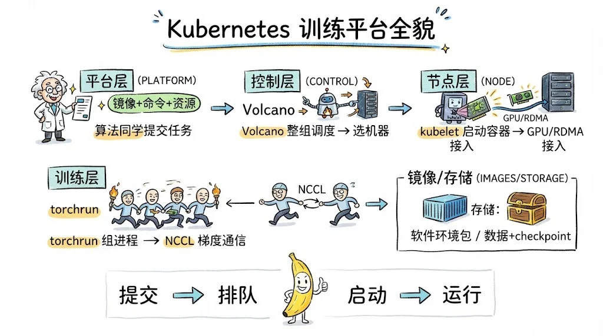

`Kubernetes`训练平台有多种实现方式，本文以常见的`Kubernetes + Volcano`架构为例说明原理，文中的镜像仓库、目录和环境变量均为通用示例，不代表某个具体平台的固定配置。

## 先认识平台中的组件

### 一张图看懂平台全貌

可以先把训练平台理解成一家自动化工厂：平台入口接收训练需求，集群控制层决定使用哪些机器，计算节点准备运行环境，训练框架最后启动真正的计算和通信。

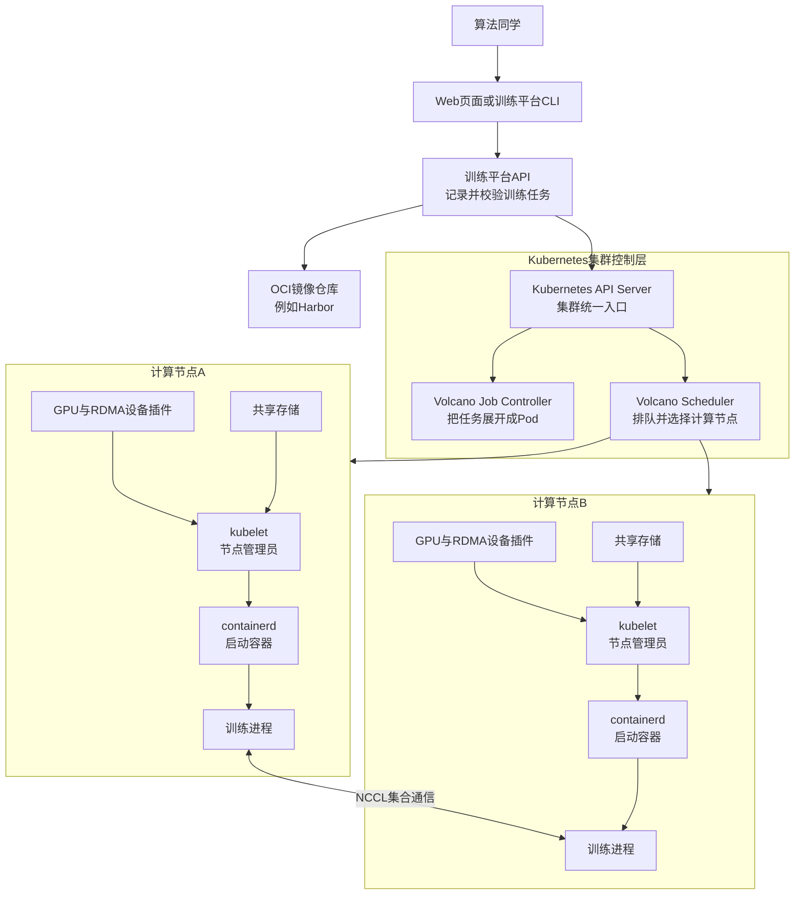


这张图包含三个层次：

1. 平台层面向算法同学，负责接收任务、校验权限和保存任务记录。
2. 集群控制层负责排队、选择机器，并持续维护任务的期望状态。
3. 计算节点负责拉取镜像，接入网络、存储和设备，并运行训练进程。

### 平台层和集群控制层组件

|组件|通俗理解|主要作用|
|---|---|---|
|`Web`页面、训练平台`CLI`|训练任务入口|填写镜像、命令和资源规格，查看任务状态。|
|训练平台`API`|平台总服务台|校验用户与队列权限，保存任务，再调用集群。|
|`OCI`镜像仓库|训练环境仓库|保存带版本的镜像，例如可使用`Harbor`。|
|`Kubernetes API Server`|集群统一入口|统一读写集群对象，是各控制组件交换状态的中心。|
|`Volcano Job Controller`|批任务管理员|把一条训练任务展开成多个训练`Pod`。|
|`Volcano Scheduler`|资源调度员|管理队列，判断资源是否足够，并为`Pod`选择节点。|
|`Volcano Queue`|资源队列|组织任务的排队顺序、优先级和可用额度。|

`Kubernetes`原生提供通用服务和`Job`的运行基础。`Volcano`在它之上补充了多节点训练需要的队列、批任务和整组调度能力。在本文的参考架构中，训练平台层创建`Volcano Job`描述一个完整训练任务，而不是让算法同学逐个创建容器。

### 计算节点和训练进程组件

|组件|可以怎样理解|主要作用|
|---|---|---|
|`Node`|一台计算节点|提供真实的`CPU`、内存、`GPU`、网卡和本地磁盘。|
|`Pod`|一组共同调度的容器|是`Kubernetes`分配资源和选择节点的基本单位。|
|`kubelet`|每台节点上的管控进程|按任务要求准备网络、存储、设备和容器。|
|`containerd`|容器管理器|拉取镜像，并通过`OCI`运行时创建和停止容器。|
|`CNI`网络插件|网络管理插件|为`Pod`分配地址、接口和路由。|
|`CSI`存储插件或`hostPath`映射|存储接入路径|把共享代码、数据和输出目录接入容器。|
|`NVIDIA Device Plugin`|显卡资源管理插件|发现显卡、上报数量，并返回容器使用已分配显卡所需的信息。|
|`NVIDIA Container Toolkit`|显卡接入容器工具|让容器运行时接入已分配的设备和驱动库。|
|`RDMA Device Plugin`|高速网卡资源插件|上报`RDMA`资源，并返回容器使用已分配设备所需的信息。|
|`torchrun`|训练进程启动器|在每个节点启动多个训练进程并分配`rank`。|
|`PyTorch DDP`|数据并行框架|让多个进程计算不同数据，再同步梯度。|
|`NCCL`|`GPU`通信库|`NVIDIA Collective Communications Library`，完成`GPU`之间的集合通信。|

组件虽然多，但可以记住一条主线：

> `Volcano`决定任务在哪些节点运行，`kubelet`让这些节点准备好容器和设备，`torchrun`再把容器里的训练进程组织起来，`NCCL`负责进程之间的数据交换。

## 了解`Kubernetes`中的几个基本对象
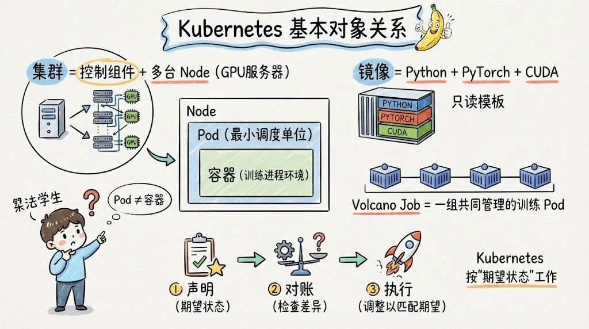

### 集群、节点、`Pod`和容器

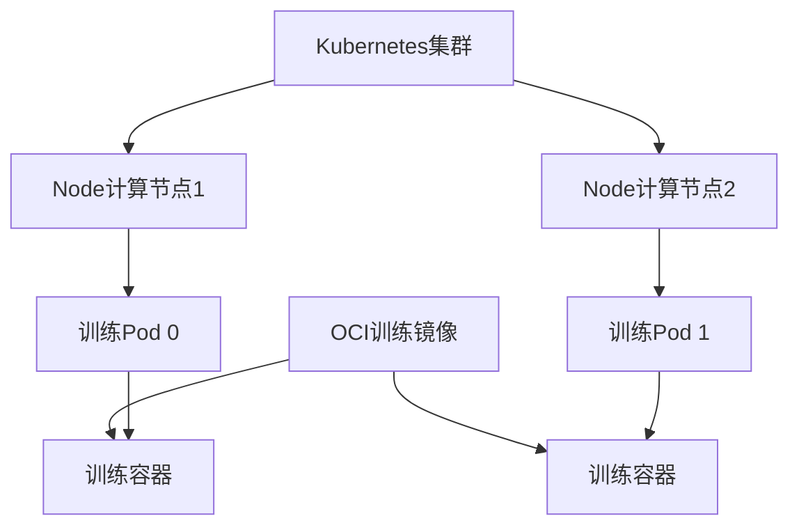

|对象|含义|在多机训练中的常见对应关系|
|---|---|---|
|集群|由控制组件和多台计算节点组成的资源整体|一个数据中心或一个训练资源池。|
|`Node`|加入集群的一台物理机或虚拟机|一台`GPU`服务器。|
|`Pod`|最小调度单位，可以包含一个或多个容器|通常对应一个训练节点。|
|容器|由镜像启动的隔离进程环境|运行`torchrun`和训练代码。|
|镜像|容器的只读环境模板|包含`Python`、`PyTorch`、`CUDA`用户态库等。|
|`Volcano Job`|一组需要共同管理的训练`Pod`|对应用户提交的一次训练任务。|

算法同学最容易混淆的是`Pod`和容器。调度器分配的是整个`Pod`（虚拟对象），不是单独的训练进程。一个训练`Pod`通常只有一个主要训练容器，也可以有负责准备目录等工作的初始化容器。

### `Kubernetes`按照“期望状态”工作

训练平台层不会登录每台机器手工执行启动命令，而是向`Kubernetes API Server`声明：“我希望有`4`个训练`Pod`，每个需要`8`张`GPU`和`512 GiB`内存。”

不同组件随后各自完成一段工作：

- 控制器发现还没有`4`个`Pod`，于是创建它们。
- 调度器发现`Pod`还没有部署到节点（`Node`），于是寻找满足资源条件的机器。
- 目标节点上的`kubelet`发现`Pod`还没有运行，于是准备并启动容器。
- 容器退出后，控制器根据任务策略决定任务完成、中止还是重新启动。

这种不断比较“希望是什么样”和“现在是什么样”的过程称为**对账**。机器、网络或控制组件发生变化后，系统仍能根据任务策略继续处理期望状态，而不依赖一次性的远程命令。训练是否重启或中止，则取决于任务本身的运行策略。

## 一次训练任务如何从提交走到运行
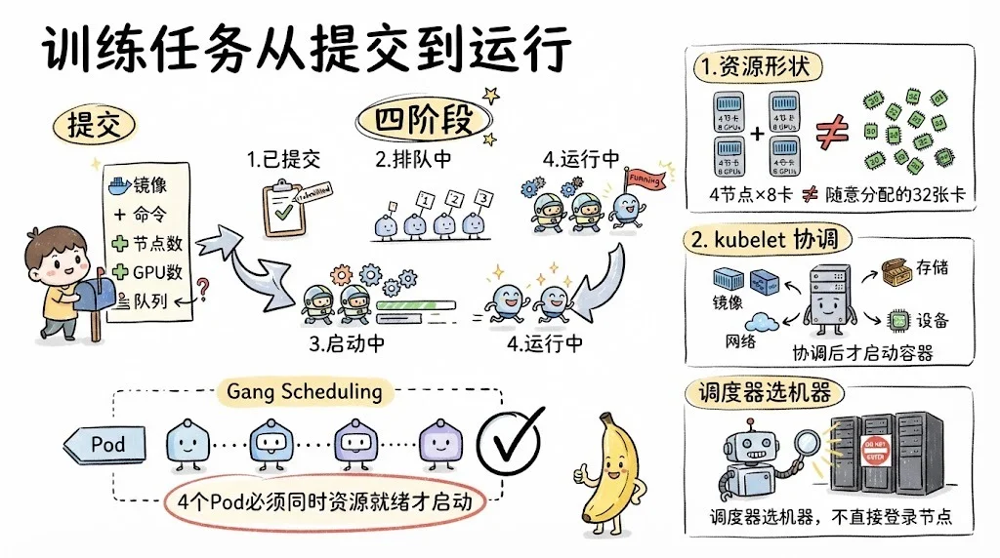

### 算法同学提交了什么

一条训练任务通常包含以下信息：

|信息|示例|任务描述为什么需要它|
|---|---|---|
|镜像|`registry.example.com/ai/pytorch@sha256:...`|确定训练软件环境。|
|启动命令|`bash scripts/pretrain.sh`|确定容器启动后执行什么。|
|节点数|`4`|确定创建多少个训练`Pod`。|
|每节点`GPU`数|`8`|确定每个`Pod`申请多少张卡。|
|每节点`CPU`和内存|`64 CPU`、`512 GiB`|供调度器寻找放得下任务的节点。|
|资源队列|`pretrain`|确定任务使用哪一组资源和排队规则。|
|工作与输出目录|代码、数据、日志和`checkpoint`路径|把共享存储接入容器。|
|环境变量|训练框架和实验配置|把可变参数传入训练程序。|

这些信息描述的是任务想要什么，不直接指定某一台机器。选择具体节点是调度器的职责；调度器会排除资源不足、不可调度或不满足任务约束的节点。

### 从提交到运行的完整流程

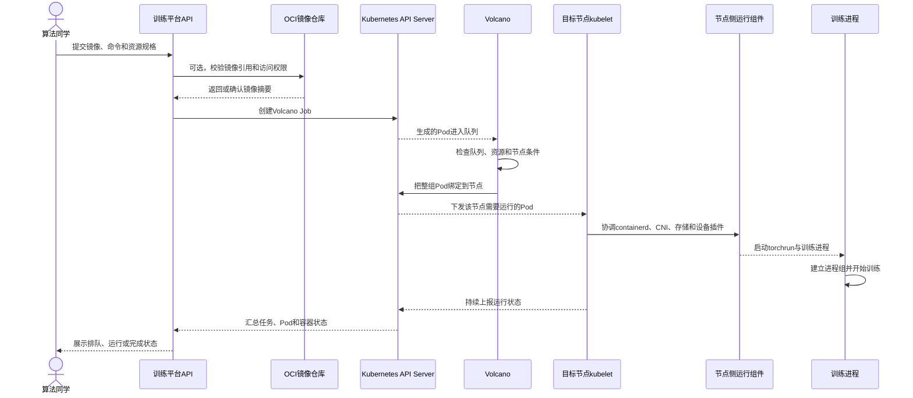

可以把这个过程分成四个容易理解的阶段：

|阶段|发生的事情|资源是否已经占用|
|:---:|---|---|
|**已提交**|训练平台`API`完成校验并创建集群任务|通常还没有。|
|**排队中**|`Volcano`等待队列额度和一组可用节点|尚未正式占用整组资源。|
|**启动中**|节点`kubelet`协调镜像、网络、存储和设备接入|已经开始占用。|
|**运行中**|训练进程组建立，开始计算和通信|完整占用任务资源。|

### 为什么多节点任务需要整组调度

假设训练需要`4`个节点，每个节点`8`张`GPU`。如果调度器先让其中一个`Pod`启动，其余三个节点却迟迟没有资源，已经启动的`8`张卡无法独立完成训练，只会空等。

`Volcano`使用`Gang Scheduling`解决这个问题。它像给四个人等一张四人桌：只有四个位置都能准备好时才让整组入场，避免少量成员先占住资源。

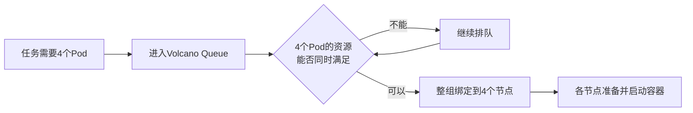

整组调度只负责“资源一起到位”，训练进程之间的同步仍由`torchrun`和`NCCL`完成。

:::tip 补充说明
对于固定规模的多节点训练，如果每个`worker Pod`独占一个节点，常见做法是让`minAvailable`（最小可用`Pod`数）等于`worker Pod`副本数。在只有`worker`这一类任务角色时，它也等于训练节点数，表示所有训练`Pod`都满足资源条件后再整体运行。如果作业还包含其他角色，`minAvailable`则应按需要同时就绪的`Pod`数设置，不能简单等同于节点数。
:::

### 调度器怎样理解一个`4`节点、`32`卡任务

下面是一段精简的`Volcano Job`资源层级示例，省略了镜像、命令和其他字段：

```yaml
spec:
  minAvailable: 4
  tasks:
    - name: worker
      replicas: 4
      template:
        spec:
          containers:
            - name: worker
              resources:
                requests:
                  cpu: "64"
                  memory: 512Gi
                  nvidia.com/gpu: "8"
                limits:
                  cpu: "64"
                  memory: 512Gi
                  nvidia.com/gpu: "8"
```

整组任务总共需要`256`个逻辑`CPU`、`2048 GiB`内存和`32`张`GPU`。不过，调度器不是先取得一个`32`卡的大资源包再任意拆分，而是必须找到`4`台机器，每台机器都能完整容纳一个`Pod`。

因此，即使集群总共空闲`32`张卡，如果每台机器最多只剩`4`张，这个任务仍然无法启动。节点数和每节点卡数描述的是资源形状，不只是资源总量。

## 训练镜像如何构建和运行
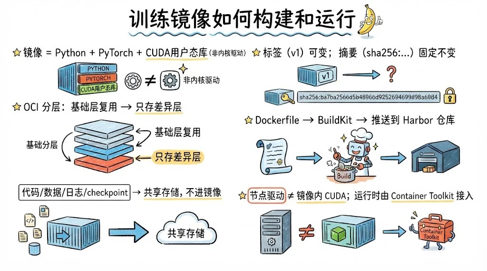

### 镜像可以理解成可重复使用的训练环境包

镜像遵循`OCI`标准，其中保存了用户态软件环境，例如：

- 基础系统文件和常用命令。
- `Python`、`PyTorch`、`CUDA`用户态运行库和其他依赖。
- 镜像默认环境变量、工作目录和启动命令。
- 选择放入镜像的训练代码或启动脚本。

镜像不是虚拟机，也不包含正在运行的`Linux`内核。所有容器共用所在节点的内核。镜像通常也不包含节点的`NVIDIA`内核驱动；节点驱动与设备由设备插件、容器运行时和`NVIDIA Container Toolkit`在容器启动时接入。

### 镜像为什么有“层”和“摘要”

`OCI`镜像由一组只读文件层和一份配置组成。构建步骤产生新的文件层，相同内容可以**在不同镜像之间复用**。这样，两个都基于同一`PyTorch`环境的镜像不必重复存储所有基础文件。

每个内容对象都有根据内容计算出的摘要，例如`sha256:...`。只要内容发生变化，摘要就会变化。标签如`v1`或`latest`便于阅读，但可以指向新内容；摘要则固定代表同一份镜像，因此正式训练应记录实际使用的摘要。

|标识方式|特点|适合用途|
|---|---|---|
|标签，如`:v1`|容易阅读，但可能被重新指向|选择和展示镜像。|
|摘要，如`@sha256:...`|内容固定，可精确复现|记录正式任务实际版本。|

### 从`Dockerfile`到训练容器

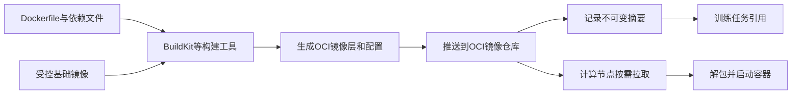

下面是一个简化示例。实际使用时，宜由团队的构建流水线管理基础镜像、版本和扫描策略。

```dockerfile
# syntax=docker/dockerfile:1
FROM registry.example.com/ai/pytorch:2.7.1-cuda12.8

WORKDIR /workspace

COPY requirements.txt ./
RUN python -m pip install --no-cache-dir -r requirements.txt

COPY . /workspace

ENTRYPOINT ["/bin/bash", "-lc"]
CMD ["python train.py"]
```

下面是几种常用的构建方式。这些命令假设`Dockerfile`和需要复制的文件都位于当前目录。命令末尾的`.`表示把当前目录作为构建上下文，不是可以省略的标点符号。构建工具会先按`.dockerignore`过滤上下文，因此可以用它排除数据集、训练输出和版本库元数据等无需进入镜像的大文件或敏感文件。

使用`docker build`在本机构建镜像：

```bash
docker build \
  --file Dockerfile \
  --tag registry.example.com/ai/training-example:1.0.0 \
  .
```

`--file`指定`Dockerfile`路径，`--tag`为镜像设置便于阅读的仓库名称和版本标签。本地验证通过后，可以把镜像推送到已登录的`OCI`镜像仓库：

```bash
docker push registry.example.com/ai/training-example:1.0.0
```

`docker buildx`基于`BuildKit`，更适合构建流水线、指定目标架构和复用构建缓存。构建单一架构镜像并加载到本地`Docker`镜像库，可以使用：

```bash
docker buildx build \
  --platform linux/amd64 \
  --file Dockerfile \
  --tag registry.example.com/ai/training-example:1.0.0 \
  --load \
  .
```

在持续集成环境中，通常让`buildx`构建完成后直接推送：

```bash
docker buildx build \
  --platform linux/amd64 \
  --file Dockerfile \
  --tag registry.example.com/ai/training-example:1.0.0 \
  --push \
  .
```

|参数|作用|使用时机|
|---|---|---|
|`--load`|把单一平台的构建结果加载到本地镜像库|需要在本机运行和验证镜像。|
|`--push`|把构建结果直接推送到镜像仓库|流水线构建或多平台构建。|
|`--platform`|指定目标操作系统和`CPU`架构|需要与训练节点架构匹配。|

`--platform`指定的是操作系统和`CPU`架构，不是`GPU`型号。要构建多平台镜像，可以使用逗号分隔多个值，例如`linux/amd64,linux/arm64`；但前提是基础镜像和所有依赖都支持这些架构。`CUDA`、节点驱动和`GPU`型号的兼容性仍需单独确认。

镜像推送完成后，可以查看仓库中的镜像摘要：

```bash
docker buildx imagetools inspect \
  registry.example.com/ai/training-example:1.0.0
```

训练任务可以记录输出中的`sha256:...`，并使用`registry.example.com/ai/training-example@sha256:...`引用确定不变的镜像内容。

构建工具逐步执行`Dockerfile`，生成镜像并推送到`OCI`镜像仓库。任务调度到节点后，`containerd`读取镜像清单，按需下载节点本地缓存中没有的文件层，校验摘要后解包并启动容器。

### 镜像、代码、数据和驱动的边界

|内容|通常放在哪里|原因|
|---|---|---|
|固定软件依赖|镜像|便于复现和分发。|
|训练代码|镜像或带版本的共享目录|取决于团队发布方式。|
|数据集|共享存储|体积大，需要被多个任务读取。|
|日志和`checkpoint`|共享持久目录|容器重建后仍要保留。|
|密钥和令牌|`Secret`或密钥服务|不能写入镜像层。|
|节点内核与`GPU`驱动|计算节点|必须与真实硬件和内核匹配。|

容器在镜像只读层上还有一个临时可写层。把文件写到这个临时层虽然能立即看到，但容器重建后可能消失。因此，训练产物不能只保存在镜像文件系统里。

`ENTRYPOINT`和`CMD`定义镜像的默认启动方式。训练任务规格中的`command`和`args`可以覆盖它们，所以同一个镜像既可以按默认方式运行，也可以由任务指定新的训练命令。

## 节点怎样启动容器并限制资源
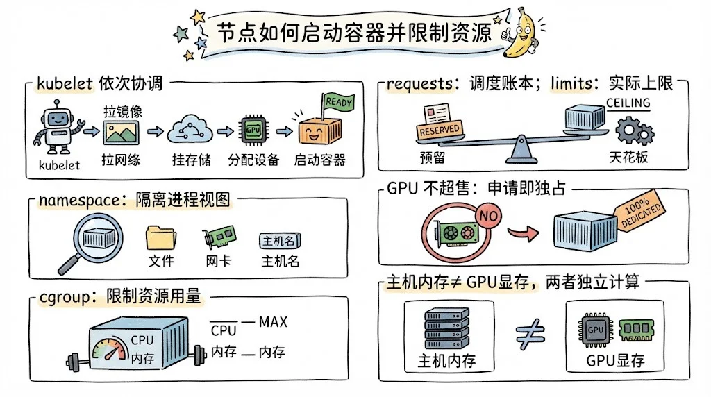

### `Pod`分到节点后发生了什么

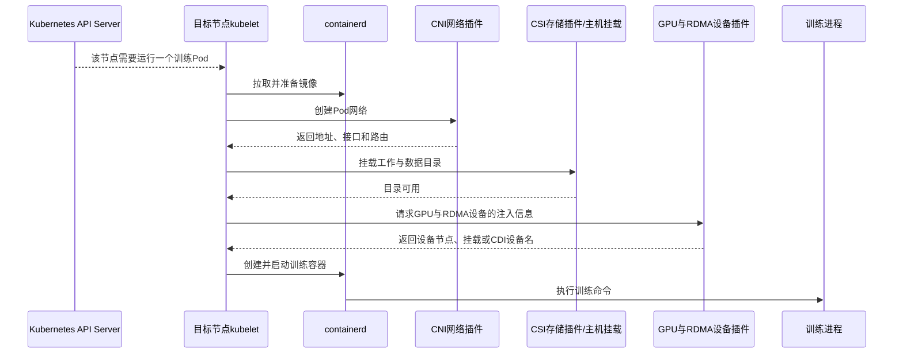

调度器到这里已经完成“选择哪台机器”。之后由目标节点上的`kubelet`负责把任务要求变成真实环境。某一步尚未准备好时，训练进程不会直接开始执行。

### 容器为什么能看到独立环境

容器不是一台小型虚拟机，而是宿主机上的一组普通进程。`Linux`内核通过两类机制让这些进程看起来像在独立环境中运行：

|机制|通俗解释|训练进程看到的效果|
|---|---|---|
|`namespace`|限制进程能看到什么|看到自己的文件、进程编号、网卡和主机名。|
|`cgroup`|限制进程能使用多少|记录并控制`CPU`、内存等资源用量。|

`containerd`负责准备文件系统并调用底层`OCI`运行时创建这些隔离环境。它只负责本节点的容器生命周期，不决定任务在哪台节点运行。

### `requests`和`limits`分别表示什么

|资源|`requests`|`limits`|
|---|---|---|
|`CPU`|调度器为`Pod`计入资源账本的计算量|容器可使用的最大`CPU`调度配额。|
|内存|调度器为`Pod`计入资源账本的容量|容器允许使用的最大主机内存。|
|`GPU`等扩展设备|需要分配的设备数量|不支持超售；同时填写两者时必须相等。|

调度器主要根据`requests`做资源账，而不是根据实时利用率做决定。在默认整卡模式下，某个任务已经申请`8`张`GPU`后，即使这些卡暂时没有真实使用`GPU`资源（如空转），其他普通任务也不能直接使用它们。

对`GPU`等扩展资源，可以只填写`limits`，`Kubernetes`会把`requests`自动设为相同数值；如果两者都填写，数值必须相等。对`CPU`和内存，性能敏感的训练任务也经常把`requests`和`limits`设为相同值，以追求更可预期的资源保障；但这是资源策略选择，而不是所有任务都必须采用的固定配置。`CPU limits`还可能在容器达到配额时引发节流，因此应由集群资源策略和训练负载特征共同决定。

`CPU`数量表示逻辑处理器的调度量，并不天然保证固定绑定到某几个物理核心。对绑核和`NUMA`位置有严格要求时，集群还需要启用相应的拓扑管理能力。

主机内存和`GPU`显存也是两类不同资源。`memory: 512Gi`限制的是节点内存；模型、激活值和优化器状态占用的显存由每张`GPU`自身容量决定。

## `GPU`如何分配给训练容器

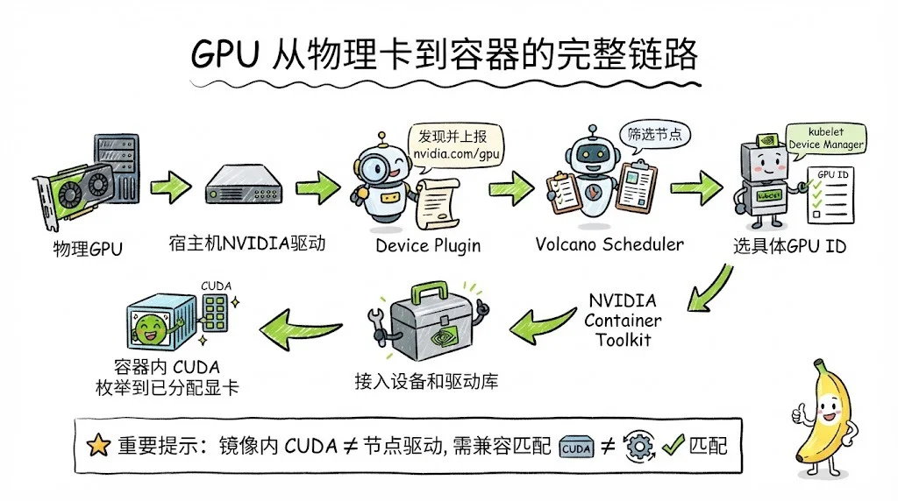

### `Kubernetes`为什么需要设备插件

`CPU`和内存是通用资源，`kubelet`原生就知道如何管理。不同厂商和型号的加速卡有自己的驱动、设备文件和健康状态，因此`Kubernetes`使用设备插件（`Device Plugin`）扩展来管理这类资源。

`NVIDIA Device Plugin`是节点硬件和`Kubernetes`之间的翻译器：

1. 它发现节点上的`GPU`并检查设备是否健康。
2. 它向`kubelet`注册`nvidia.com/gpu`这种资源名。
3. `kubelet`把可用数量上报给集群控制层。
4. `Pod`绑定到节点后，`kubelet Device Manager`选择具体设备，再调用插件的`Allocate`接口获取容器运行时所需的设备注入信息。

### 从物理显卡到容器内`CUDA`设备

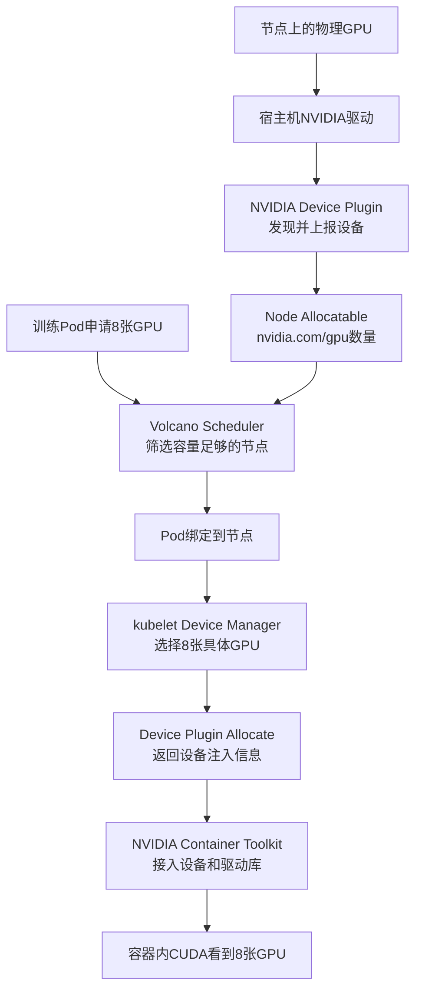


这里有一个重要分工：调度器主要决定“哪个节点还有`8`张卡”，并不直接选择物理编号。`Pod`到达节点后，`kubelet Device Manager`从设备插件上报的健康设备中选择具体`GPU ID`；如果插件实现了偏好分配接口，`kubelet`还可以参考插件给出的设备组合建议。

容器内的`GPU 0`只是该容器看到的局部编号，不一定等于宿主机的物理`GPU 0`。硬件的稳定身份是`GPU UUID`，集群资产与可观测系统可以用它把任务、节点和具体设备关联起来。

:::info 额外说明
如果在单机内进行`GPU`资源分配，`NVIDIA Device Plugin`会根据自身的`Topo`感知自动做资源分配优化，以便多卡之间在单机内能够使用到`NVLink`等高速通信。具体可以通过`nvidia-smi topo -m`查看单机拓扑情况了解细节。
:::

### `GPU`设备究竟怎样进入容器

常说的“把`GPU`挂载到容器”是一种简化说法。它实际上是一组由`kubelet`、设备插件、容器运行时和`NVIDIA Container Toolkit`协作完成的注入动作：

1. `kubelet Device Manager`先从设备插件上报的健康设备中选择`GPU ID`，再调用`NVIDIA Device Plugin`的`Allocate`接口。`GPU ID`使用`UUID`还是节点内索引，由设备插件配置决定。
2. `Allocate`返回容器使用这些设备所需的信息，可以包括设备节点、环境变量、普通挂载或`CDI`设备名。
3. `kubelet`把这些信息通过`CRI`交给`containerd`等容器运行时。
4. `NVIDIA Container Toolkit`按设备列表改写容器的`OCI`运行配置，只接入本次分配的`GPU`以及公共控制设备、驱动库等必要内容。
5. 容器运行时创建设备访问规则并启动进程，容器内的`CUDA`才能枚举到已分配的显卡。

按`NVIDIA Device Plugin`与`NVIDIA Container Toolkit`的常见默认配置，整卡容器通常会自动接入下列内容：

|类别|常见内容|说明|
|:---:|---|---|
|**已分配的计算设备**|`/dev/nvidia0`等|只接入该容器获得的`GPU`，具体物理编号不固定。|
|**公共控制设备**|`/dev/nvidiactl`、`/dev/nvidia-uvm`等|可能还包括`/dev/nvidia-uvm-tools`或`/dev/nvidia-modeset`，具体取决于驱动和能力配置。|
|**宿主机驱动库**|`libcuda.so`、`libnvidia-ml.so`等|由工具链按需接入，并不把宿主机整个驱动目录复制进去。|
|**设备选择信息**|`NVIDIA_VISIBLE_DEVICES`或`CDI`设备名|告诉运行时应接入哪些设备。|

实际列表不是`Kubernetes`固定规定的。`NVIDIA Device Plugin`可以通过环境变量、普通挂载、`CDI annotations`或`CRI CDIDevices`字段传递设备列表，最终接入什么还取决于设备插件、工具链和驱动能力配置。训练镜像中的`PyTorch`、`CUDA`用户态运行库、训练代码和数据集不会因申请`GPU`而自动出现。

### 为什么训练镜像有`CUDA`仍然需要节点驱动

训练镜像通常包含训练框架和`CUDA`用户态库，节点包含与硬件交互的内核驱动。在常见的`NVIDIA`容器架构中，`NVIDIA Container Toolkit`配合容器运行时，或者支持`CDI`的容器运行时按已生成的`CDI`规格，在容器启动时把已分配设备和所需的宿主机驱动库接入容器。

因此，“训练镜像里安装了`CUDA`”不等于“任何节点都能运行”。训练镜像的`CUDA`版本、节点驱动和真实`GPU`型号需要满足兼容关系。

### 数量满足不代表拓扑一定最优

同一节点内的`GPU`可能通过`NVLink`、`NVSwitch`或`PCIe`互连，并靠近不同的`CPU NUMA`节点和高速网卡。默认资源计数首先保证卡数正确，不一定自动得到最优的`GPU`、`CPU`和网卡组合。

当训练`Pod`完整占用节点上的全部`GPU`时，不再存在部分`GPU`选择不当导致的拓扑割裂。`NCCL`会根据可见的`GPU`、`PCIe`、`NVLink`、`NVSwitch`和高速网卡拓扑选择通信路径与算法，因此通常更容易获得稳定的通信性能。

这并不保证拓扑一定最优。`NCCL`只能在已分配的硬件范围内选择路径，不能改变`Pod`所在节点、`CPU NUMA`位置、网卡分配和物理连线，也不能消除跨节点网络拥塞。调度器仍然需要结合节点标签、硬件拓扑信息和拓扑感知策略改善放置结果。

## `IB/RDMA`如何提供多节点高速通信
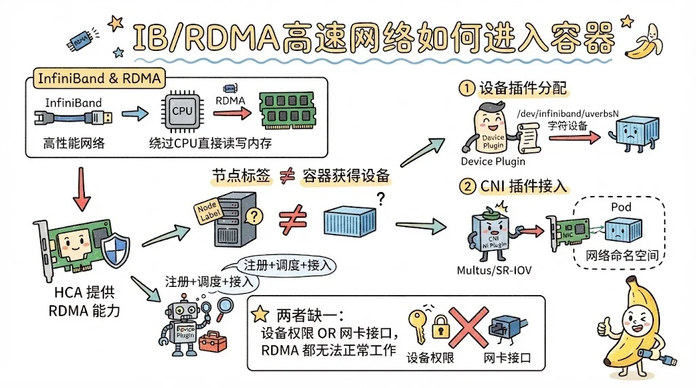

### `IB`和`RDMA`分别是什么

`InfiniBand`简称`IB`，是一种常见的高性能网络技术。`RDMA`是一种让一台机器直接访问另一台机器内存数据的通信能力，可以运行在`IB`上，也可以通过`RoCE`运行在经过配置的以太网上。

与普通网络通信相比，`RDMA`可以减少操作系统协议栈参与和数据复制，从而降低延迟与`CPU`消耗。节点上提供这种能力的网卡通常称为`HCA`（`Host Channel Adapter`）。在多机多卡训练中，`NCCL`可以利用它交换梯度、参数分片或激活值。

### 高速网卡也需要“先调度，再接入”

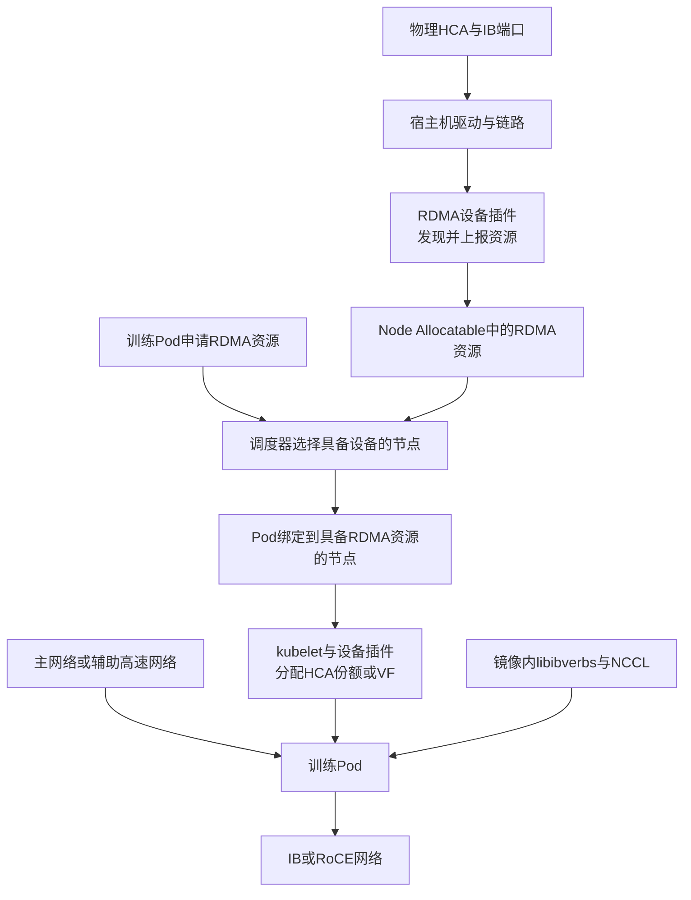

这个过程和`GPU`分配很像：

1. 节点驱动先让操作系统认识物理`HCA`。
2. 设备插件把它转换成`Kubernetes`可以计数的扩展资源。
3. 任务显式申请该资源，调度器才能把它作为放置条件。
4. `kubelet`调用设备插件的`Allocate`接口，获得字符设备或`CDI`设备的注入信息。
5. 如果任务还需要独立网卡接口，`CNI`插件会把相应接口接入`Pod`网络命名空间。
6. 容器内的`libibverbs`、`libmlx5.so`等`verbs`提供者库和`NCCL`共同使用这条链路。

仅给节点增加“支持`IB`”标签，只能帮助调度器识别候选节点，不能自动把设备交给容器。真正可用还需要设备资源申请、设备接入、网络连通和用户态通信库共同完成。

### `RDMA`设备和网卡接口怎样进入容器

对`RDMA`来说，“挂载高速网卡”至少包含两条相互配合的链路：设备插件负责分配设备并授予字符设备访问权，网络插件负责让相关网卡接口出现在`Pod`的网络命名空间中。只完成其中一条，并不一定能建立`RDMA`通信。

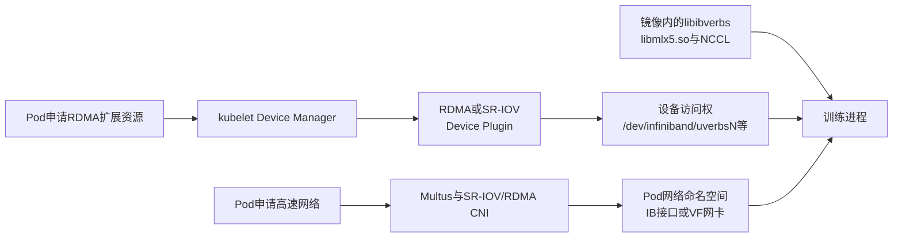

容器中常见的相关对象如下：

|对象|作用|通常由谁提供|
|---|---|---|
|`/dev/infiniband/uverbsN`|用户态`verbs`访问入口|设备插件返回设备节点或`CDI`设备名，容器运行时应用。|
|`/dev/infiniband/rdma_cm`|`RDMA Connection Manager`访问入口|按应用需求和集群设备访问策略接入。|
|`/dev/infiniband/umadN`、`/dev/infiniband/issmN`|网络管理操作|训练通常不需要，不应默认全部接入。|
|`ib0`、`net1`或`VF`网卡|承载`IB`或`RoCE`网络流量|主网络或`Multus`、`SR-IOV CNI`、`RDMA CNI`等网络插件。|
|`libibverbs`与`libmlx5.so`等`verbs`提供者库|将`NCCL`请求转换为驱动调用|通常由训练镜像提供。|

集群的`RDMA`设备接入配置应根据`Pod`申请到的资源和实际部署模式，只授予所需设备的访问权限。共享`HCA`模式可以按设计让多个`Pod`访问同一组设备，但不应在任务未申请资源或缺少隔离策略时，默认向每个容器暴露节点上的全部`/dev/infiniband/*`设备。自动接入的精确列表取决于驱动、设备插件、共享`HCA`或`SR-IOV VF`模式以及`CNI`配置。宿主机内核驱动不会被复制进容器，容器共用宿主机内核；`libibverbs`等用户态库一般需要镜像自带，除非节点侧工具明确提供了额外的用户态库注入机制。

### 共享`HCA`和独占虚拟设备

`RDMA`高速网卡通常由两种资源分配方式：

|接入方式|通俗理解|特点|
|---|---|---|
|共享`HCA`|多个`Pod`共用一张高速网卡|配置简单，但带宽不一定严格隔离。|
|独占`VF`|给`Pod`分配一块虚拟出来的独立网卡|隔离更明确，网络配置也更复杂。|

具体资源数代表物理网卡、虚拟设备还是共享份额，由集群的设备插件配置决定，不是`Kubernetes`统一规定的。

### `GPU`数据怎样经过高速网络到达另一台节点

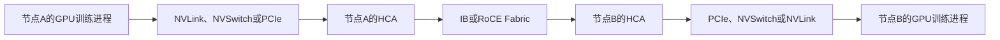

`NCCL`会根据节点内`GPU`连接和节点间网络建立通信通道。具备`GPUDirect RDMA`条件时，数据可以在`GPU`显存和`HCA`之间以更直接的路径传输，减少经过主机内存的复制。

基础设施管理层可以用节点标签记录是否具备`IB`以及所在拓扑域，调度器用标签和`RDMA`扩展资源筛选节点，`kubelet`与设备插件再完成实际设备分配。因此，“节点带有`IB`标签”和“容器已经获得`RDMA`设备”是两个不同概念；前者描述节点能力，后者才表示任务获得了可使用的设备。

## 共享存储和网络如何进入容器
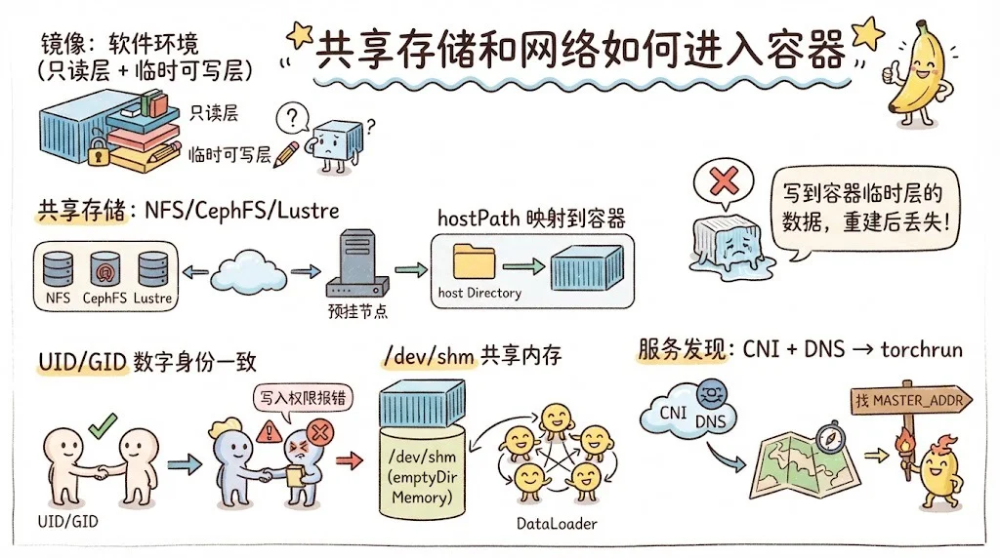

### 镜像负责环境，存储负责数据

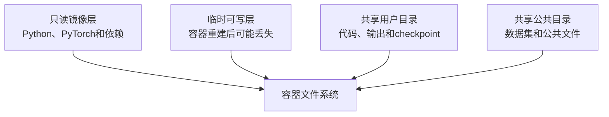

镜像适合保存软件环境，不适合保存大规模数据和持续变化的训练结果。共享存储让不同节点上的`Pod`看到同一份代码、数据、日志和`checkpoint`。

生产集群常见两种挂载方式：

|方式|原理|需要注意什么|
|---|---|---|
|`PV/PVC + CSI`|通过`Kubernetes`存储对象和插件挂载|控制面和`CSI`插件可以统一管理卷与挂载关系。|
|预挂载目录加`hostPath`|节点先挂好共享文件系统，再映射目录|所有候选节点必须保证路径和内容一致。|

无论集群采用哪种存储接入方式，算法同学都应把代码成果、日志和`checkpoint`写入训练平台层约定的共享持久目录，例如`/workspace`、`/data`或`/outputs`，而不是只写到容器临时层。实际目录以所使用训练平台的文档和任务配置为准。

### 预挂载共享存储与`hostPath`如何解耦

`hostPath`本身不是一种共享存储技术，它只把宿主机上已存在的文件或目录映射到容器。真正的共享能力来自节点上预先挂载的`NFS`、`CephFS`、`Lustre`、`BeeGFS`或其他共享文件系统。

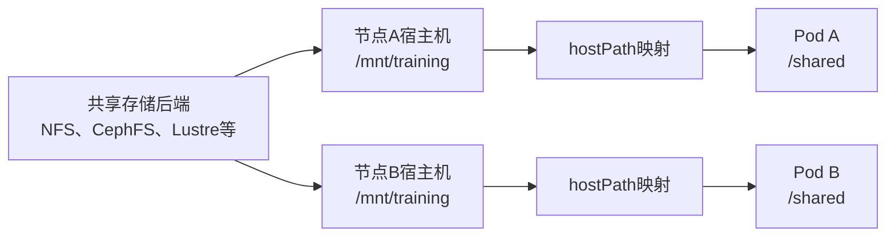

这种架构把职责分成两层：

|层次|关注内容|对外提供的契约|
|---|---|---|
|节点和存储管理层|存储选型、客户端安装、挂载参数、认证和高可用|所有候选节点上存在一致的宿主机路径。|
|训练平台层|`hostPath`路径、容器内路径和只读或可写权限|向任务提供稳定的容器目录。|

因此，训练平台层不需要在每个任务规格中理解存储协议、服务端地址或挂载参数，只需遵守稳定的宿主机路径契约。底层存储可以独立选型、调优或更换，只要节点对外暴露的路径和语义不变，上层任务配置就无需随之变化。这是预挂载加`hostPath`方案的主要解耦价值。

一个简化的`Pod`挂载如下：

```yaml
volumes:
  - name: shared-training
    hostPath:
      path: /mnt/training
      type: Directory
containers:
  - name: worker
    volumeMounts:
      - name: shared-training
        mountPath: /shared
```

对于预先挂载的共享文件系统，`type: Directory`可以确认该目录已经存在。如果改用`DirectoryOrCreate`，当某个节点忘记挂载共享存储时，`kubelet`可能在本地磁盘创建一个同名空目录，反而破坏“各节点看到同一份数据”的契约。`type: Directory`也只检查目录是否存在，不能证明它已挂载到正确的共享文件系统。节点和存储管理层仍需要维持这一运行契约；训练平台层可在任务规格中添加节点选择条件，让调度器只考虑满足该契约的节点。

这种解耦需要满足几个前提：

- 所有候选节点的相同路径必须指向同一共享存储命名空间，不能只是同名本地目录。
- 路径权限和数字`UID/GID`必须在节点之间保持一致。
- 任务模板或准入策略应只允许挂载经过管理的共享路径，而不是让普通任务任意访问宿主机文件。
- `hostPath`不会让`Kubernetes`自动感知底层存储容量、健康状态或动态供应能力，这些仍属于节点和存储管理层。

### 为什么文件权限看数字`UID/GID`

共享文件系统真正记录的是数字用户标识`UID`和用户组标识`GID`，而不是页面上显示的用户名。训练任务的`securityContext`需要使用和共享目录匹配的数字身份，否则可能出现文件属于`root`或其他用户、后续任务不能继续写入的情况。

这也是容器运行身份与用户身份系统需要建立映射的原因。用户名负责让人理解资源归属，`UID/GID`负责让操作系统执行真实的文件权限判断。

### `/dev/shm`为什么会影响多进程训练

`/dev/shm`是内存中的共享空间。`PyTorch DataLoader`的多进程数据加载、进程间张量传递等操作可能使用它。容器默认共享内存空间可能较小，因此大任务通常需要显式挂载内存型`emptyDir`。

```yaml
volumes:
  - name: dshm
    emptyDir:
      medium: Memory
      sizeLimit: 64Gi
containers:
  - name: worker
    volumeMounts:
      - name: dshm
        mountPath: /dev/shm
```

这部分空间最终仍计入`Pod`的主机内存使用，不是额外获得的一块免费内存。

### `Pod`之间怎样找到彼此

`CNI`网络插件为每个`Pod`准备网络接口、地址和路由。`Kubernetes Service`提供稳定名称，集群`DNS`把这个名称解析成实际地址。

使用`Volcano`时，可以通过`svc`插件为一组训练`Pod`创建服务发现信息。这样，其他副本可以通过稳定名称找到用于进程组初始化的`Pod`或端点，而不必提前知道某个临时`Pod IP`。

**服务发现主要帮助进程完成初始化。训练开始后，`NCCL`数据通常由各`rank`之间直接传输，并不会全部经过进程组初始化端点或`Kubernetes API Server`。**

## 多机多卡训练进程如何通信

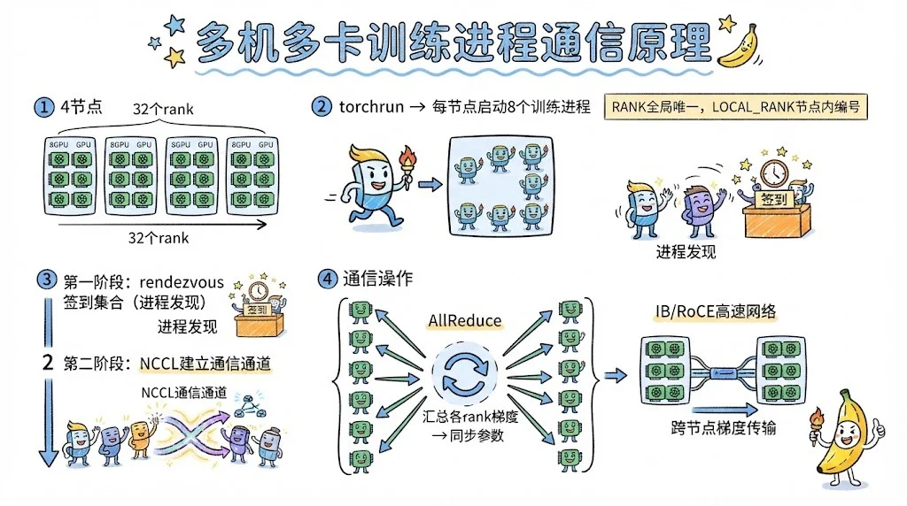

### 节点、`Pod`、进程和`rank`的关系

以`4`个节点、每节点`8`张`GPU`为例，`Volcano Job Controller`创建`4`个训练`Pod`。每个`Pod`内运行一个`torchrun`，再启动`8`个训练进程，通常让一个进程使用一张`GPU`。

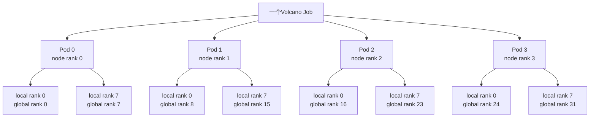

|术语|本例取值|含义|
|---|---|---|
|`nnodes`|`4`|训练节点或训练`Pod`数量。|
|`nproc_per_node`|`8`|每个节点启动的训练进程数。|
|`WORLD_SIZE`|`32`|全局训练进程总数。|
|`RANK`|`0`至`31`|进程在全局进程组中的唯一编号。|
|`LOCAL_RANK`|每节点`0`至`7`|进程在本节点内的编号，常用于选择`GPU`。|
|`node_rank`|`0`至`3`|节点或`Pod`副本编号。|

全局进程总数通常等于节点数乘以每节点进程数。`LOCAL_RANK`可以在不同节点重复，`RANK`在整个训练任务中不能重复。

### `torchrun`怎样启动一组进程

训练任务控制器或启动脚本通常会为`torchrun`准备以下信息：

- `NNODES`表示训练节点数量。
- `NPROC_PER_NODE`表示每个节点启动的训练进程数。
- `NODE_RANK`表示当前节点在所有节点中的编号。
- `MASTER_ADDR`和`MASTER_PORT`表示进程组初始化端点的地址和端口。

在下面的固定规模示例中，该初始化端点通常位于`node_rank 0`所在的`Pod`。它只负责帮助进程集合并交换初始化信息，不表示这个`Pod`会成为长期控制其他训练进程的“主节点”。弹性训练还会使用`--rdzv-backend`和`--rdzv-endpoint`指定独立的`rendezvous`服务；它与训练进程环境中的`MASTER_ADDR`、`MASTER_PORT`职责不同，不应混为同一个地址概念。

典型启动方式如下：

```bash
torchrun \
  --nnodes="${NNODES}" \
  --nproc-per-node="${NPROC_PER_NODE}" \
  --node-rank="${NODE_RANK}" \
  --master-addr="${MASTER_ADDR}" \
  --master-port="${MASTER_PORT}" \
  train.py
```

`torchrun`启动子进程后，会为每个训练进程设置标准含义的`WORLD_SIZE`、`RANK`和`LOCAL_RANK`。其中`WORLD_SIZE`是全局进程总数，不是节点数；脚本应区分节点级参数和进程级参数。

### 通信分为“先集合”和“再传数据”

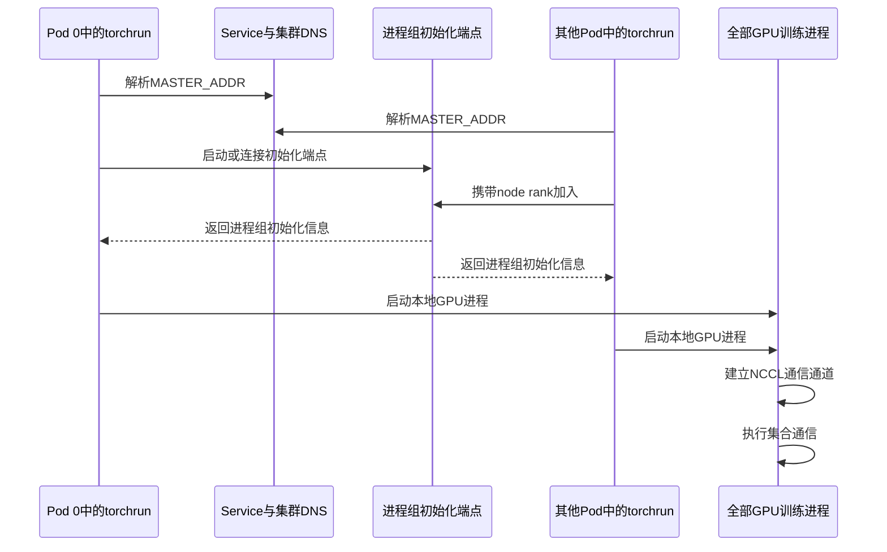

第一阶段称为`rendezvous`，可以理解为所有参与者先签到，确认成员数量并交换进程组初始化信息。第二阶段才是训练数据通信，`NCCL`根据`GPU`和网络拓扑建立通信通道。

该初始化端点不是所有梯度数据的长期中转站。进程组建立后，各个`rank`按照通信拓扑直接交换数据。

### `PyTorch DDP`为什么需要`AllReduce`

经典数据并行中，每个`rank`持有一份完整模型，但读取不同的数据分片：

1. 每个`rank`独立完成前向计算。
2. 每个`rank`独立反向计算，得到本地梯度。
3. `NCCL AllReduce`汇总各`rank`的梯度。
4. 所有`rank`使用相同结果更新参数，模型继续保持一致。

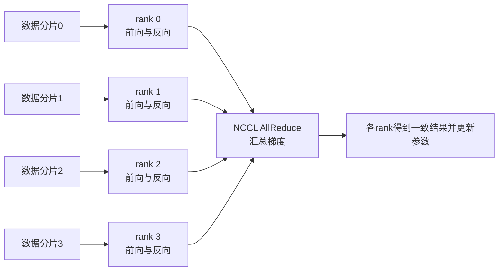


集合通信要求同一通信组中的成员以一致顺序参加相同操作。如果一个`rank`提前退出或一直没有进入下一次`AllReduce`，其他成员就会等待。因此，多机训练中的一个进程失败，常常会影响整个任务，而不是只损失一张卡的计算。

### 不同并行方式需要不同通信

|并行方式|拆分的内容|主要通信形式|
|---|---|---|
|数据并行`DP/DDP`|训练样本|同步梯度。|
|张量并行`TP`|单层张量或算子|频繁聚合或拆分张量。|
|流水线并行`PP`|模型层|相邻阶段传递激活值和梯度。|
|专家并行`EP`|不同专家|在进程间重新分发数据。|

这说明“都使用`32`张卡”并不代表网络需求相同。张量并行和专家并行通常比纯数据并行更依赖低延迟、高带宽和良好的硬件拓扑。

## 算法同学使用平台时需要理解的边界
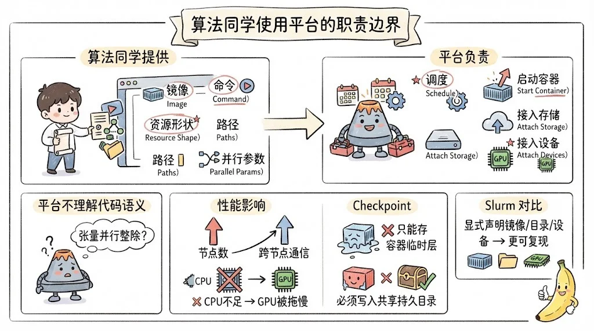

### 用户负责描述任务，集群组件负责实现运行环境

|算法同学提供|负责组件|系统行为|
|---|---|---|
|训练镜像和启动命令|训练平台`API`、`kubelet`和容器运行时|记录任务，拉取镜像并启动容器。|
|节点数和每节点资源|`Volcano Scheduler`|管理排队并选择满足条件的节点。|
|工作目录、数据与输出路径|任务模板、`kubelet`和存储接入组件|把共享存储接入所有训练`Pod`。|
|训练环境变量和并行参数|任务控制器或启动脚本|写入环境变量并提供副本信息。|
|`checkpoint`保存策略和写入逻辑|训练代码、共享存储和任务控制器|代码写入持久目录，控制器按任务策略停止或重建`Pod`。|

训练平台层和集群组件可以准备计算环境，但不会自动理解模型代码内部语义。例如调度器知道任务需要`32`张卡，却不知道张量并行数和流水线并行数是否与`32`整除；这类关系仍要由训练配置和框架共同保证。

### 几个配置项会怎样影响运行

|配置|直接影响|容易忽略的关系|
|---|---|---|
|节点数|创建多少个训练`Pod`|增加节点会增加跨节点通信。|
|每节点`GPU`数|每个`Pod`申请多少张卡|通常也决定本地训练进程数。|
|`CPU`和内存|数据加载与主机侧计算容量|不足会拖慢`GPU`，过大则更难调度。|
|镜像|框架、依赖和`CUDA`用户态版本|必须与节点驱动兼容。|
|队列|可用节点范围和排队规则|也可能限定卡型、机房和`IB`能力。|
|输出路径|日志与`checkpoint`保存位置|必须位于持久共享目录。|
|并行配置|进程组和模型拆分方式|决定通信量和拓扑敏感度。|

### 常见的训练任务设计方式

|设计点|常见做法|对算法同学的含义|
|---|---|---|
|训练副本|一个`worker Pod`通常对应一个节点|在这种布局下，节点数等于`worker Pod`副本数。|
|整组调度|`minAvailable`表示最少同时就绪的`Pod`数|固定规模任务通常等待全部`worker`资源凑齐。|
|资源声明|`GPU`扩展资源的请求值与上限一致|`CPU`和内存则按集群资源策略设置。|
|节点选择|使用标签和亲和性筛选卡型或网络|候选节点会随条件变少。|
|服务发现|通过`Service`、`DNS`或框架插件|副本能通过稳定名称互相发现。|
|共享存储|通过持久卷或预挂载目录接入|训练产物应写入持久目录。|

这些是固定规模训练的常见做法，不是`Kubernetes`强制规定。不同平台可能使用不同的训练控制器、资源名称、目录和环境变量，应以所用训练平台`API`生成的任务规格为准。

## 如果你使用过`Slurm`

`Slurm`也是训练和科学计算中常见的高性能计算调度框架。它常与`Singularity`或`Apptainer`配合：`Slurm`分配节点和资源，容器工具提供软件环境。

在采用`Kubernetes + Volcano`的训练平台中，熟悉`Slurm`的读者可以用下面的小表建立对应关系，不需要把两套系统理解成完全相同的实现。

|`Slurm`中的概念|`Kubernetes + Volcano`中的概念|共同目的|
|---|---|---|
|`sbatch`作业|训练平台任务、`Volcano Job`|描述一次批任务。|
|分区、账号和`QoS`|`Volcano Queue`和训练平台权限|组织资源与排队规则。|
|作业节点数|训练`Pod`副本数|确定多节点规模。|
|`GPU GRES`|`nvidia.com/gpu`扩展资源|申请`GPU`数量。|
|作业`cgroup`|`Pod`和容器`cgroup`|限制`CPU`和内存。|
|`Singularity SIF`|镜像仓库中的`OCI`镜像|分发训练软件环境。|
|`srun`、`PMI`或`MPI`|`torchrun`与服务发现|启动并组织多节点进程。|

两者最直观的差异是：`Slurm`脚本常能直接继承宿主机环境，而`Kubernetes`更强调显式声明镜像、挂载目录、网络和设备资源。显式声明增加了一些配置，但也让环境更容易通过训练平台`API`和`Kubernetes`对象统一记录、复现和自动管理。

## 总结

理解基于`Kubernetes`的训练平台，可以始终沿着下面这条链路思考：

1. 算法同学提交镜像、命令、资源形状和持久化路径。
2. 训练平台`API`把这些信息转换成`Volcano Job`。
3. `Volcano`等待整组资源满足，再把各训练`Pod`放到节点上。
4. `kubelet`通过运行时、网络、存储和设备插件准备容器。
5. `torchrun`在每个节点启动训练进程并建立全局进程组。
6. `NCCL`根据节点内和节点间拓扑执行集合通信。
7. 镜像提供软件环境，共享存储保存数据、日志和`checkpoint`。

还可以记住几个不容易混淆的结论：

- `Pod`是调度和资源分配单位，`rank`是分布式训练进程编号。
- `Gang Scheduling`保证整组资源一起到位，不负责梯度同步。
- 镜像中的`CUDA`用户态库不能代替节点的`GPU`驱动。
- 设备资源申请只是起点，设备插件、容器运行时和`CNI`还需要把设备访问权交给容器。
- 有`IB`标签不等于容器已经获得`RDMA`设备。
- `hostPath`只负责映射宿主机路径，共享能力来自节点上预先挂载的文件系统。
- `MASTER_ADDR`指向进程组初始化端点，该端点不承载全部训练数据流量。
- 容器临时层不适合保存必须长期保留的训练产物。

## 参考资料

- [`OCI` Image Format Specification](https://github.com/opencontainers/image-spec)
- [`docker image build` reference](https://docs.docker.com/reference/cli/docker/image/build/)
- [`docker buildx build` reference](https://docs.docker.com/reference/cli/docker/buildx/build/)
- [`Kubernetes` Images](https://kubernetes.io/docs/concepts/containers/images/)
- [`Kubernetes` Container Runtime Interface](https://kubernetes.io/docs/concepts/architecture/cri/)
- [`Kubernetes` Device Plugins](https://kubernetes.io/docs/concepts/extend-kubernetes/compute-storage-net/device-plugins/)
- [`Kubernetes` Resource Management](https://kubernetes.io/docs/concepts/configuration/manage-resources-containers/)
- [`Kubernetes` Volumes and `hostPath`](https://kubernetes.io/docs/concepts/storage/volumes/#hostpath)
- [`Kubernetes` DNS for Services and Pods](https://kubernetes.io/docs/concepts/services-networking/dns-pod-service/)
- [`Volcano Job`](https://volcano.sh/docs/concepts/volcanojob/)
- [`Volcano` Introduction and Gang Scheduling](https://volcano.sh/docs/home/introduction/)
- [`NVIDIA GPU Operator` Overview](https://docs.nvidia.com/datacenter/cloud-native/gpu-operator/latest/overview.html)
- [`NVIDIA Kubernetes Device Plugin`](https://github.com/NVIDIA/k8s-device-plugin)
- [`NVIDIA Container Toolkit`](https://docs.nvidia.com/datacenter/cloud-native/container-toolkit/latest/index.html)
- [`NVIDIA Network Operator`](https://docs.nvidia.com/networking/display/cokan10/network+operator)
- [`Kubernetes RDMA CNI`](https://github.com/k8snetworkplumbingwg/rdma-cni)
- [`Kubernetes RDMA Shared Device Plugin`](https://github.com/Mellanox/k8s-rdma-shared-dev-plugin)
- [`NVIDIA NCCL` User Guide](https://docs.nvidia.com/deeplearning/nccl/user-guide/docs/overview.html)
- [`PyTorch Distributed Elastic Run`](https://docs.pytorch.org/docs/stable/elastic/run.html)
- [`PyTorch Distributed Data Parallel` Notes](https://docs.pytorch.org/docs/stable/notes/ddp.html)
