## 前言

在推动大模型训练平台从传统高性能计算（`HPC`）架构向云原生（`Cloud-Native`）架构演进的过程中，许多基础设施团队都会遇到一个极具反差感的工程难题：同样是一份解压后体积高达`85GB`的大模型训练环境，在基于`Slurm`调度器与`Apptainer`（原名`Singularity`）的传统平台上，作业被调度到计算节点后**只需几秒钟**即可开始执行训练脚本；而在基于`Kubernetes`与标准`Docker`/`OCI`镜像的云原生平台上，一旦任务被调度到尚未缓存该镜像的节点（冷启动），往往需要经历**十几分钟甚至数十分钟**的镜像拉取（`Pull`）与解压（`Unpack`）等待，容器才能真正启动。

**在大规模分布式预训练或微调场景下，这种冷启动延迟会被进一步放大**。例如，当`Volcano`或`Kueue`通过整组调度（`Gang Scheduling`）同时为一次`64`节点、`512`张`GPU`的训练任务分配好算力时，只要其中任意一台节点处于拉取和解压`85GB`镜像的过程中，其余所有节点的昂贵`GPU`都只能原地空转等待。更严重的是，数十台节点在同一秒向中心镜像仓库（如`Harbor`）发起大体积镜像拉取，极易打满镜像仓库的出口带宽，甚至引发拉取超时和任务重启。

为什么标准`Docker`/`OCI`镜像拥有如此繁荣的构建、分发与云原生工具链生态，却在大体积训练镜像的冷启动表现上远逊于`Apptainer`的`SIF`（`Singularity Image Format`）镜像？这并非因为`Kubernetes`本身调度慢，而是**两种镜像格式在设计之初所面向的硬件假设、底层存储结构以及容器运行时的挂载机制存在根本性差异**。

为了彻底讲清楚这一问题并给出可落地的工程解法，下文将按照循序渐进的顺序展开：

1. 先拆解一个`85GB`的大模型训练镜像内部究竟装了什么，以及理解容器镜像底层机制所需的两个前置概念。
2. 深入剖析`Apptainer SIF`镜像与`Docker`/`OCI`镜像的内部文件结构，对比两者的完整启动链路。
3. 量化拆解`85GB`的`OCI`镜像在`Kubernetes`节点上耗时数十分钟的四大核心瓶颈。
4. 全方位对比两种镜像方案在构建迭代、分发管理、运行性能、安全隔离与生态兼容上的优劣势。
5. 提供一套从“零侵入基础优化”到“`P2P`分发”、“按需加载（`Lazy Pulling`）远程快照器”乃至“共享存储融合架构”的云原生镜像冷启动加速方案。


## 为什么大模型训练镜像动辄数十GB

在普通微服务场景中，一个包含`Go`或`Java`运行时的业务容器镜像通常只有几十`MB`到几百`MB`，拉取和解压只需几秒钟。但在大模型训练场景中，镜像体积膨胀到`50GB`至`100GB`以上（例如典型的`85GB`训练环境）却非常普遍。


### 一份85GB训练镜像的内部构成

大模型训练高度依赖底层硬件加速库、编译器工具链以及庞大的`Python`科学计算生态。以一个典型的`85GB`（解压后逻辑体积）`PyTorch`大模型训练镜像为例，其内部文件通常由以下几部分叠加而成：

| 组成模块 | 包含的核心内容 | 典型解压后体积 | 文件特征 |
| :--- | :--- | :--- | :--- |
| **操作系统基础层** | `Ubuntu`/`Rocky Linux`用户态工具、`glibc`、`OpenSSH`、基础编译工具（`gcc`、`cmake`、`ninja`） | `1GB` ~ `3GB` | 以系统二进制文件与基础动态库为主 |
| **`CUDA`与通信加速库** | 完整`CUDA Toolkit`（含`nvcc`编译器）、`cuBLAS`、`cuDNN`、`NCCL`、`NVSHMEM`以及`Mellanox OFED`/`RDMA`用户态驱动库 | `15GB` ~ `30GB` | 包含大量数百`MB`的动态链接库（`.so`）和体积庞大的静态链接库（`.a`） |
| **深度学习框架与算子库** | `PyTorch`、`Triton`、`FlashAttention`、`TransformerEngine`、`Apex`、`DeepSpeed`、`Megatron-LM`、`vLLM`等 | `15GB` ~ `25GB` | 包含针对多种`GPU`架构（如`sm_80`、`sm_90`）预编译的算子二进制文件 |
| **`Python`与`Conda`环境** | `Miniconda`/`Anaconda`多套虚拟环境、数据处理库（`Arrow`、`Datasets`、`NumPy`、`SciPy`）、分词器与评测工具 | `10GB` ~ `20GB` | **包含数十万个几`KB`到几十`KB`的`.py`源码、`.pyc`字节码与头文件** |
| **构建缓存与冗余产物** | 未清理的`pip`/`conda`下载缓存、源码编译中间产物（`build/`目录）、甚至误打包进镜像的权重或测试数据 | `5GB` ~ `15GB` | 大量在容器实际运行阶段完全不会被读取的冗余文件 |

从上表可以看出，一个`85GB`的大模型训练镜像同时具备两个棘手的物理特征：

- **总字节数极大**：即使经过`gzip`或`zstd`压缩，存储在镜像仓库中的压缩体积通常也在`30GB`~`45GB`左右，解压后则达到`85GB`。
- **小文件数量极多**：由于`Python`包管理器（`pip`/`conda`）和`C++/CUDA`头文件的存在，整个镜像往往包含 **`30`万到`80`万个独立的小文件（`Inode`）** 。

### 理解镜像差异的两个前置概念

在对比`Apptainer`和`Docker`/`OCI`之前，需要先用通俗的方式理清两个底层操作系统概念： **“归档压缩包”与“只读文件系统镜像”的区别** ，以及 **“解压落盘”与“直接挂载”的区别** 。

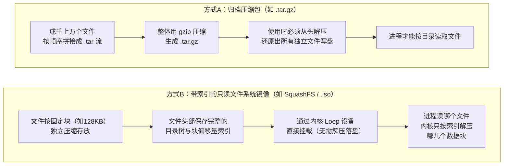

1. **归档压缩包（如`.tar.gz`）必须“先全部拆箱，再拿东西”**：
   `tar`（`Tape Archive`）最初是为磁带机设计的顺序归档格式，它把成千上万个文件首尾相连拼成一条长长的数据流，再用`gzip`对这条流进行整体压缩。这种格式没有随机访问索引，且`gzip`解压依赖前文窗口数据。如果容器需要读取压缩包末尾的一个`10KB`的`train.py`文件，运行时也必须把整个几十`GB`的`.tar.gz`从头到尾解压一遍，并在本地磁盘上把所有文件逐一创建出来。
2. **只读文件系统镜像（如`SquashFS`）支持“直接挂上墙，按索引随时取”**：
   `SquashFS`（或`EROFS`、光盘`.iso`镜像）本身就是一个完整的文件系统，只是被装进了一个单独的文件里。它在内部把数据切分成固定大小的数据块（例如默认`128KB`）分别压缩，并在镜像里维护了一张清晰的“目录与数据块位置索引表（`Inode`与块偏移表）”。`Linux`内核可以通过`Loop`回环设备（把一个普通文件伪装成一块虚拟硬盘），在几毫秒内直接把这个单文件挂载成一个只读目录。当训练进程读取某个文件时，操作系统内核直接查表定位到对应的几个`128KB`数据块，仅把这几个块从磁盘读入内存并实时解压，其余未访问的几十`GB`数据根本不需要触碰。

理解了这两者的本质差异，就能瞬间看透`Apptainer SIF`与`Docker`/`OCI`在`85GB`训练镜像上表现迥异的根源。

## 两种镜像格式的底层原理与启动链路


### Apptainer与SIF镜像：单文件封装与只读文件系统直接挂载

#### 为什么Slurm超算集群偏爱Apptainer

在传统的`Slurm`超算与`AI`集群中，计算节点通常通过高速网络挂载一套统一的并行共享文件系统（如`Lustre`、`IBM Spectrum Scale`/`GPFS`或`BeeGFS`），多租户作业直接以普通宿主机用户的身份在节点上运行。

在这种环境下，早期的`Docker`面临两个难以在超算落地的障碍：一是`dockerd`守护进程默认需要`root`权限，普通用户在容器内若获得`root`身份极易威胁共享宿主机安全；二是如果把几十万个`Python`小文件直接散落在`Lustre`等并行文件系统上，多机作业同时启动（例如执行`import torch`）时，成百上千个进程会同时向并行文件系统的元数据服务器（`MDS`）发起数百万次`stat()`和`open()`请求，造成严重的 **“元数据风暴（`Metadata Storm`）”** ，甚至拖垮整个集群的存储。

为此，劳伦斯伯克利国家实验室（`LBNL`）等机构设计了`Singularity`（后捐赠给`Linux`基金会并更名为`Apptainer`），并专门定义了单文件容器格式——**`SIF`（`Singularity Image Format`）**。

#### SIF镜像的内部二进制结构

一个`.sif`镜像在宿主机或共享存储上表现为一个**单一、不可变的二进制文件**（例如`llm-train-env.sif`）。它并不是把文件简单打包，而是采用类似“自带分区表的容器封装结构”，内部由三部分顺序组成：

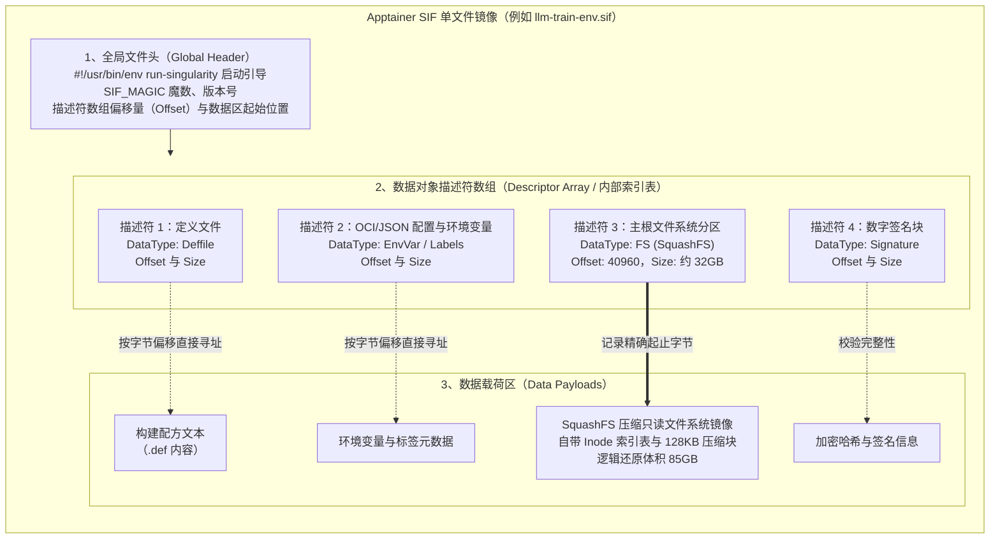

1. **全局文件头（`Global Header`）**：位于文件最开头，记录了`SIF_MAGIC`标识、格式版本以及描述符数组在文件中的精确字节偏移量。
2. **数据对象描述符数组（`Descriptor Array`）**：相当于文件内部的“分区表”。每个描述符是一个固定长度的结构体，明确记录了某一段载荷数据的类型（如定义文件、环境变量、`SquashFS`文件系统分区、加密签名）以及它在`SIF`文件中的**起始字节偏移量（`Offset`）**和**字节长度（`Size`）**。
3. **数据载荷区（`Data Payloads`）**：占据`SIF`文件`99%`以上体积的核心载荷，就是一个完整的 **`SquashFS`压缩只读文件系统分区** 。原本`85GB`的训练环境经过`SquashFS`（通常采用`zlib`或`zstd`）按块压缩后，封装成的单个`.sif`文件体积通常在`30GB`~`40GB`左右。

#### Apptainer如何在数秒内启动85GB训练环境

当用户在`Slurm`中通过`srun apptainer exec --nv /mnt/lustre/images/llm-train.sif python train.py`启动训练任务时，`Apptainer`**完全不需要下载镜像，也不需要解压任何文件到本地磁盘**。其完整启动链路如下：

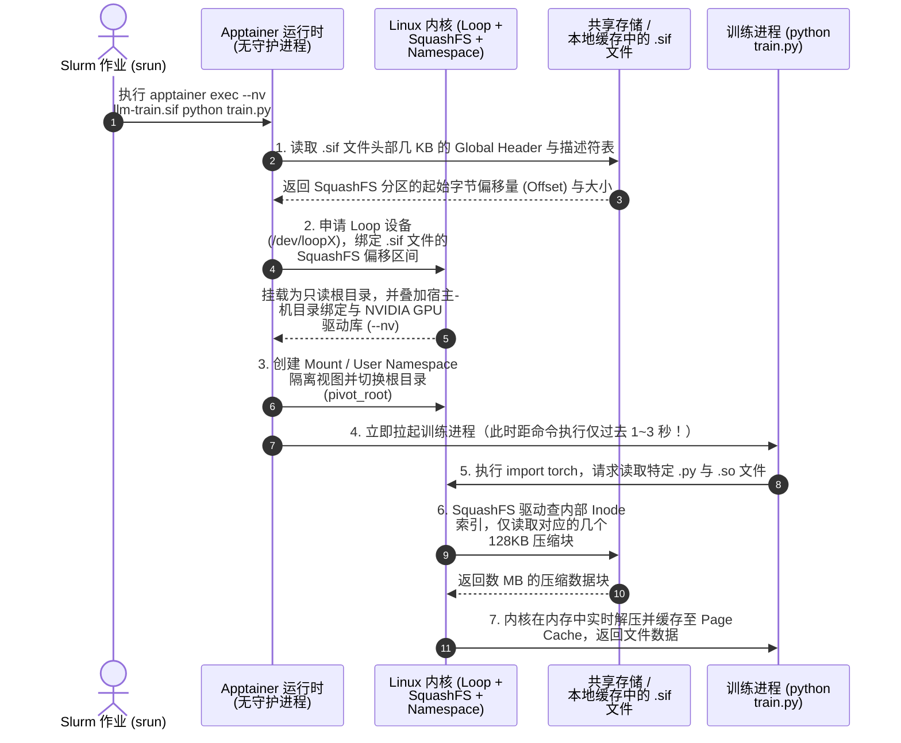

可以看到，`Apptainer`之所以能在几秒内完成`85GB`环境的启动，核心原因有三点：

1. **零解压启动（`Mount-in-Place`）**：容器启动动作本质上只是一次内核级的`mount`系统调用——通过`Loop`设备（或在非特权用户命名空间下通过`squashfuse`）将`.sif`文件内的`SquashFS`字节区间直接映射为容器根文件系统，耗时通常在**数十毫秒到数秒**之间。
2. **严格的按需读取与块级解压（`On-Demand Block Decompression`）**：研究表明，一个复杂的容器从启动到进入主循环，实际被进程读取的文件通常只占镜像总体积的 **`6%`~`20%`** 。对于`85GB`的训练镜像，`python`解释器启动并加载`PyTorch`和`CUDA`核心动态库，真正读取的数据往往只有 `2GB` ~ `5GB` 。`SquashFS`让节点只需从存储中读取并解压这`2GB`~`5GB`的数据块，其余`80GB`未用到的静态库、头文件和工具包全程处于休眠状态。
3. **规避共享存储元数据瓶颈**：对底层`Lustre`或`GPFS`共享存储而言，计算节点只是打开了 **`1`个`.sif`大文件** 并对它进行按偏移量的数据块读取（`Data Read`），而不是打开数十万个小文件。这把令并行文件系统头疼的 **“百万级小文件元数据操作”转化为了并行文件系统最擅长的“单文件块级读取”** ，并且读取过的数据块还会自动留在计算节点的`Linux Page Cache`内存中供同机多个训练进程（如单机`8`卡的`8`个`rank`进程）直接共享。

### Docker与OCI镜像：分层流式归档与联合文件系统解包

#### OCI镜像的设计初衷与分层结构

转向云原生`Kubernetes`平台后，容器运行时（如`containerd`或`CRI-O`）遵循的是由开放容器倡议组织制定的 **`OCI`（`Open Container Initiative`）镜像规范** 。

与`HPC`假设“所有节点共享一套超算并行文件系统”不同，云原生架构假设 **“计算节点是随时扩缩容的无状态机器，通过标准`HTTP/HTTPS`协议从远端镜像仓库（`Registry`）拉取环境”** 。同时，为了支撑软件工程的高频迭代与多镜像复用，`OCI`镜像没有采用单文件设计，而是采用了 **“内容寻址的分层归档结构”** ：

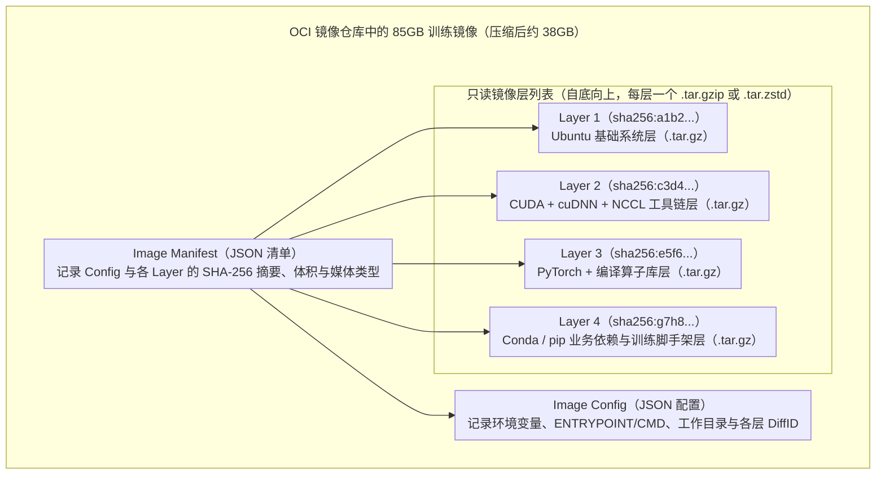

在`OCI`镜像中，你在`Dockerfile`里编写的每一条`RUN`、`COPY`或`ADD`指令，都会将相对于上一层新增、修改或删除的文件打包成一个独立的 **`tar`流式归档包** ，再经过`gzip`（默认）或`zstd`压缩，生成带有唯一`SHA-256`摘要的`Blob`数据块并上传到镜像仓库。

#### containerd拉取并启动OCI镜像的完整流水线

既然`OCI`镜像的每一层都是`.tar.gz`归档压缩包，而`Linux`内核无法直接在一个未解压的`.tar.gz`流上运行程序，那么当`Kubernetes`将训练`Pod`调度到一台冷节点时，节点上的`containerd`就必须执行一套繁重的 **“下载 -> 校验 -> 解压 -> 解包落盘 -> 联合挂载”** 流水线：

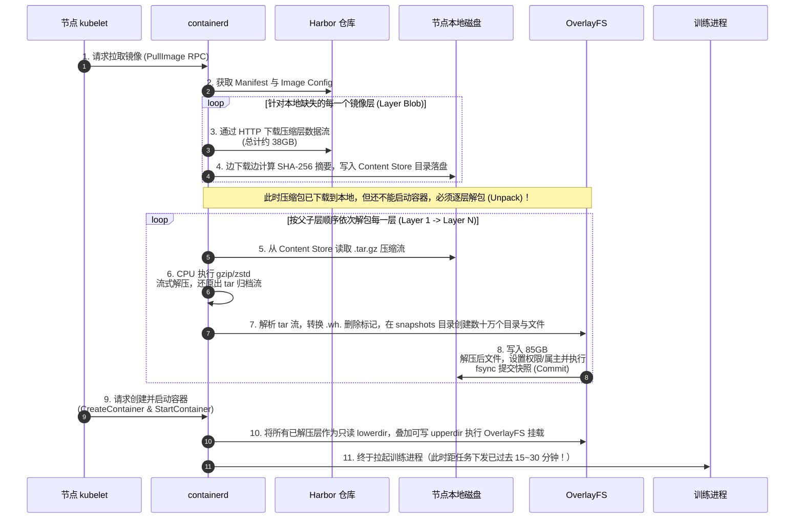

在这个过程中，`containerd`内部有两个核心组件直接决定了本地磁盘的读写行为：

1. **内容存储区（`Content Store`）**：默认位于`/var/lib/containerd/io.containerd.content.v1.content/`。它负责保存从`Harbor`下载下来的**原始`.tar.gz`压缩包文件（`Blob`）**。对于一个解压后`85GB`的镜像，这里会先写入约`35GB`~`40GB`的压缩数据。
2. **快照管理器（`Snapshotter`，默认为`overlayfs`）**：默认位于`/var/lib/containerd/io.containerd.snapshotter.v1.overlayfs/`。它负责把`Content Store`里的每一层`.tar.gz`解压并还原成真实的目录树（称为一个`Snapshot`快照）。当所有层都解压完毕后，`OverlayFS`将所有只读层目录（`lowerdir`）与容器专属的可写层目录（`upperdir`）通过联合挂载（`Union Mount`）合并成容器看到的根目录（`/`）。

### 核心结论对比

- `Apptainer SIF`把“构建文件系统”的工作前置到了**镜像制作阶段**（生成带块索引的`SquashFS`），因此容器启动阶段只需一次轻量级的**内核直接挂载**，运行期按需读取。
- 默认的`Docker`/`OCI`把“还原文件系统”的工作推迟到了**每个计算节点的容器启动阶段**，要求节点必须把所有压缩层 **`100%`下载完、`100%`解压完、`100%`在本地文件系统创建出数十万个文件** 之后，才允许启动容器内的第一个进程。

## 深度拆解：85GB的OCI镜像究竟慢在哪里


在生产环境中，当算法工程师反馈“提交了一个`85GB`镜像的训练任务，卡在`ContainerCreating`状态`25`分钟还没跑起来”时，如果把这`25`分钟拆解到 **网络**、**存储**、**`CPU`** 和 **文件系统** 四个维度，会发现时间被消耗在以下四个环环相扣的瓶颈上：


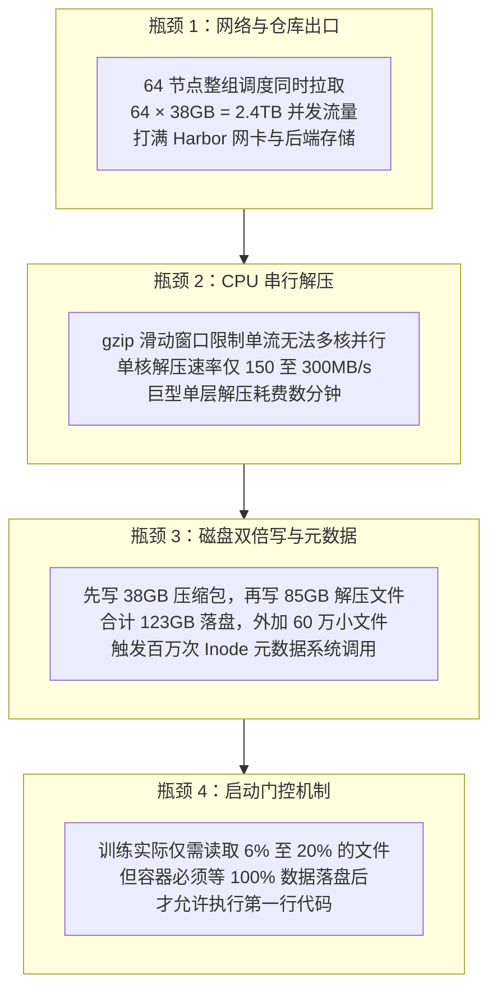

### 瓶颈一：多机整组调度引发的镜像仓库出口与网络拥塞

大模型训练与普通微服务滚动发布有一个巨大的不同：**分布式训练具有极强的“同时性”**。

当使用`Volcano`或`Kueue`进行整组调度（`Gang Scheduling`）时，调度器会等待所需的全部节点（例如`32`台或`64`台`GPU`服务器）资源同时就绪，然后在 **同一秒钟** 把`64`个训练`Pod`绑定到这`64`台节点上。如果这是一个新构建的`85GB`训练镜像（压缩后约`38GB`）：

- `64`台计算节点上的`kubelet`会在同一瞬间向中心镜像仓库（如`Harbor`）发起镜像拉取请求。
- 中心镜像仓库瞬间面临`64 × 38GB ≈ 2.43TB`的突发下行流量需求。
- 假设企业内部的`Harbor`集群及其后端对象存储（如`MinIO`或`Ceph RGW`）总出口带宽为`25Gbps`（理论极限约`3.1GB/s`，实际有效吞吐通常在`2GB/s` ~ `2.5GB/s`左右），仅把这`2.43TB`压缩数据从仓库发往各个节点，在网络完全打满的情况下也需要 **`16`~`20`分钟** 。
- 更糟糕的是，高并发大流量会导致`Harbor`代理层连接池耗尽、后端存储读取延迟飙升，部分节点的`HTTP`分块下载请求甚至会触发超时重试，进一步拉长整组作业的就绪时间。

### 瓶颈二：流式tar.gz的单核串行解压与父子层顺序依赖

即便单台节点的网络带宽非常充裕（例如管理网配备了`25Gbps`甚至`100Gbps`网卡，几十秒就能把`38GB`的压缩包下载到本地`Content Store`），用户依然会发现`containerd`卡在 **`Unpacking`阶段长达十余分钟** 。罪魁祸首正是 **`gzip`压缩算法与`tar`归档格式的单核串行瓶颈** 。

1. **`gzip`单流无法利用多核`CPU`并行解压**：
   传统`Docker`构建默认采用`gzip`（基于`DEFLATE`算法）压缩镜像层。`DEFLATE`算法使用`32KB`的滑动窗口字典，后一个数据块的解压严格依赖前一个数据块的解压结果。这意味着，对于单个`.tar.gz`镜像层，即便`GPU`计算节点拥有`128`个或`256`个`CPU`核心，**解压这一个镜像层时也只能用到`1`个`CPU`核心** 。单核`gzip`解压+`tar`流解析的吞吐量通常只有`150MB/s` ~ `300MB/s`。如果算法同学在`Dockerfile`里通过一条`RUN conda install ... && pip install ...`生成了一个解压后`45GB`的巨型层，仅单核解压这一层就需要 **`3` ~ `5`分钟** 。
2. **父子镜像层的顺序应用（`Apply`）与`Whiteout`语义约束**：
   在`OverlayFS`中，上层镜像可能会删除或覆盖下层镜像中的文件。`OCI`规范通过在`tar`包中放入特殊的`.wh.<filename>`标记文件（称为`Whiteout`文件）来表示删除操作。为了保证最终目录状态与`ChainID`校验完全正确，`Snapshotter`必须严格按照从底层（父层）到顶层（子层）的顺序依次提交快照，无法将所有层毫无约束地同时写入同一个目录。

### 瓶颈三：本地磁盘双倍写放大与数十万小文件的元数据风暴

在`containerd`的默认工作流中，拉取并解压一个`85GB`（压缩后`38GB`）的镜像，对计算节点本地磁盘造成的实际负载远超`85GB`：

| 阶段 | 磁盘读写行为 | `I/O`量 | 性能瓶颈类型 |
| :--- | :--- | :--- | :--- |
| **1. 下载落盘** | 将压缩层写入`Content Store` | 写入约`38GB` | 顺序写带宽 |
| **2. 摘要校验与读取解压** | 从`Content Store`读取压缩包计算`SHA-256`并送入解压流 | 读取约`38GB` | 顺序读带宽 + 单核`CPU` |
| **3. 解包还原文件** | 在`OverlayFS snapshots`目录创建并写入所有解压文件 | 写入约`85GB` | **随机写 + 极高元数据`IOPS`** |
| **合计本地磁盘`I/O`** | **两次落盘 + 一次全量读取** | **约`123GB`写入 + `38GB`读取** | **写放大与元数据双重风暴** |

除了高达`123GB`的写放大之外，真正的隐形杀手是**小文件元数据开销**。

正如前文拆解，`Conda`、`Python`、`PyTorch`和`CUDA`头文件中包含 **`30`万到`80`万个独立小文件** 。`containerd`在解包`tar`流时，每还原一个小文件，都需要向底层本地文件系统（如`ext4`或`xfs`）依次发起`openat()`、`write()`、`chmod()`、`lchown()`、`utimensat()`、`close()`等一系列系统调用，并在目录项（`dentry`）和索引节点（`inode`）日志中落盘。

如果计算节点的`/var/lib/containerd`目录挂载在普通的系统盘（例如单块`SATA SSD`、带写惩罚的`RAID`阵列或云厂商的普通云盘）上，数百万次元数据操作会瞬间打满磁盘`IOPS`，导致磁盘`iowait`飙升至接近`100%`，解包速度甚至会跌落到几十`MB/s`，耗费十几分钟才能写完。

### 瓶颈四：“全量就绪才启动”与实际按需读取率的严重错配

在容器存储领域，威斯康星大学麦迪逊分校发表于`USENIX FAST '16`的经典论文《`Slacker: Fast Distribution with Lazy Docker Containers`》以及阿里云、`AWS`等云厂商的大规模生产统计均揭示了一个关键事实：**容器从启动到正常运行，实际读取的数据量平均仅占整个镜像体积的`6%`~`20%`**。

在`85GB`的大模型训练镜像中，这种错配尤为明显：

- 镜像里包含了数十`GB`的`CUDA`静态链接库（如`libcublas_static.a`、`libcudnn_static.a`）、支持十几种不同代际显卡架构（从`Volta`、`Turing`到`Ampere`、`Hopper`）的`PTX`/`SASS`指令集、`C++`头文件、命令行调试工具、文档手册以及当前任务根本不会`import`的数百个`Python`包。
- 一次真实的`PyTorch`训练任务启动时，仅仅需要加载`Python`解释器、当前`GPU`架构对应的`CUDA`/`NCCL`动态库（`.so`）以及实际用到的框架代码，真正需要读取的字节数往往只有 **`2GB`~`6GB`** 。
- 然而，标准`OCI`运行时采取的是 **“全有或全无（`All-or-Nothing`）”** 策略：哪怕有`80GB`的文件在整个训练生命周期里连一次都不会被打开，节点也必须花费数十分钟把它们全部下载、解压并写入磁盘，之后才允许容器启动。

## Apptainer SIF与Docker OCI全方位对比与优劣势分析

理解了两种镜像格式的底层机制与瓶颈后，我们对`Apptainer SIF`与`Docker`/`OCI`进行一次系统性的对比。


### 核心技术维度全景对比

| 对比维度 | `Apptainer`（`SIF`镜像） | `Docker` / 标准`OCI`镜像 |
| :--- | :--- | :--- |
| **设计起源与核心场景** | 专为`HPC`超算与`Slurm`批处理作业设计 | 专为云原生微服务、通用软件交付与`Kubernetes`设计 |
| **物理存储格式** | 单一不可变文件（`.sif`），内嵌`SquashFS`只读文件系统分区 | `JSON`清单（`Manifest`/`Config`）+ 多层`.tar.gz`/`.tar.zstd`归档包 |
| **本地解包需求** | **无需解包**，直接通过内核`Loop`设备或`squashfuse`原位挂载 | **必须全量解包**，逐层解压还原为本地目录树后再联合挂载 |
| **`85GB`镜像冷启动耗时** | **秒级（`1`~`5`秒）**，仅挂载元数据头，运行期按块读取 | **十分钟至数十分钟**，受限于网络传输、单核解压与小文件落盘 |
| **数据读取模式** | **按需随机块读取**（仅解压被进程实际访问的`128KB`数据块） | **启动前全量顺序解压**（未使用的`80%`冗余文件也必须解压落盘） |
| **存储空间占用与写放大** | 集群共享存储仅存`1`份约`35GB`的`.sif`文件，计算节点零磁盘写放大 | 每个运行节点需占用`38GB`压缩包+`85GB`解压目录，合计逾`120GB` |
| **对小文件元数据的友好度** | **极高**，数十万小文件被封装在单个`.sif`内，不消耗宿主机`Inode` | **较低**，解包时在节点本地文件系统真实创建数十万个`Inode` |
| **增量构建与层复用能力** | **较弱**，默认每次重新构建都会生成全新的完整单文件，难以跨镜像共享底层 | **极强**，多层内容寻址设计，修改顶层代码仅需构建和传输数`MB`增量层 |
| **运行时安全与权限模型** | 无守护进程（`Daemonless`），默认容器内外`UID`一致，天然`Rootless` | 依赖`containerd`守护进程，支持完整的`Namespace`、`Cgroup`与可写层隔离 |
| **云原生生态兼容性** | 属于`HPC`专用生态，难以直接融入`Kubernetes CRI`与标准云原生工具链 | **全球事实标准**，原生无缝对接`Kubernetes`、`Harbor`、安全扫描与`CI/CD` |

### Apptainer SIF镜像的优势与局限性

#### 核心优势

1. **极致的大镜像启动速度与按需`I/O`**：借力`SquashFS`的块级索引与`Linux`内核`Loop`直接挂载，彻底消除了“全量解压落盘”阶段，使`85GB`乃至上百`GB`的科学计算与大模型镜像能够实现**秒级启动**。
2. **保护共享并行文件系统免受元数据风暴冲击**：将数十万个零散的`Python`与`CUDA`文件收敛为共享存储上的单个`.sif`大文件，使`Lustre`/`GPFS`只需处理少量的单文件块级读取，大幅提升了百节点、千节点并发执行`import torch`时的稳定性。
3. **极简的单文件归档与加密签名验证**：一个环境就是一个文件，可以通过`cp`、`scp`、`rsync`直接拷贝，支持在`SIF`描述符中直接嵌入加密签名，非常适合对实验环境长期封存归档有严格要求的科研与超算机构。

#### 固有局限性

1. **缺乏细粒度分层复用，迭代构建与分发笨重**：
   由于`SIF`将整个根文件系统压制成单一的`SquashFS`分区，如果算法工程师只是在`85GB`的基础环境上新增了一个`20MB`的`Python`库并重新构建`.sif`镜像，默认需要重新打包生成一个新的`35GB`单文件。当团队中有几十名算法工程师各自维护微调环境时，共享存储上会迅速堆积大量高度重复的几十`GB`的`.sif`文件，既无法像`OCI`那样在仓库端共享底层`CUDA`/`PyTorch`数据块，也难以接入标准化的`CI/CD`增量流水线。
2. **重度依赖底层高性能共享文件系统**：
   `Apptainer`“秒级启动”的前提是计算节点已经能通过本地路径（如`/mnt/lustre/xxx.sif`）直接访问到该镜像文件。如果集群没有昂贵的并行文件系统（如`Lustre`/`GPFS`），或者上千台节点在没有任何本地缓存的情况下同时读取普通`NFS`/`NAS`上的同一个`.sif`文件，并发块读取依然会打满共享存储的读取带宽。
3. **难以满足云原生平台的标准化治理与编排需求**：
   现代`AI`平台往往需要同时承载交互式开发（`Jupyter`/`VS Code`）、数据处理任务、分布式训练（`Volcano`/`Kubeflow`）以及在线推理服务（`KServe`/`vLLM`），并依赖`Kubernetes`提供弹性的`Pod`编排、`Sidecar`日志监控注入、`CNI`多网卡隔离与`CSI`存储编排。`Apptainer`并非为`Kubernetes CRI`（容器运行时接口）标准而生，强行在`Kubernetes`中用`Apptainer`替代标准容器运行时会丧失云原生生态的绝大多数红利。

### Docker与OCI镜像的优势与局限性

#### 核心优势

1. **强大的分层复用与敏捷工程迭代**：
   通过`Dockerfile`与`BuildKit`，平台可以将底层`OS + CUDA`、中层`PyTorch`框架与上层业务依赖清晰解耦。算法同学修改代码或补充轻量依赖时，只需几秒钟构建出几十`MB`的顶层`Layer`，推送与拉取（在已有基础层缓存的节点上）耗时极短。
2. **完善的云原生工具链与跨集群分发能力**：
   不依赖特定的底层共享文件系统，只需标准的`HTTP/HTTPS`网络即可跨机房、跨云分发；天然支持`Harbor`镜像复制、漏洞扫描、内容信任签名以及`Kubernetes`原生的声明式`API`。
3. **标准的读写隔离与容器生命周期管理**：
   每个容器自动获得基于`OverlayFS`的独立可写层（`upperdir`）和完整的`PID`/`Network`/`Mount`/`IPC`命名空间隔离，不会像默认挂载宿主机家目录的`Apptainer`那样容易受到宿主机残留环境变量（如宿主机`~/.local/lib/python`）的污染。

#### 固有局限性

1. **原始`tar+gzip`格式完全不适合数十`GB`的巨型镜像冷启动**：缺乏文件级或块级的随机访问索引，强制绑定了“全量下载+单核解压+全量落盘”的串行链路。
2. **多节点并发拉取时的中心化带宽瓶颈**：标准的客户端-服务端（`Client-Registry`）星型拉取拓扑，在大规模`Gang Scheduling`下必然遭遇中心仓库出口拥塞。
3. **计算节点本地磁盘的空间与`Inode`高消耗**：多租户频繁切换不同大镜像时，极易撑爆计算节点的`/var/lib/containerd`磁盘分区，触发`kubelet`的`DiskPressure`驱逐（`Eviction`）。

## 云原生大模型训练平台大镜像冷启动加速方案

既然问题的根源已经清晰——`Apptainer SIF`之所以快，是因为它具备 **“文件块索引 + 内核直接挂载 + 按需读取 + 共享存储协同”** 四大特性；而默认`OCI`镜像之所以慢，是因为它受困于 **“星型网络拉取 + 单核流式解压 + 全量小文件落盘 + 100%就绪门控”** 。

那么，在建设云原生大模型训练平台时，我们完全不需要放弃`Kubernetes`与`Docker`/`OCI`的标准化生态，而是可以通过一套由浅入深、可组合演进的工程方案，逐一击破上述四大瓶颈，让`85GB`的`OCI`训练镜像同样实现**秒级冷启动**。


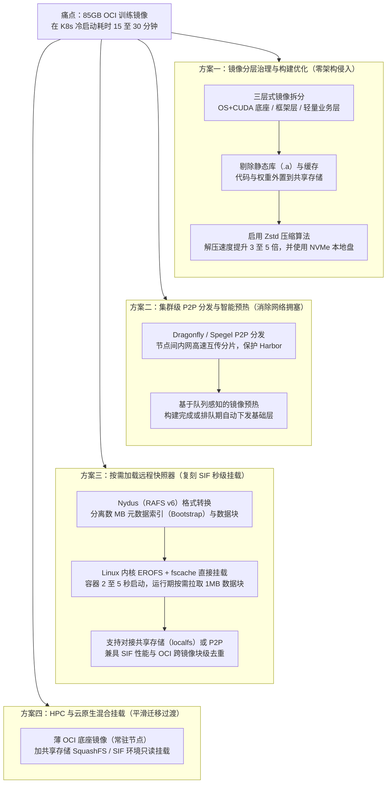

### 方案一：镜像分层治理、构建瘦身与Zstd压缩优化

在引入任何复杂的底层组件之前，平台团队首先应当通过**镜像工程规范**与**运行时配置优化**解决“镜像无序膨胀”与“`gzip`单核解压慢”的问题。这一步无需改动`Kubernetes`架构，却能立即消除`70%`以上的重复拉取开销。

#### 建立三层式标准训练镜像架构

许多算法团队之所以每次任务都触发`85GB`全量拉取，是因为他们将底层`CUDA`、框架代码和每天修改的业务训练脚本全部混杂在庞大的顶层镜像中，或者没有统一全平台的基础镜像底座。

平台应当在`CI/CD`流水线中强制推行 **“三层式（`Three-Tier`）镜像分层规范”** ，并将高频变化的代码与数据彻底移出镜像：

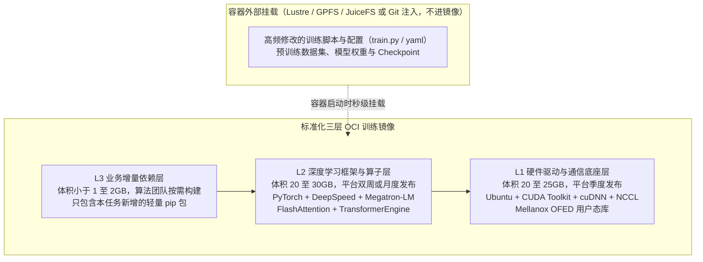

- **`L1`硬件底座层与`L2`框架层常驻节点**：平台仅维护少数几个标准版本的`L1+L2`基础镜像，并在所有`GPU`节点入网或空闲时通过`DaemonSet`预先拉取解包到本地`OverlayFS Snapshotter`中（配置垃圾回收白名单防止被`kubelet`清理）。
- **冷启动退化为轻量增量拉取**：当算法工程师基于平台标准镜像构建自己的训练环境时，底下`75GB`的`L1`和`L2`层在计算节点本地直接命中`Snapshot`缓存（耗时为`0`），节点只需下载并解压顶层`1GB`~`2GB`的`L3`增量层，启动耗时直接从`25`分钟缩短至 **`10`~`20`秒** 。

#### 剔除无用静态库与切换Zstd压缩算法

在构建那部分体积庞大的基础层时，有两项极具性价比的优化手段：

1. **清理`CUDA`静态链接库（`.a`文件）**：
   官方`nvidia/cuda:*-devel`镜像为了支持全静态编译，内置了大量以`_static.a`结尾的静态库（例如`libcublas_static.a`、`libcublasLt_static.a`、`libcusolver_static.a`、`libcudnn_ops_static.a`等）。在`PyTorch`训练以及`FlashAttention`/`DeepSpeed`的即时编译（`JIT`）中，链接器使用的全部是动态库（`.so`）。仅删除这些无用的`_static.a`文件以及清理`pip`/`conda`构建缓存，通常就能在不影响任何编译与训练功能的前提下，**直接削减`10GB`~`20GB`的解压体积**。
2. **使用`zstd`替代默认的`gzip`压缩**：
   `Zstandard`（`zstd`）是由`Meta`开源的高性能压缩算法，自`Docker Buildx`（`BuildKit`）与`containerd 1.5+`起已获得原生支持。与`gzip`相比，`zstd`在压缩率相当甚至更优的同时， **解压速度可达`500MB/s` ~ `1200MB/s`（是`gzip`的`3`~`5`倍）** 。

下面是一个集成了缓存清理、静态库瘦身与`zstd`压缩构建的生产级示例：

```dockerfile
# syntax=docker/dockerfile:1
FROM nvcr.io/nvidia/pytorch:24.07-py3

# 1. 安装额外依赖并在同一层内彻底清理缓存，避免无用文件残留在下层 Snapshot
RUN pip install --no-cache-dir \
        deepspeed==0.15.0 \
        transformers==4.44.0 \
        accelerate==0.33.0 && \
    conda clean -a -y && \
    rm -rf /root/.cache /tmp/* && \
    # 2. 按需清理体积庞大且运行/JIT编译均不使用的 CUDA 静态链接库 (*_static.a)
    find /usr/local/cuda -name "*_static.a" -delete
```

在`CI`流水线中使用`docker buildx`构建并显式指定`zstd`压缩推送到镜像仓库：

```bash
docker buildx build \
  --platform linux/amd64 \
  --output type=registry,compression=zstd,compression-level=3,force-compression=true \
  --tag registry.example.com/ai-base/pytorch-llm:24.07-zstd \
  .
```

#### 节点侧containerd存储与并发调优

在`GPU`计算节点上，还应配合完成以下三项基础配置：

| 优化项 | 推荐配置方案 | 解决的瓶颈 |
| :--- | :--- | :--- |
| **独立`NVMe`数据盘** | 将`/var/lib/containerd`挂载到节点本地高性能`NVMe SSD`（或`RAID0`阵列）上，与操作系统根分区隔离 | 彻底解决`85GB`解包时的磁盘`IOPS`与吞吐瓶颈，避免打满系统盘 |
| **提升并发拉取度** | 在`/etc/containerd/config.toml`中调大`max_concurrent_downloads = 10` | 充分利用节点高速网卡带宽并发下载多个镜像层 |
| **升级`containerd 2.x`** | 启用新版有界内存并行拉取（`Disk-Backed Parallel Pull`）与并行解包优化 | 防止超大镜像并发分块拉取时导致`containerd`守护进程内存暴涨（`OOM`） |

### 方案二：集群级P2P镜像分发与智能预热

当一次大规模分布式训练任务通过`Volcano`整组调度同时在`64`台甚至`256`台节点上启动时，即便镜像已经过`zstd`压缩，数十台节点同时从`Harbor`拉取同一个镜像层依然会造成中心仓库出口拥塞。此时需要引入**点对点（`P2P`）镜像分发网络**。

#### P2P分发如何化解多节点并发洪峰

`P2P`镜像分发的核心思想是**将“所有节点向中心仓库拉取”的星型拓扑，转化为“节点与节点之间互相传输数据分片”的网状拓扑**：

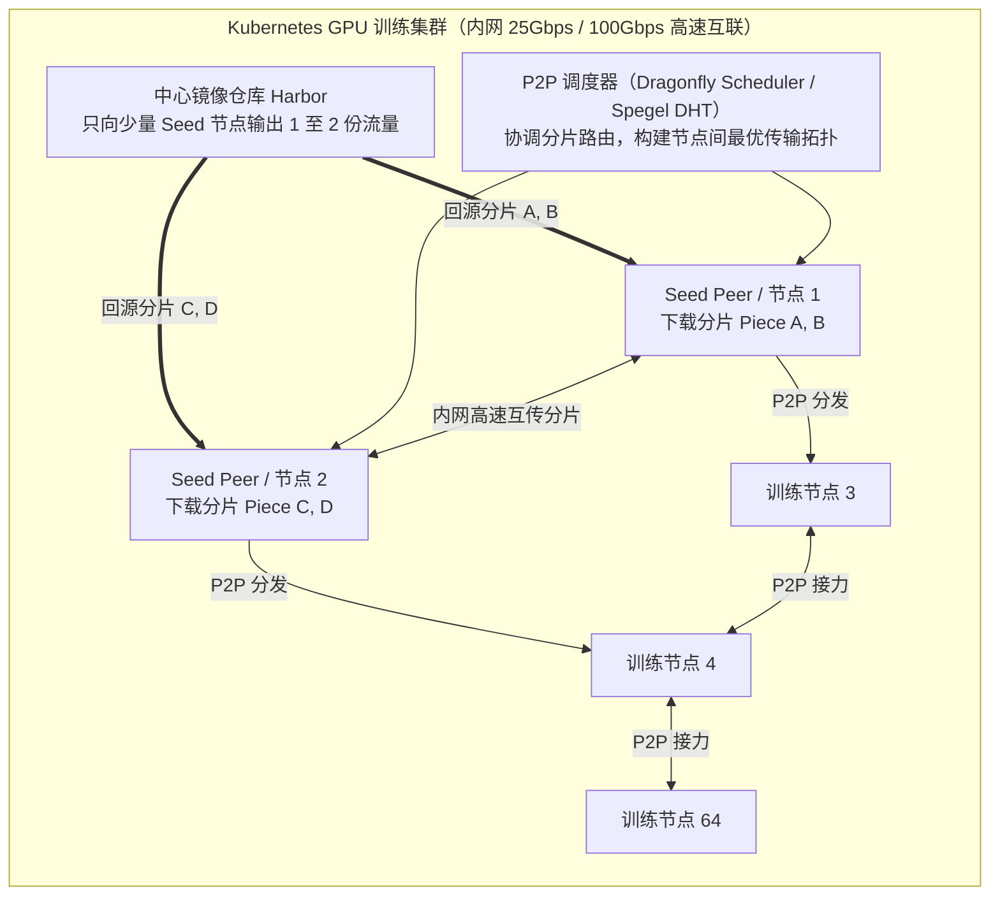

在云原生生态中，目前最主流的两套`P2P`加速方案分别是 **`Dragonfly`**与**`Spegel`** ：

| 对比维度 | `Dragonfly`（`CNCF`孵化项目） | `Spegel`（无状态集群内镜像缓存） |
| :--- | :--- | :--- |
| **架构模式** | 包含`Manager`、`Scheduler`、`Seed Peer`与节点`dfdaemon`的完整企业级架构 | 极简无状态架构，仅以`DaemonSet`形式运行在各节点，通过`DHT`路由 |
| **分发粒度** | **分片级（`Piece-level`）**，单个大镜像层可被切分为数`MB`的分片并发互传 | **镜像层级（`Blob-level`）**，从已拥有完整`Blob`的邻居节点拉取 |
| **主动预热能力** | **原生支持**，提供`Preheat API`，可在任务调度前将镜像主动分发至指定节点 | 不支持集中式`API`预热，依赖首个节点拉取后的被动共享 |
| **与按需加载集成** | **深度原生集成`Nydus`**，支持对`Nydus`数据块进行`P2P`分发 | 仅面向标准`OCI`镜像层 |
| **适用规模与场景** | 百节点至万节点级大规模训练集群、跨机房分发、需要与平台`API`联动预热 | 中小规模集群（数十至数百节点）、追求零外部组件依赖与快速上线 |

#### 结合训练队列的智能镜像预热（Image Pre-warming）

在训练平台工程实践中，我们还可以利用 **“作业排队时间窗口”** 实现零感知预热：

1. 当算法同学在训练平台提交一个`32`节点的训练任务时，任务往往需要先在`Volcano Queue`中排队等待资源（或者平台正在为其准备调度）。
2. 训练平台`API`在接收到任务提交请求的那一刻，立即异步调用`Dragonfly`的`Preheat API`（或向目标资源池下发预热指令），先把该任务使用的镜像拉取到`Seed Peer`或候选空闲节点上。
3. 等到`Volcano`真正将该任务绑定到节点启动时，镜像数据早已分布在集群内网或目标节点本地，从而彻底消除网络下载等待时间。

### 方案三：基于按需加载（Lazy Pulling）的远程快照器-在K8s上复刻SIF的秒级挂载

方案一和方案二虽然大幅加快了网络传输与解压速度，但只要依然使用`containerd`默认的`overlayfs snapshotter`，面对一个从未见过的全新`85GB`镜像，计算节点仍然逃不开“必须先把整个镜像层下载完、解压完才能启动容器”的物理定律。

要让`OCI`镜像彻底达到`Apptainer SIF`那样 **“无论镜像是`10GB`还是`100GB`，统统在`2`~`5`秒内启动容器，用到哪个文件再读哪个数据块”** 的效果，核心突破口就是将`containerd`的默认快照器替换为 **支持按需加载（`Lazy Pulling`）的远程快照器（`Remote Snapshotter`）** 。

#### Nydus（RAFS v6）+ Linux内核EROFS over fscache深度解析

在众多按需加载方案中，由阿里云与蚂蚁集团开源并捐赠给`CNCF Dragonfly`项目的 **`Nydus`（`Dragonfly Image Service`）** ，是目前在大规模`AI`训练与推理场景落地最成熟、性能最接近原生文件系统的方案。

为什么说`Nydus`本质上就是“把`Apptainer SIF`的设计精髓移植到了`OCI`生态”？我们可以对比两者的结构：

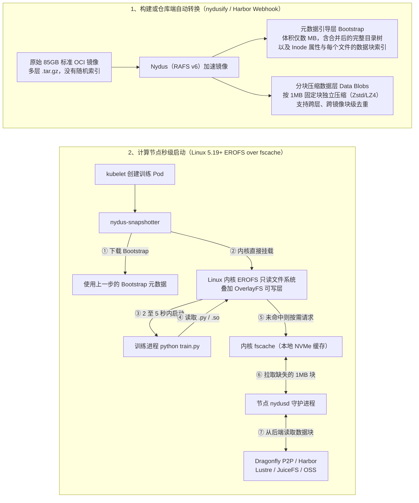

`Nydus`（特别是其`RAFS v6`版本）解决了传统`OCI`镜像的三大核心痛点：

1. **元数据与数据彻底分离，实现秒级挂载**：
   通过`nydusify`转换工具（或`BuildKit`原生构建、`Harbor`仓库推送后自动触发`Webhook`转换），`Nydus`将原本分散在各个`.tar.gz`层中的目录结构提取并合并为一个通常只有 **`2MB`~`10MB`的`Bootstrap`元数据文件** ，而将真正的文件内容切分为按`1MB`对齐的压缩数据块（`Chunk`）。当`85GB`的训练容器启动时，节点只需花不到`1`秒钟下载这个几`MB`的`Bootstrap`文件，即可把整个`85GB`的目录树完整挂载出来并立即拉起容器进程。
2. **基于`Linux`内核`EROFS + fscache`的原位运行，告别用户态`FUSE`性能损耗**：
   早期的按需加载技术大多基于用户态文件系统（`FUSE`），当`Python`高频读取成千上万个小文件时，请求需要在“容器进程 -> 内核`VFS` -> 用户态`FUSE`守护进程 -> 内核网络/磁盘 -> 容器进程”之间反复切换上下文，导致`import torch`变慢。
   而`Nydus RAFS v6`的磁盘格式与`Linux`内核原生的 **`EROFS`（`Enhanced Read-Only File System`，增强型只读文件系统）** 完全兼容 。配合`Linux 5.19`内核合入的 **`EROFS over fscache`** 机制：
   - 文件系统的目录查找（`lookup`）、属性读取（`stat`）以及已缓存数据块的读取，**`100%`在`Linux`内核态直接完成**，零用户态上下文切换，性能与`Apptainer`挂载内核`SquashFS`几乎完全一致！
   - 只有当训练进程第一次读取某个尚未下载的数据块时，内核`fscache`才会通知`nydusd`去远端拉取对应的`1MB`数据块并自动落盘到节点本地`NVMe`的`fscache`目录中；同一台机器上的后续容器或其它`GPU rank`进程再次访问时，直接命中内核缓存。
3. **独特的共享存储后端（`localfs`）支持，打通`HPC`与云原生**：
   在大模型训练集群中，通常已经部署了高性能并行文件系统（如`Lustre`、`GPFS`）或分布式文件系统（如`JuiceFS`）、对象存储（`S3`/`MinIO`）。`Nydus`不仅支持从`Registry`和`Dragonfly P2P`拉取数据块，还支持直接将**共享存储目录（`localfs`）或对象存储配置为后端数据源（`Backend`）**。
   这意味着：镜像转换生成的`Blob`数据块只需写一份到共享存储或对象存储中，全集群所有`Kubernetes`节点无需通过`Harbor`走`HTTP`下载，直接由各节点的`EROFS + fscache`从共享存储按需读取那`6%`~`20%`真正用到的数据块并缓存在本地`NVMe`——**既拥有了`Apptainer SIF`在共享存储上秒级启动的极致体验，又保留了`OCI`镜像的细粒度块级去重与`Kubernetes`全套编排能力**。

#### 四大主流按需加载（Lazy Pulling）方案横向对比

除了`Nydus`之外，云原生社区还有`OverlayBD`、`eStargz`（及`zstd:chunked`）和`SOCI`等按需加载方案。我们可以根据基础设施条件进行对比选型：

| 方案名称 | 核心技术原理 | 是否改变镜像格式 | 内核态/用户态机制 | 优势与适用场景 |
| :--- | :--- | :--- | :--- | :--- |
| **`Nydus`（`RAFS v6`）** | 分离`Bootstrap`元数据与`1MB`定长压缩`Chunk`，支持跨镜像块级去重 | 是（需转换或构建为`Nydus`格式，可与原镜像共存） | 支持内核态`EROFS + fscache`及用户态`FUSE` | **大规模`AI`平台首选**：启动最快、小文件元数据性能极佳、原生融合`Dragonfly P2P`与共享存储后端 |
| **`OverlayBD`（`DADI`）** | 将`OCI`层转化为基于虚拟块设备的块级镜像（内部为`ext4`/`erofs`文件系统） | 是（需转换为块设备层格式） | 通过内核`TCMU`或`ublk`映射为虚拟块设备挂载 | 块设备语义最纯粹，无`OverlayFS`层数限制，适合超大镜像与随机块`I/O`密集型负载 |
| **`eStargz` / `zstd:chunked`** | 在标准`tar`包内部对文件独立压缩，并在末尾附加`TOC`目录索引 | 兼容标准`OCI`（可被普通`Docker`直接拉取） | 用户态`FUSE`挂载 | 生态兼容性最好，无需维护两套不兼容的镜像制品，但百万小文件场景下`FUSE`开销略高于`EROFS` |
| **`SOCI`（`AWS`开源）** | **不修改原始`.tar.gz`镜像**，在镜像外部单独生成一份`SOCI Index`索引制品 | **否（原始镜像零改动）** | 用户态`FUSE` + `gzip`/`zstd`分块索引寻址 | 对存量镜像与构建流水线**零侵入**，适合无法改造用户构建流程的场景，但首次生成索引与随机解压开销稍大 |

:::tip 用户无感转换实践
采用`Nydus`或`OverlayBD`时，**并不需要让算法工程师修改他们习惯的`docker build`和`docker push`命令**。生产平台通常在`Harbor`镜像仓库侧配置`Webhook`或在平台镜像中心配置异步转换任务：当用户推送标准`OCI`镜像`train-env:v1`后，后台流水线自动生成对应的加速镜像`train-env:v1-nydus`（或通过同一个`Image Index`挂载多架构/多格式清单）；当训练任务下发到`Kubernetes`时，由平台准入控制器（`Mutating Admission Webhook`）或`nydus-snapshotter`自动优先匹配加速格式，若转换尚未完成则无缝回退至标准`OCI`拉取。
:::

### 方案四：混合过渡方案-轻量化OCI底座挂载共享存储SquashFS/SIF环境

如果团队当前正处于从`Slurm`向`Kubernetes`迁移的过渡期，集群本身已经拥有一套性能极强的并行共享存储（如`Lustre`、`GPFS`或带本地缓存的`JuiceFS`），且短期内不想在所有计算节点上部署和维护自定义`containerd snapshotter`插件，还可以采用一种极其务实的 **“薄`OCI`底座 + 共享存储`SquashFS`/`SIF`环境只读挂载”** 混合架构。

#### “薄底座+厚环境挂载”的工作机制

该方案将`85GB`的训练环境一分为二：

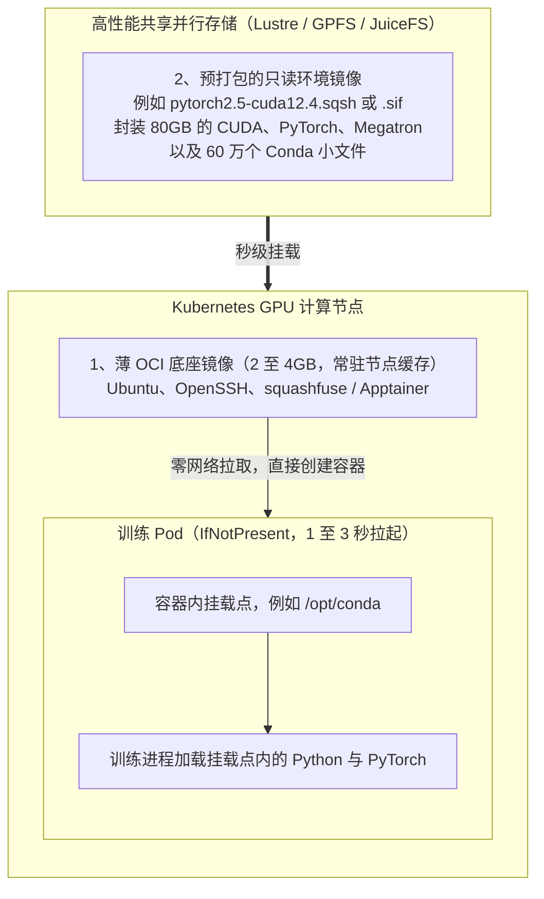

1. **构建常驻节点的“薄`OCI`底座镜像”**：
   平台统一提供一个仅`2GB` ~ `4GB`的轻量级`OCI`底座镜像，其中只包含基础操作系统工具、通信启动器以及`squashfuse`（或`apptainer`客户端）。由于体积很小且全集群统一，该底座镜像始终缓存在每台`GPU`节点本地，设置`imagePullPolicy: IfNotPresent`后，`Pod`的容器创建耗时稳定在 **`1`~`3`秒** 。
2. **将庞大的`Conda`/`PyTorch`/`CUDA`环境打包为`.sqsh`或`.sif`存放在共享存储**：
   利用`mksquashfs`（或`conda-pack`结合`SquashFS`、或直接使用原有的`Apptainer .sif`文件），将原本包含数十万个小文件、`80GB`大小的训练软件栈压制成一个只读的`.sqsh`或`.sif`单文件，存放在共享存储目录（如`/mnt/lustre/envs/llm-env-v1.sqsh`）中。
3. **容器启动时原位挂载**：
   在训练`Pod`的启动脚本（或`InitContainer`）中，通过`mount -t squashfs -o loop`或非特权模式下的`squashfuse`（或者直接在轻量`Pod`内调用`apptainer exec --nv /mnt/lustre/envs/llm-env.sif`），在`1`秒钟内将该只读文件系统挂载到容器的`/opt/conda`目录并加入`PATH`与`LD_LIBRARY_PATH`。

这种混合模式在迁移期具有显著优势：**既`100%`复用了`Kubernetes`的`Volcano`/`Kueue`调度、`Pod`监控、日志收集与`RDMA`/`GPU`设备插件体系，又直接继承了`Slurm`时代`SIF`/`SquashFS`在共享存储上秒级启动且不产生小文件元数据风暴的优点**。

此外，`Kubernetes`社区自`v1.31`（`Alpha`）及`v1.33+`（`Beta`）起原生引入了 **`ImageVolume`（`KEP-4639`）** 特性，允许将符合`OCI`规范的只读镜像或环境制品直接作为`Volume`挂载到`Pod`指定路径，未来这类“基础容器与大型只读软件环境包解耦挂载”的模式将进一步成为云原生标准能力。

## 生产落地选型建议


| 平台所处阶段与场景特征 | 推荐核心方案组合 | 实施复杂度 | `85GB`镜像冷启动耗时 |
| :--- | :--- | :--- | :--- |
| **初创或中小规模集群（`< 32`节点）**：希望零组件侵入、最快速度解决慢启动 | **方案一**：三层镜像拆分规范 + 清理静态库 + `Zstd`压缩 + 本地`NVMe`盘 + 基础层`DaemonSet`预热 | 低（`1`~`2`周即可落地） | 基础层命中时 **`10`~`20`秒** ；全冷拉取降至 **`2`~`4`分钟 ** |
| **正从`Slurm`向`K8s`迁移的集群**：已有`Lustre`/`GPFS`且存量有大量`.sif`或`Conda`环境 | **方案四 + 方案一**：薄`OCI`底座镜像常驻节点 + 共享存储挂载`.sqsh`/`.sif`只读环境文件 | 低~中 | **稳定`3`~`8`秒**（直接复用已有共享存储能力） |
| **中大型云原生训练平台（`32`~`500`节点）**：频繁进行多机`Gang Scheduling`，仓库带宽常被打满 | **方案一 + 方案二**：三层镜像治理 + `Zstd` + **`Dragonfly`（或`Spegel`）`P2P`分发与队列预热** | 中 | 热镜像秒级；`64`节点并发拉取新镜像稳定在 **`1`~`3`分钟**  |
| **超大规模或多租户高频自定义镜像平台**：算法团队频繁构建全新大镜像，要求极致冷启动体验 | **方案一 + 方案二 + 方案三**：`Harbor` + **`Dragonfly P2P` + `Nydus`（`EROFS over fscache`）** | 中~高（需配置节点内核`EROFS`与快照器插件） | **无论镜像多大、是否缓存，冷启动均稳定在`3`~`10`秒** |


## 总结

回顾`Apptainer SIF`与`Docker`/`OCI`在大模型训练平台中的碰撞，可以提炼出以下核心脉络：

1. **现象背后的本质差异**：`85GB`训练镜像在`Apptainer`下只需几秒启动，是因为`SIF`本质上是一个内嵌了 **`SquashFS`块级索引只读文件系统** 的单文件，启动时只需执行一次内核`Loop`直接挂载，运行期仅按需读取并解压实际用到的`6%`~`20%`数据块；而默认的`Docker`/`OCI`是由多层**无随机索引的`.tar.gz`流式归档包**组成的，强制要求节点在容器启动前完成`100%`网络下载、单核串行解压以及数十万个小文件的本地落盘。
2. **各自的生态权衡**：`Apptainer SIF`非常适合具备统一并行共享存储的传统`Slurm`超算环境，但在细粒度分层复用、增量构建分发以及云原生编排集成上存在明显短板；`Docker`/`OCI`拥有强大的分层缓存复用与`Kubernetes`云原生工具链生态，但原始的`tar+gzip+overlayfs`全量解包机制无法直接适应数十`GB`的`AI`巨型镜像。
3. **云原生的破局之道**：通过 **“三层镜像规范 + `Zstd`压缩 + 本地`NVMe`”** 削减无效负载与解压耗时，通过 **“`Dragonfly`/`Spegel` `P2P`分发”** 消除多机整组调度时的网络拥塞，再通过 **“`Nydus`（`RAFS v6`）+ 内核`EROFS over fscache`按需加载”**（或过渡期的薄底座挂载共享存储`SquashFS`/`.sif`方案）将“按索引直接挂载、按需读取数据块”的机制引入`containerd`，即可在云原生底座上完美兼得`OCI`的工程生态与`SIF`的秒级启动性能。

## 参考资料

- [`Apptainer` User Guide & Architecture](https://apptainer.org/docs/user/main/)
- [`Singularity Image Format (SIF)` Specification](https://github.com/apptainer/sif)
- [`OCI` Image Format Specification](https://github.com/opencontainers/image-spec)
- [`containerd` Snapshotters & Content Flow Overview](https://github.com/containerd/containerd/blob/main/docs/snapshotters/README.md)
- [*Slacker: Fast Distribution with Lazy Docker Containers* (`USENIX FAST '16`)](https://www.usenix.org/conference/fast16/technical-sessions/presentation/harter)
- [`Nydus` (`Dragonfly Image Service`) Architecture & `RAFS v6` Specification](https://nydus.dev/docs/overview/introduction/)
- [`Linux` Kernel Documentation: `EROFS` File System & `EROFS over fscache`](https://docs.kernel.org/filesystems/erofs.html)
- [`Dragonfly` P2P File and Image Distribution System](https://d7y.io/docs/)
- [`OverlayBD` (`DADI` Block-Based Container Image Acceleration)](https://github.com/containerd/accelerated-container-image)
- [`containerd` `Stargz Snapshotter` (`eStargz` & `zstd:chunked`)](https://github.com/containerd/stargz-snapshotter)
- [`AWS` `SOCI` (`Seekable OCI`) Snapshotter](https://github.com/awslabs/soci-snapshotter)
- [`Spegel`: Stateless Cluster Local OCI Registry Mirror](https://github.com/spegel-org/spegel)
- [`Kubernetes` `KEP-4639`: OCI VolumeSource (`ImageVolume`)](https://kubernetes.io/docs/tasks/configure-pod-container/image-volumes/)
