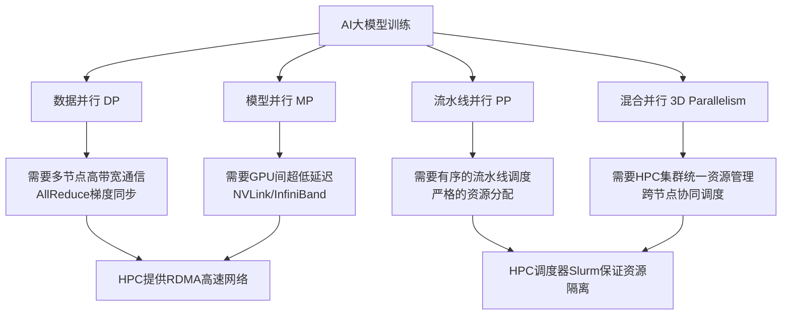
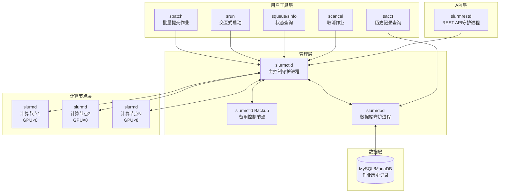

大规模`AI`大模型的训练和微调已成为当今人工智能领域的核心工程挑战。训练一个百亿参数的模型往往需要数百乃至数千块`GPU`协同运行数天。在这一背景下，如何高效地管理`GPU`集群、调度训练作业、最大化算力利用率，成为`AI`基础设施团队必须面对的关键问题。

本文将系统介绍高性能计算（`HPC`）的基本概念与技术体系，并重点深入讲解`Slurm`工作负载管理器在`AI`大模型训练和微调场景中的架构、使用方法与实践经验。

## 什么是高性能计算

高性能计算（`High-Performance Computing`，简称`HPC`）是指利用大量互联的计算节点并行处理极其复杂的计算任务，以达到单台普通计算机无法实现的计算性能。其核心目标是在可接受的时间内完成需要巨大计算量的科学、工程或数据分析任务。

### HPC解决的核心问题

| 问题类型 | 典型场景 | 痛点描述 |
|----------|----------|----------|
| 算力瓶颈 | 大模型预训练 | 单节点显存和算力不足以容纳千亿参数模型 |
| 时间约束 | 科学计算、气象模拟 | 单机完成需数年，并行后缩短至数小时 |
| 数据规模 | 基因测序、天文数据分析 | 数据量超过单节点处理能力 |
| 资源利用 | 多团队共享集群 | 缺乏统一调度导致资源闲置或冲突 |

### 常见的HPC技术方案

**并行计算模型**

- **共享内存并行（`SMP`）**：多核`CPU`共享内存，通过`OpenMP`等实现线程级并行，适合单节点内部并行
- **分布式内存并行（`MPI`）**：多节点各自拥有独立内存，通过`MPI`库在节点间传递消息，是集群计算的主流方案
- **`GPU`加速计算（`GPGPU`）**：利用`NVIDIA CUDA`或`AMD ROCm`将大量计算密集型任务卸载到`GPU`，尤其适合矩阵运算
- **混合并行**：结合`MPI` + `OpenMP` + `GPU`，实现多级并行，最大化硬件利用率

**高速互联网络**

`HPC`集群的性能瓶颈之一在于节点间通信。常用的高速互联技术包括：

| 技术 | 带宽 | 延迟 | 特点 |
|------|------|------|------|
| `InfiniBand` | `200Gb/s+` | `< 1μs` | 超低延迟，专为`HPC`设计 |
| `RoCE` | `100Gb/s+` | `1-5μs` | 基于以太网的`RDMA`，成本较低 |
| `NVLink` | `600GB/s+` | 极低 | `NVIDIA GPU`间直连，单机内部 |
| `GPUDirect RDMA` | `100Gb/s+` | `< 2μs` | `GPU`直接与网卡通信，绕过`CPU` |

**资源管理与作业调度**

在多用户、多任务的集群环境中，需要一套资源管理系统来统一调度和管理计算资源。主流的`HPC`资源管理系统包括：

| 系统 | 开发方 | 特点 |
|------|--------|------|
| `Slurm` | `SchedMD` | 开源，主流`HPC`集群首选，支持`GPU`调度 |
| `PBS/Torque` | `Altair` | 商业版`PBS Pro`，历史悠久 |
| `LSF` | `IBM` | 商业系统，功能完善，企业级支持 |
| `SGE/UGE` | `Oracle/Altair` | 网格引擎，多适用于生物信息学 |
| `Kubernetes` | `CNCF` | 云原生容器编排，`AI`推理场景强 |

## HPC在AI大模型训练与微调中的应用

### 为什么AI大模型训练必须依赖HPC

现代`AI`大模型的规模已远超单节点算力边界：

- **`GPT-3`（175B参数）**：需要数百块`A100 GPU`运行数周才能完成训练
- **`LLaMA-3`（70B参数）**：微调一次完整模型需要至少`8`块`80GB A100`
- **`Mixtral-8x7B`**：混合专家模型需要跨节点的精细资源调度

这些规模决定了`AI`训练必须在多节点`GPU`集群上运行，也就是必须依赖`HPC`基础设施。

### AI训练中的并行策略与HPC的对应关系



### HPC在AI微调场景中的价值

| 应用场景 | HPC必要性 | 核心需求 |
|----------|-----------|----------|
| 全参数微调（`Full Fine-tuning`） | 高，模型需完整加载 | 多卡显存聚合、梯度同步 |
| `LoRA/QLoRA`微调 | 中，显存需求降低 | 快速任务调度、队列管理 |
| 持续预训练 | 高，时间长、规模大 | 作业检查点、故障恢复 |
| 强化学习微调（`RLHF`） | 高，需要多组件协同 | `Actor/Critic`分离部署 |
| 批量评估推理 | 中，并发任务多 | 多任务队列、资源公平分配 |

## 什么是Slurm

`Slurm`（`Simple Linux Utility for Resource Management`）是一个开源的、容错性强、高度可扩展的集群管理和作业调度系统，广泛应用于全球顶级超算中心和大型`GPU`训练集群。它由`SchedMD`公司主导开发和维护，遵循`Apache 2.0`开源协议。

`Slurm`承担三个核心职责：

1. **资源分配**：将计算节点（含`CPU`、内存、`GPU`等）独占或非独占地分配给用户指定时长
2. **作业管理**：在分配的节点上启动、执行和监控并行作业
3. **队列仲裁**：管理待执行作业的队列，按优先级和策略调度

### Slurm的显著优点

| 优点 | 说明 |
|------|------|
| 开源免费 | 无商业授权费用，社区活跃，持续迭代 |
| 原生GPU支持 | 通过`GRES`机制精细管理`GPU`资源，支持`MIG`、`MPS` |
| 高可用 | 支持备用控制节点，单点故障自动切换 |
| 丰富的调度策略 | 多因子优先级、公平调度、抢占调度、回填调度 |
| 计量记账 | 完整的作业历史记录和资源使用统计 |
| 可扩展插件 | 覆盖认证、调度、记账、MPI等各类插件接口 |
| 广泛的生态支持 | 与`PyTorch`、`DeepSpeed`、`MPI`等深度集成 |
| 大规模验证 | 全球`Top500`超算榜单中绝大多数使用`Slurm` |

### Slurm与Kubernetes的对比

在`AI`训练场景下，`Slurm`和`Kubernetes`各有侧重：

| 维度 | Slurm | Kubernetes |
|------|-------|-----------|
| 设计定位 | `HPC`作业批量调度 | 容器化服务编排 |
| GPU调度 | 原生支持，精细到设备级 | 需要`Device Plugin`，粒度较粗 |
| 训练适合性 | 非常适合批处理训练任务 | 适合推理服务，训练需额外框架 |
| 启动速度 | 秒级（无容器开销） | 分钟级（镜像拉取、容器启动） |
| 故障恢复 | 节点级，作业重排队 | `Pod`重启，需配合`Checkpoint` |
| 多租户隔离 | 账号/分区体系成熟 | `Namespace`隔离，`RBAC` |
| 学习曲线 | 对`HPC`工程师友好 | 对云原生工程师友好 |
| 在线推理 | 不适合 | 非常适合（`AI`推理） |

在实践中，许多大型`AI`团队采用混合架构：`Slurm`负责训练，`Kubernetes`负责推理服务，二者各司其职。

## Slurm的架构设计

### 整体架构



### 核心组件详解

#### slurmctld — 主控制守护进程

`slurmctld`是`Slurm`的"大脑"，运行在管理节点（`headnode`）上，负责：

- 监控所有计算节点的状态（在线、下线、故障等）
- 接收用户提交的作业请求
- 根据调度策略决定作业在哪些节点上运行
- 向`slurmd`下发作业执行指令

为保证高可用，`slurmctld`支持配置备用节点，主节点故障时备用节点自动接管。

#### slurmd — 计算节点守护进程

`slurmd`运行在每一个计算节点上，是"工人"角色，负责：

- 向`slurmctld`上报本节点的资源信息（`CPU`数量、内存大小、`GPU`数量等）
- 接收`slurmctld`下发的作业步骤（`job step`）
- 启动、监控和清理作业进程
- 收集作业资源使用数据

#### slurmdbd — 数据库守护进程

`slurmdbd`是可选组件，负责将作业的历史记录、用户账号、资源使用统计等数据持久化到`MySQL/MariaDB`数据库中，支持：

- 跨集群的统一记账
- 作业历史查询（`sacct`命令）
- 基于账号的资源限额管理（`QOS`、`limits`）

#### slurmrestd — REST API守护进程

`slurmrestd`是可选的`REST API`服务，允许外部系统（如`AI`平台、工作流引擎）通过标准`HTTP API`提交作业、查询状态，而无需安装`Slurm`客户端工具。这在与`Kubernetes`、`Airflow`等系统集成时非常有用。

### Slurm的核心概念

| 概念 | 说明 |
|------|------|
| `Node`（节点） | 集群中的单台计算服务器，可包含多个CPU核和GPU |
| `Partition`（分区） | 节点的逻辑分组，类似于作业队列，可设置不同的策略 |
| `Job`（作业） | 用户提交的计算任务，包含资源需求和执行脚本 |
| `Job Step`（作业步骤） | 作业内部的并行子任务，通过`srun`启动 |
| `GRES`（通用资源） | GPU等特殊资源的抽象，支持精细的资源调度 |
| `QOS`（服务质量） | 作业优先级和资源限额的策略集合 |
| `Account`（账号） | 用户组织单元，用于记账和资源配额管理 |

## Slurm的使用与配置

### 安装与基础配置

`Slurm`的核心配置文件为`/etc/slurm/slurm.conf`。以下是一个适合`GPU`训练集群的配置示例：

```ini
# /etc/slurm/slurm.conf 基础配置示例

# ==================== 全局配置 ====================
ClusterName=ai-gpu-cluster
SlurmctldHost=headnode01          # 主控节点
SlurmctldHost=headnode02          # 备用控制节点（可选）

# 认证
AuthType=auth/munge

# 调度器设置
SchedulerType=sched/backfill      # 开启回填调度，提升利用率
SelectType=select/cons_tres       # 消耗型资源分配（GPU调度必须）
SelectTypeParameters=CR_Core_Memory

# ==================== 资源类型配置 ====================
# 注册GPU为可调度资源
GresTypes=gpu

# ==================== 记账配置（需slurmdbd）====================
AccountingStorageType=accounting_storage/slurmdbd
AccountingStorageHost=headnode01
AccountingStorageTRES=gres/gpu    # 统计GPU使用量

# ==================== 节点配置 ====================
# GPU训练节点：每节点8块A100 80GB
NodeName=gpu-node[01-16] \
    CPUs=128 \
    RealMemory=1048576 \
    Gres=gpu:a100:8 \
    State=UNKNOWN

# ==================== 分区配置 ====================
# 普通训练分区
PartitionName=train \
    Nodes=gpu-node[01-08] \
    Default=YES \
    MaxTime=72:00:00 \
    State=UP

# 高优先级分区（长时间训练）
PartitionName=train-priority \
    Nodes=gpu-node[09-16] \
    MaxTime=7-00:00:00 \
    AllowGroups=ml-team \
    State=UP
```

### GPU资源配置（gres.conf）

`gres.conf`描述每个计算节点上的`GPU`详细信息：

```ini
# /etc/slurm/gres.conf
# 自动检测NVIDIA GPU（推荐）
AutoDetect=nvml

# 若需手动指定，示例如下（8卡A100节点）：
# Name=gpu Type=a100 File=/dev/nvidia[0-7]
```

### 常用命令速查

| 命令 | 用途 | 常用示例 |
|------|------|----------|
| `sbatch` | 提交批量作业 | `sbatch train.sh` |
| `srun` | 交互式运行或启动作业步骤 | `srun --gres=gpu:4 python train.py` |
| `squeue` | 查看作业队列 | `squeue -u $USER` |
| `sinfo` | 查看节点和分区状态 | `sinfo -o "%N %G %T"` |
| `sacct` | 查询作业历史记录 | `sacct -j 12345 --format=JobID,State,Elapsed` |
| `scancel` | 取消作业 | `scancel 12345` |
| `scontrol` | 查看或修改作业/节点状态 | `scontrol show job 12345` |
| `sacctmgr` | 管理用户、账号、QOS | `sacctmgr show user` |

下面按命令分别介绍具体用法。示例沿用上文的`train`分区、`a100`资源类型和`gpu-node01`节点，作业编号`12345`仅为示意，实际使用时需要替换为集群中的名称和编号。命令应在已配置`Slurm`客户端的登录节点或作业环境中执行；训练脚本、数据和虚拟环境也需要在计算节点上可访问。

各命令的输出示例均为示意数据，用于说明返回内容和字段含义，不是实际集群的执行记录；不同示例也不代表同一作业的连续操作过程。实际输出会随`Slurm`版本、集群配置和作业状态变化。

#### sbatch：提交批量作业

`sbatch`适合提交长时间运行的训练、微调和评估任务，基本语法为`sbatch [选项] 脚本文件 [脚本参数]`。提交成功后返回`Submitted batch job 12345`，表示控制器已接收作业，作业可能仍在排队；终端断开不会影响已经提交的批量作业。

**简单执行示例**

输入，假设`train.sh`已经包含资源申请和训练启动命令：

```bash
sbatch train.sh
```

输出示例：

```text
Submitted batch job 12345
```

`12345`是新提交作业的编号，后续可用`squeue -j 12345`查询状态。这里显示的是提交结果，训练程序的输出会写入作业日志。

**常用参数**

| 参数 | 说明 |
|------|------|
| `-J`、`--job-name` | 设置便于识别的作业名称 |
| `-p`、`--partition` | 指定提交到哪个分区 |
| `-A`、`--account` | 指定记账账号，需已获得该账号的使用权限 |
| `--qos` | 指定服务质量策略，需符合账号及分区规则 |
| `-N`、`--nodes` | 申请节点数，例如`--nodes=2` |
| `-n`、`--ntasks` | 申请的任务总数，不等于`GPU`数量 |
| `--ntasks-per-node` | 每节点任务数，常与`--nodes`配合使用 |
| `-c`、`--cpus-per-task` | 每个任务申请的`CPU`数量 |
| `--gres=gpu:a100:4` | 每个节点申请4块`A100 GPU` |
| `--mem=128G` | 每个节点申请的主机内存，不是`GPU`显存 |
| `-t`、`--time` | 运行时限，例如`12:00:00`或`2-00:00:00` |
| `-o`、`--output` | 标准输出路径，`%j`替换为作业编号 |
| `-e`、`--error` | 标准错误路径，未单独设置时默认与标准输出合并 |
| `--array` | 提交作业数组，例如`0-15%4`表示最多同时运行4个元素 |
| `--dependency` | 设置作业依赖，例如`afterok:12345` |
| `--parsable` | 输出便于脚本处理的作业编号，可能附带`;集群名` |

**提交训练任务并覆盖脚本中的资源设置**

```bash
# 日志目录必须在作业启动前存在，并能从计算节点访问
mkdir -p logs

# train.sh需包含实际的训练启动命令
sbatch --job-name=llm-finetune \
    --partition=train \
    --nodes=1 --ntasks=1 \
    --gres=gpu:a100:4 --cpus-per-task=16 \
    --mem=128G --time=12:00:00 \
    --output=logs/finetune_%j.out \
    --error=logs/finetune_%j.err \
    train.sh
```

命令行中的选项优先于脚本里的同名`#SBATCH`指令。`#SBATCH`指令必须放在脚本第一条实际执行语句之前，并且不会展开`$USER`等`Shell`变量；需要动态路径时，应在命令行中传入。`sbatch`只在一个分配节点上执行一份批处理脚本，即使申请了多个任务，也需要由脚本中的`srun`或训练启动器真正启动相应进程。

**串联训练与评估、提交超参数搜索**

```bash
# 训练成功结束后才运行评估；保留对提交失败的检查
if submit_result=$(sbatch --parsable train.sh); then
    train_job_id=${submit_result%%;*}
    sbatch --dependency="afterok:${train_job_id}" evaluate.sh
fi

# 同一份脚本执行16组实验，最多4组同时运行
sbatch --array=0-15%4 \
    --output=logs/search_%A_%a.out hparam_search.sh
```

`afterok`要求前置作业成功退出；如果只要求前置作业结束，无论成功与否，可使用`afterany`。数组脚本通过`SLURM_ARRAY_TASK_ID`读取当前实验索引，日志中的`%A`和`%a`分别表示数组主作业编号与元素索引。资源申请按每个数组元素计算，因此每组申请4块`GPU`、并发4组时，最多会同时占用16块`GPU`。

完整参数见[sbatch官方手册](https://slurm.schedmd.com/sbatch.html)。

#### srun：运行命令与启动作业步骤

`srun`的基本语法为`srun [选项] 可执行程序 [程序参数]`。在尚未获得资源分配时执行，它会先申请资源并等待调度，再运行命令；在`sbatch`等已分配资源的环境中执行，则通常在现有资源内创建一个作业步骤，不会自动扩充原作业的资源配额。

**简单执行示例**

输入，在登录节点申请单节点、单卡资源，运行一次`hostname`：

```bash
srun -p train -N 1 -n 1 --gres=gpu:a100:1 --time=00:01:00 hostname
```

输出示例，假设资源立即可用：

```text
gpu-node01
```

这表示命令实际运行在`gpu-node01`上。输出来自`hostname`程序；命令结束后，这次独立申请的作业资源会被释放。

**常用参数**

| 参数 | 说明 |
|------|------|
| `-N`、`--nodes` | 本次运行使用的节点数 |
| `-n`、`--ntasks` | 启动的任务总数，每个任务执行一份指定命令 |
| `--ntasks-per-node` | 每节点任务数；同时指定`-n`时作为每节点上限 |
| `-c`、`--cpus-per-task` | 每任务需要的`CPU`数量 |
| `--gres=gpu:a100:4` | 每节点需要的`GPU`类型与数量 |
| `--gpus-per-task=1` | 每任务申请1块`GPU`，需要明确任务数 |
| `--pty` | 为第一个任务分配伪终端，常用于交互式`Shell` |
| `-l`、`--label` | 在每行输出前添加任务编号，便于定位进程 |
| `--kill-on-bad-exit=1` | 任一任务非零退出时结束该步骤中的其他任务 |

`--gpus-per-task`等`--gpu*`选项要求集群使用`select/cons_tres`。使用已分配资源时，步骤请求的资源数量与类型必须和作业分配兼容，例如作业申请了`gpu:a100:4`，步骤中也应保持对应的类型约束。

**申请单卡交互式调试环境**

```bash
srun --partition=train --nodes=1 --ntasks=1 \
    --gres=gpu:a100:1 --cpus-per-task=8 \
    --mem=32G --time=01:00:00 --pty bash -l

# 以下命令在获得资源后的计算节点Shell中执行
hostname
nvidia-smi
python debug_train.py
exit
```

资源不足时，`srun`会停留在等待状态，不会立即进入计算节点。上面这种独立启动的交互式作业在退出`Shell`后释放资源，适合短时间排错；长时间训练通常使用`sbatch`提交。

**在批量作业中启动单节点多卡训练**

```bash
#!/bin/bash
#SBATCH --partition=train
#SBATCH --nodes=1
#SBATCH --ntasks=1
#SBATCH --gres=gpu:a100:4
#SBATCH --cpus-per-task=16
#SBATCH --mem=128G
#SBATCH --time=12:00:00

set -euo pipefail

# 按集群实际情况加载环境，并激活已安装PyTorch的虚拟环境
srun --ntasks=1 --cpus-per-task=16 --kill-on-bad-exit=1 \
    torchrun --standalone --nnodes=1 --nproc-per-node=4 train.py
```

这里`Slurm`启动1个`torchrun`任务，再由`torchrun`创建4个训练进程。若把`srun --ntasks`也改成4，就会启动4份`torchrun`，每份又创建4个训练进程，造成进程数和资源预期不符。多节点训练同样要明确由哪一层启动每卡进程，不能仅凭`GPU`数量机械设置任务数。

完整参数见[srun官方手册](https://slurm.schedmd.com/srun.html)。

#### squeue：查看当前作业与排队原因

`squeue`用于查看控制器当前管理的作业，最常用于检查自己的任务是否开始运行，以及为什么仍在等待。已经结束并从控制器清理的作业应使用`sacct`查询。

**简单执行示例**

输入，查看自己的作业编号、名称、完整状态及节点或排队原因：

```bash
squeue -u "$USER" -o "%i %j %T %R"
```

输出示例：

```text
JOBID NAME STATE NODELIST(REASON)
12345 llm-finetune RUNNING gpu-node01
12346 llm-pretrain PENDING (Resources)
12347 llm-eval PENDING (Dependency)
```

`STATE`列说明作业处于哪个阶段。最后一列在运行时显示节点名，在排队时显示带括号的原因：`12346`正在等待资源，`12347`正在等待前置依赖，二者的状态都是`PENDING`。

**常用参数**

| 参数 | 说明 |
|------|------|
| `-u "$USER"` | 只查看当前用户的作业 |
| `-j 12345` | 查看指定作业，可用逗号分隔多个编号 |
| `-p train` | 只查看指定分区 |
| `-t PENDING,RUNNING` | 按状态筛选 |
| `-r`、`--array` | 将作业数组的各元素逐行展开 |
| `-o`、`--format` | 自定义输出字段与列宽 |
| `--start` | 查询待运行作业的预计开始时间 |

```bash
# 查看自己的作业，并显示完整状态及排队原因
squeue -u "$USER" \
    -o "%.18i %.12P %.24j %.10T %.10M %.10l %.6D %R"

# 只查看train分区中自己的待运行作业
squeue -u "$USER" -p train -t PENDING

# 展开某个数组作业的各个元素
squeue -r -j 12345

# 查看调度器估计的启动时间
squeue --start -j 12345
```

格式字符串中的`%i`是作业编号，`%P`是分区，`%j`是名称，`%u`是用户名，`%T`是完整状态，`%M`是已运行时间，`%l`是运行时限，`%D`是节点数。`%R`在作业排队时显示原因，在运行时通常显示分配的节点列表。

**常见问题：USER列太窄，用户名显示不完整**

`squeue`默认输出格式中的用户名字段通常是`%.8u`，列宽为`8`个字符。较长的用户名，例如`alice_training_team`，可能只显示为`alice_tr`。这是输出格式造成的截断，单纯加宽终端窗口不会改变该列的格式宽度；应通过`-o`或`--format`调整`%u`字段。

输入，将`USER`列加宽到`24`个字符，并按左对齐显示：

```bash
squeue -u "$USER" -o "%8i %24u %12T %R"
```

输出示例，假设当前用户名为`alice_training_team`：

```text
JOBID    USER                     STATE        NODELIST(REASON)
12345    alice_training_team      RUNNING      gpu-node01
```

| 格式写法 | 含义 |
|----------|------|
| `%.8u` | 用户名列宽为`8`个字符，右对齐，默认格式常用此写法 |
| `%24u` | 用户名列宽为`24`个字符，左对齐 |
| `%.24u` | 用户名列宽为`24`个字符，右对齐 |
| `%u` | 不指定列宽，按用户名实际长度输出 |

数字表示列宽，`.`表示右对齐，不表示小数位数。固定列宽仍可能截断更长的用户名，因此需要完整显示任意长度的用户名时，可以省略宽度，并用分隔符区分各列。

输入：

```bash
squeue -u "$USER" -o "%i|%u|%T|%R"
```

输出示例：

```text
JOBID|USER|STATE|NODELIST(REASON)
12345|alice_training_team|RUNNING|gpu-node01
```

注意区分`-u "$USER"`和格式中的`%u`：前者筛选当前用户的作业，后者控制用户名列的显示。作业名称太长时，也可将`%j`改为`%40j`加宽到40个字符，或使用不带宽度的`%j`完整输出；格式中的空格或竖线用于分隔相邻字段。

**常见作业状态**

状态字段由`%t`输出缩写，或由`%T`输出完整名称，用于描述作业的生命周期阶段。

| 状态缩写（`%t`） | 完整状态（`%T`） | 含义 |
|------------------|------------------|------|
| `PD` | `PENDING` | 尚未运行，进一步查看排队原因 |
| `CF` | `CONFIGURING` | 已分配资源，正在等待节点等资源就绪 |
| `R` | `RUNNING` | 正在运行，可结合日志确认训练进度 |
| `CG` | `COMPLETING` | 正在退出、清理资源，尚未完全结束 |
| `S` | `SUSPENDED` | 作业已被暂停，恢复方式取决于集群策略 |

**常见排队原因**

对于`PENDING`作业，`%R`显示当前未能开始运行的原因。下面列出的是原因代码，不是作业状态；一个作业可能存在多个调度限制，当前显示的原因也可能随调度过程变化。

| 排队原因（`%R`） | 含义与排查方向 |
|------------------|----------------|
| `Resources` | 暂时没有满足资源要求的可用资源 |
| `Priority` | 有优先级更高的作业需要先调度 |
| `Dependency` | 前置作业条件尚未满足 |
| `DependencyNeverSatisfied` | 依赖无法满足，例如`afterok`依赖的训练失败 |
| `QOSMaxGRESPerUser` | 用户使用的通用资源达到当前`QOS`上限 |
| `ReqNodeNotAvail` | 所需节点不可用，需检查维护、故障或预留情况 |

预计开始时间取决于调度器是否能给出估计，可能显示`N/A`，也可能随队列变化而调整。需要持续观察时可使用`squeue --iterate=30 -u "$USER"`每`30`秒刷新一次，并遵循集群的查询频率要求。

完整参数见[squeue官方手册](https://slurm.schedmd.com/squeue.html)。

#### sinfo：查看分区、节点与可调度资源

`sinfo`用于回答“有哪些分区”“节点处于什么状态”“每个节点配置了多少资源”。不带参数时主要按分区和节点状态汇总；使用`-N`后按节点展示，同一节点属于多个分区时可能出现多行。

**简单执行示例**

输入，查看`train`分区各节点的名称、`GPU`配置和状态：

```bash
sinfo -N -p train -o "%N %G %t"
```

输出示例，节选两个节点：

```text
NODELIST GRES STATE
gpu-node01 gpu:a100:8 mix
gpu-node02 gpu:a100:8 idle
```

两个节点都配置了8块`A100 GPU`；`gpu-node01`有部分资源已分配，`gpu-node02`当前空闲。仅凭这里的`GRES`列不能判断每个节点还剩多少块可用`GPU`。

**常用参数**

| 参数 | 说明 |
|------|------|
| `-s`、`--summarize` | 显示简洁的分区汇总 |
| `-p train` | 只查看指定分区 |
| `-N`、`--Node` | 按节点展示信息 |
| `-n gpu-node01` | 只查看指定节点 |
| `-t idle,mix` | 按节点状态筛选 |
| `-R`、`--list-reasons` | 显示节点不可用的原因 |
| `-o`、`--format` | 使用`%N`等格式代码选择字段 |
| `-O`、`--Format` | 使用`NodeList`等字段名选择字段，注意大写`O` |

```bash
# 查看分区汇总，分区名后的星号表示默认分区
sinfo -s

# 查看每个节点的CPU数量、主机内存、GPU配置和状态
sinfo -N -p train -o "%16N %8c %10m %24G %12T"

# 对照GPU配置总量与Slurm已分配的GPU资源
sinfo -N -p train -O NodeList:20,Gres:30,GresUsed:40,StateLong:16

# 排查无法接收新作业的节点
sinfo -R -p train
```

`%c`是节点配置的`CPU`数量，`%m`是配置的主机内存，单位为`MiB`；`%G`展示节点的`GRES`配置，例如`gpu:a100:8`，并不表示还有8块空闲`GPU`。`GresUsed`反映`Slurm`已分配的通用资源，也不等于`GPU`计算利用率；后者需要结合监控系统或在已分配节点上运行`nvidia-smi`查看。

| 节点状态 | 含义 |
|----------|------|
| `idle` | 当前没有分配作业，但仍受预留、权限等限制 |
| `alloc`、`allocated` | 节点资源已处于分配状态 |
| `mix`、`mixed` | 部分资源已分配，部分尚未分配 |
| `drng`、`draining` | 不再接收新作业，已有作业仍在运行 |
| `drain`、`drained` | 已排空，不参与正常的新作业分配 |
| `down` | 节点不可用，通常需要管理员处理 |

节点处于`mixed`不代表一定还有空闲`GPU`，也可能只剩下`CPU`或内存。判断训练作业能否运行时，需要同时检查`GPU`类型与数量、`CPU`、内存、分区限制和账号权限。

完整参数见[sinfo官方手册](https://slurm.schedmd.com/sinfo.html)。

#### sacct：查询历史记录与资源用量

`sacct`用于查询记账系统保存的作业及作业步骤记录，适合排查训练失败、统计运行时长和分析资源申请是否合理。可查询的历史范围及字段完整性取决于集群的记账配置、数据保留策略和查看权限；资源用量还依赖相应的采集插件。

**简单执行示例**

输入，查询作业及其步骤的状态、退出码和运行时长，使用竖线分隔字段：

```bash
sacct -j 12345 -P -o JobID,State,ExitCode,Elapsed
```

输出示例，节选主要记录：

```text
JobID|State|ExitCode|Elapsed
12345|COMPLETED|0:0|00:10:05
12345.batch|COMPLETED|0:0|00:10:05
12345.0|COMPLETED|0:0|00:10:03
```

该作业整体运行了10分5秒，批处理脚本和编号为`0`的步骤均正常退出。步骤时长略短于整个作业，可能是因为脚本还包含环境准备等操作。

**常用参数**

| 参数 | 说明 |
|------|------|
| `-j 12345` | 查询指定作业及其步骤 |
| `-u "$USER"` | 查询指定用户的作业 |
| `-S`、`--starttime` | 设置查询时间窗口起点，例如`now-7days` |
| `-E`、`--endtime` | 设置查询时间窗口终点，例如`now` |
| `-s`、`--state` | 按作业状态筛选 |
| `-o`、`--format` | 指定输出字段，字段后的`%数字`设置列宽 |
| `-X`、`--allocations` | 只显示作业分配记录，不显示步骤记录 |
| `--units=G` | 将适用的资源数值按`G`单位显示 |
| `-P`、`--parsable2` | 使用竖线分隔字段，便于后续处理 |
| `-n`、`--noheader` | 不输出表头 |

```bash
# 查询单个作业的最终状态、退出码和内存峰值
sacct -j 12345 --units=G \
    -o JobID,JobName%24,State%24,ExitCode,Elapsed,AllocTRES%60,MaxRSS

# 查询过去7天内自己的失败、超时及内存不足作业
sacct -u "$USER" -S now-7days -E now \
    -s FAILED,TIMEOUT,OUT_OF_MEMORY \
    -o JobID,JobName%24,State%24,ExitCode,Elapsed,MaxRSS

# 导出作业级分配信息；不包含各个步骤，也不用于分析内存峰值
sacct -X -u "$USER" -S now-7days -E now -P \
    -o JobID,Partition,State,Elapsed,AllocTRES > job_allocations.psv
```

**关键字段与结果解读**

| 字段或记录 | 解读方式 |
|------------|----------|
| `12345` | 作业整体的分配与状态记录 |
| `12345.batch` | 批处理脚本所在步骤 |
| `12345.extern` | 集群配置启用时出现的外部步骤记录 |
| `12345.0` | 由`srun`创建的一个普通作业步骤 |
| `State` | 如`COMPLETED`、`FAILED`、`TIMEOUT`、`OUT_OF_MEMORY` |
| `ExitCode` | 格式为`退出码:信号`，例如`0:0`表示正常退出 |
| `Elapsed` | 作业或步骤的实际运行时长，不含排队等待时间 |
| `AllocTRES` | 分配到的资源，例如`cpu=16,mem=128G,gres/gpu=4` |
| `MaxRSS` | 采集到的任务主机内存峰值，通常在步骤行查看 |

`MaxRSS`不是`GPU`显存，也不是多任务内存峰值的简单总和。使用`-X`会隐藏步骤行，因此不适合据此分析训练进程的内存用量。`AllocTRES`记录分配量，即使显示申请了4块`GPU`，也不能据此判断这4块卡是否充分参与计算。

默认查询时间窗口会受`-j`和`-s`等选项影响，查询历史任务时建议显式指定`-S`与`-E`。如果批处理脚本吞掉训练命令的错误，整体作业仍可能显示`COMPLETED`，因此排障时还应核对步骤退出码和训练日志，并让脚本正确返回训练进程的失败状态。

完整参数见[sacct官方手册](https://slurm.schedmd.com/sacct.html)。

#### scancel：取消作业与发送信号

`scancel`的基本语法为`scancel [选项] 作业编号`，可取消待运行作业，也可终止正在运行的作业。普通用户通常只能操作自己的作业；管理员等授权角色可按权限操作其他用户的作业。

**简单执行示例**

输入，取消自己的作业，并立即查看取消命令的退出码：

```bash
scancel 12345
echo $?
```

输出示例：

```text
0
```

`scancel`成功时通常没有输出，这里的`0`来自紧随其后的`echo $?`，表示取消命令正常返回。作业进程退出和资源清理可能仍需时间，可继续用`squeue`查看，最终状态则通过`sacct`确认。

**常用参数与目标形式**

| 参数或目标 | 说明 |
|------------|------|
| `12345` | 取消指定作业及其步骤；数组主编号表示整个数组 |
| `12345_3` | 只取消数组中索引为3的元素 |
| `12345.0` | 只操作指定作业步骤，不等同于取消整个作业 |
| `-u`、`--user` | 按所属用户筛选 |
| `-p`、`--partition` | 按分区筛选 |
| `-n`、`--name` | 按作业名称筛选 |
| `-t`、`--state` | 按状态筛选，如`PENDING`或`RUNNING` |
| `-i`、`--interactive` | 对匹配的作业逐一交互确认 |
| `-s`、`--signal` | 发送指定信号，用于应用自定义处理 |

```bash
# 取消单个作业
scancel 12345

# 取消多个作业
scancel 12345 12346

# 只取消数组中的第3号元素，保留其他元素
scancel 12345_3

# 先确认筛选结果，再取消自己在train分区中排队的作业
squeue -u "$USER" -p train -t PENDING
scancel --interactive --user="$USER" --partition=train --state=PENDING
```

多个筛选条件组合使用时，会进一步缩小操作范围。`scancel --user="$USER"`则会匹配自己所有符合权限范围的作业，包括正在训练的任务，批量操作时应明确用户、分区、名称或状态。

**向训练步骤发送检查点信号**

```bash
# 前提：确认12345.0是目标训练步骤，且训练进程已处理SIGUSR1
scancel --signal=USR1 12345.0
```

信号是否保存检查点、是否触发退出，取决于训练程序的实现；发送`USR1`本身不会提供自动保存能力，未注册处理函数的进程还可能直接终止。对整个作业发送非`SIGKILL`信号时，默认不发送给批处理脚本；`--batch`仅发送给批处理`Shell`，`--full`还会覆盖批处理脚本及其子进程，应根据实际的信号处理位置选择。

普通取消会先给进程终止机会，并在集群配置的`KillWait`等待期后清理仍未退出的进程。这个等待期不保证足够完成大型模型检查点保存，需保留进度时应先按训练程序支持的方式保存，再取消作业。

完整参数见[scancel官方手册](https://slurm.schedmd.com/scancel.html)。

#### scontrol：查看详细信息与控制作业状态

`scontrol`直接查询或调整控制器维护的对象，基本语法为`scontrol 子命令 [对象或参数]`。它适合深入排查单个作业、节点和分区，而不是长期历史统计。

**简单执行示例**

输入，查询一个正在运行的作业：

```bash
scontrol show job 12345
```

输出示例，仅节选状态、节点和日志路径等字段：

```text
JobId=12345 JobName=llm-finetune
   JobState=RUNNING Reason=None Dependency=(null)
   RunTime=00:10:05 TimeLimit=12:00:00
   NodeList=gpu-node01
   WorkDir=/home/alice/training
   StdErr=/home/alice/training/logs/finetune_12345.err
   StdOut=/home/alice/training/logs/finetune_12345.out
```

可以看到该作业运行在`gpu-node01`，已运行10分5秒，时限为12小时。需要查看训练日志时，可直接使用`StdOut`或`StdErr`给出的路径。

**常用子命令**

| 子命令 | 用途 |
|--------|------|
| `show job 12345` | 查看作业的资源申请、状态、路径及依赖 |
| `show node gpu-node01` | 查看节点配置、已分配资源和故障原因 |
| `show partition train` | 查看分区的节点范围、时限和访问限制 |
| `show hostnames` | 将压缩的节点列表展开为逐行节点名 |
| `hold 12345` | 阻止待运行作业被调度 |
| `release 12345` | 解除对应的作业保持状态，使其重新参与调度 |
| `update JobId=12345 ...` | 修改权限和作业状态允许调整的属性 |
| `requeue 12345` | 将符合条件的批量作业重新放入队列 |

```bash
# 排查单个作业
scontrol show job 12345

# 查看节点和分区限制
scontrol show node gpu-node01
scontrol show partition train

# 在已分配资源的作业环境中展开节点列表
scontrol show hostnames "$SLURM_JOB_NODELIST"
```

查看作业时，重点关注`JobState`、`Reason`、`Dependency`、`ReqTRES`、`AllocTRES`、`NodeList`、`TimeLimit`、`WorkDir`、`StdOut`和`StdErr`。例如，排队问题可以从`Reason`和`ReqTRES`入手；找不到日志时可直接核对`StdOut`与`StdErr`的实际路径。查看节点时，可通过`CfgTRES`与`AllocTRES`对照资源配置量和已分配量。

**调整自己的作业**

```bash
# 暂时不让待运行作业开始调度
scontrol hold 12345

# 调整待运行作业的时限，需符合分区和QOS规则
scontrol update JobId=12345 TimeLimit=08:00:00

# 解除自己设置的保持状态
scontrol release 12345

# 另一个场景：已确认检查点可用后，将批量作业重新排队
scontrol requeue 12346
```

`hold`不等于暂停正在运行的训练，`release`也不保证立刻获得资源。普通用户不能解除管理员设置的保持状态；已运行作业的时限调整等操作也存在额外权限限制。

`requeue`会使脚本在下次调度时从头执行，若目标作业仍在运行，其当前执行会被终止。它不会恢复进程内存或自动加载模型检查点，训练脚本必须自行实现断点续训，且操作是否允许受作业设置和集群策略限制。

**管理员维护节点**

```bash
# 以下操作需要管理员权限
# 停止向节点分配新作业，允许已有作业继续完成
scontrol update NodeName=gpu-node01 State=DRAIN Reason="GPU maintenance"

# 维修完成并检查健康状态后，恢复节点参与调度
scontrol update NodeName=gpu-node01 State=RESUME
```

`DRAIN`适合安排维护，但不会立即终止节点上已有的训练任务。`RESUME`是恢复节点的控制动作，不会自动修复驱动、硬件或网络故障，节点仍需正常注册并满足健康条件。

完整参数见[scontrol官方手册](https://slurm.schedmd.com/scontrol.html)。

#### sacctmgr：管理账号、用户关联与QOS

`sacctmgr`管理记账数据库中的集群、账号、用户关联和`QOS`，通常用于已配置`slurmdbd`的环境。它与`sacct`的区别是：`sacct`查询作业发生了什么，`sacctmgr`管理用户以什么账号、在什么策略下使用资源。

**简单执行示例**

输入，查询已配置的`QOS`名称及其优先级参数：

```bash
sacctmgr -P show qos format=Name,Priority
```

输出示例，假设已配置以下两种策略：

```text
Name|Priority
normal|0
finetune|0
```

这表示数据库中有`normal`和`finetune`两种策略，它们的`QOS`优先级参数均为`0`；这不代表作业最终优先级相同，其他调度因子仍可能产生差异。能查询到某个`QOS`也不代表当前用户已获准使用，还需核对用户关联及分区规则。

**常用子命令与选项**

| 子命令或选项 | 用途 |
|--------------|------|
| `show cluster` | 查看已登记的集群 |
| `show account` | 查看记账账号 |
| `show user` | 查看记账用户 |
| `show assoc` | 查看集群、账号、用户、可选分区构成的关联 |
| `show qos` | 查看服务质量策略与限额 |
| `add` | 创建账号、用户关联或`QOS`等对象 |
| `modify ... where ... set ...` | 筛选目标并修改属性 |
| `format=...` | 选择输出字段及列宽 |
| `-P` | 使用竖线分隔的输出格式 |

**查询自己的账号权限及可用策略**

```bash
sacctmgr show cluster
sacctmgr show user where Name="$USER"

# 一个用户可以在不同集群、账号下拥有多条关联
sacctmgr show assoc where User="$USER" \
    format=Cluster,Account,User,Partition,QOS%40,DefaultQOS

# 查看GPU与并发作业等限制
sacctmgr show qos \
    format=Name,Priority,MaxWall,MaxTRESPU%40,MaxJobsPU
```

查询结果可能受集群隐私配置限制。`Account`是`Slurm`的项目或组织记账单元，不等同于操作系统用户组；在`sacctmgr`中添加用户也不会创建对应的`Linux`账号或登录凭据。用户还需要满足分区的访问规则，拥有账号关联并不意味着可以使用所有分区。

**管理员创建账号并配置用户限额**

下面假设`ai-gpu-cluster`已经登记在记账数据库中，示例对象尚未创建；已有对象应先查询，再按需要使用`modify`更新。操作需要相应的管理权限。

```bash
# 创建训练团队的记账账号
sacctmgr add account Name=ml-team Cluster=ai-gpu-cluster \
    Description="Model training team" Organization=ml

# 为已有的系统用户alice建立账号关联
sacctmgr add user Name=alice Account=ml-team Cluster=ai-gpu-cluster

# 创建策略：每个用户最多同时使用8块GPU、运行2个作业
sacctmgr add qos Name=finetune \
    MaxTRESPerUser=gres/gpu=8 MaxJobsPerUser=2 \
    MaxWallDurationPerJob=12:00:00

# 仅调整指定集群、账号下的alice关联，并保留已有QOS
sacctmgr modify user \
    where Name=alice Account=ml-team Cluster=ai-gpu-cluster \
    set QOS+=finetune

sacctmgr modify user \
    where Name=alice Account=ml-team Cluster=ai-gpu-cluster \
    set DefaultQOS=finetune

# 由alice提交作业；train分区也必须允许该账号和QOS
sbatch --account=ml-team --qos=finetune --partition=train train.sh
```

`QOS+=finetune`表示追加可用策略，而`QOS=finetune`会替换该关联的策略列表。设置`DefaultQOS`前应确保该策略已被允许。上例的`MaxTRESPerUser`限制使用该`QOS`时每个用户的并发资源总量，不是给每个作业各分配8块`GPU`。

账号和限额配置的实际约束还取决于`AccountingStorageEnforce`等集群设置，例如是否启用`limits`与`qos`相关检查。`sacctmgr`的修改通常会要求确认提交，应核对匹配对象和变更内容，避免遗漏`where`条件而扩大影响范围。

完整参数见[sacctmgr官方手册](https://slurm.schedmd.com/sacctmgr.html)。

### 使用示例

#### 提交单节点GPU训练作业

以下是一个完整的`PyTorch`单节点多卡训练作业脚本：

```bash
#!/bin/bash
#SBATCH --job-name=llm-finetune          # 作业名称
#SBATCH --partition=train                # 目标分区
#SBATCH --nodes=1                        # 节点数量
#SBATCH --ntasks-per-node=1             # 每节点任务数
#SBATCH --gres=gpu:a100:8               # 请求8块A100 GPU
#SBATCH --cpus-per-task=32              # 每任务CPU数
#SBATCH --mem=256G                       # 内存需求
#SBATCH --time=24:00:00                 # 最长运行时间
#SBATCH --output=logs/finetune_%j.out   # 标准输出
#SBATCH --error=logs/finetune_%j.err    # 错误输出

# 加载环境
module load cuda/12.2 python/3.10

# 激活虚拟环境
source /path/to/venv/bin/activate

# 设置分布式训练环境变量
export MASTER_ADDR=$(hostname)
export MASTER_PORT=29500

# 使用torchrun启动8卡分布式训练
torchrun \
    --nproc_per_node=8 \
    --master_addr=$MASTER_ADDR \
    --master_port=$MASTER_PORT \
    finetune_llm.py \
    --model_name meta-llama/Llama-3-70b \
    --data_path /data/training_data \
    --output_dir /output/checkpoints \
    --epochs 3 \
    --batch_size 4 \
    --lr 2e-4
```

提交作业：

```bash
sbatch train_job.sh
```

#### 多节点分布式训练（多机多卡）

大模型全参数预训练通常需要多个节点。以下示例展示4节点×8卡（共32块`A100`）的`DeepSpeed`训练配置：

```bash
#!/bin/bash
#SBATCH --job-name=llm-pretrain
#SBATCH --partition=train
#SBATCH --nodes=4                        # 4个计算节点
#SBATCH --ntasks-per-node=8             # 每节点8个进程（对应8块GPU）
#SBATCH --gres=gpu:a100:8
#SBATCH --cpus-per-task=8
#SBATCH --mem=512G
#SBATCH --time=7-00:00:00               # 7天
#SBATCH --output=logs/pretrain_%j.out
#SBATCH --error=logs/pretrain_%j.err

# Slurm自动提供节点列表
MASTER_NODE=$(scontrol show hostnames "$SLURM_JOB_NODELIST" | head -n 1)
MASTER_PORT=29500

echo "Master node: $MASTER_NODE"
echo "All nodes: $SLURM_JOB_NODELIST"
echo "Total GPUs: $((SLURM_NNODES * 8))"

# 使用srun在所有分配节点上启动训练进程
srun \
    --nodes=$SLURM_NNODES \
    --ntasks=$SLURM_NTASKS \
    python -m deepspeed.launcher.launch \
    --node_rank=$SLURM_NODEID \
    --master_addr=$MASTER_NODE \
    --master_port=$MASTER_PORT \
    pretrain_gpt.py \
    --deepspeed ds_config_zero3.json \
    --model_config configs/7b_model.json \
    --data_path /data/pile_dataset \
    --save_dir /checkpoints/gpt-7b
```

#### 数组作业（批量超参数搜索）

超参数搜索时，可使用`Slurm`作业数组同时提交多个作业：

```bash
#!/bin/bash
#SBATCH --job-name=hparam-search
#SBATCH --partition=train
#SBATCH --array=0-15                    # 提交16个作业，ID为0-15
#SBATCH --nodes=1
#SBATCH --gres=gpu:a100:2              # 每个作业使用2块GPU
#SBATCH --mem=64G
#SBATCH --time=8:00:00
#SBATCH --output=logs/hparam_%A_%a.out

# 定义超参数组合
LEARNING_RATES=(1e-5 2e-5 5e-5 1e-4)
BATCH_SIZES=(8 16 32 64)

LR_IDX=$((SLURM_ARRAY_TASK_ID / 4))
BS_IDX=$((SLURM_ARRAY_TASK_ID % 4))

LR=${LEARNING_RATES[$LR_IDX]}
BS=${BATCH_SIZES[$BS_IDX]}

echo "Task $SLURM_ARRAY_TASK_ID: lr=$LR, batch_size=$BS"

torchrun \
    --nproc_per_node=2 \
    finetune.py \
    --learning_rate $LR \
    --batch_size $BS \
    --output_dir /output/hparam_lr${LR}_bs${BS}
```

#### 查询和监控作业状态

```bash
# 查看自己的所有作业
squeue -u $USER --format="%.18i %.9P %.30j %.8u %.8T %.10M %.9l %.6D %R"

# 查看GPU节点状态
sinfo -N -p train --format="%.10N %.4c %.8m %.20G %.8t"

# 查看已完成作业的GPU使用情况
sacct -j 12345 --format=JobID,State,Elapsed,AllocTRES%50,MaxRSS

# 实时查看作业输出
tail -f logs/pretrain_12345.out

# 取消特定作业
scancel 12345

# 取消自己所有待运行的作业
scancel --state=PENDING --user=$USER

# 查看集群整体GPU使用情况
sinfo -O NodeList:20,Gres:30,GresUsed:30,State:10
```

#### 高级配置：服务质量（QOS）管理

在多团队共享`GPU`集群时，`QOS`可以实现优先级控制和资源限额：

```bash
# 创建普通训练QOS
sacctmgr add qos normal-train \
    Priority=10 \
    MaxTRESPerUser=gres/gpu=32 \
    MaxJobsPerUser=10

# 创建高优先级QOS（用于紧急训练任务）
sacctmgr add qos priority-train \
    Priority=100 \
    MaxTRESPerUser=gres/gpu=64 \
    MaxWallDurationPerJob=7-00:00:00

# 为用户分配QOS
sacctmgr modify user alice set qos=normal-train,priority-train

# 提交作业时指定QOS
sbatch --qos=priority-train train_urgent.sh
```

#### 与深度学习框架的集成

**集成`PyTorch`分布式训练**

`Slurm`通过环境变量与`PyTorch`的分布式训练无缝集成：

```python
import os
import torch
import torch.distributed as dist


def init_distributed():
    """从Slurm环境变量初始化分布式训练"""
    # Slurm设置的环境变量
    rank = int(os.environ.get("SLURM_PROCID", 0))
    world_size = int(os.environ.get("SLURM_NTASKS", 1))
    local_rank = int(os.environ.get("SLURM_LOCALID", 0))

    master_addr = os.environ.get("MASTER_ADDR", "localhost")
    master_port = os.environ.get("MASTER_PORT", "29500")

    dist.init_process_group(
        backend="nccl",
        init_method=f"tcp://{master_addr}:{master_port}",
        world_size=world_size,
        rank=rank,
    )

    torch.cuda.set_device(local_rank)
    return rank, world_size, local_rank
```

**集成`DeepSpeed`**

`DeepSpeed`提供了对`Slurm`的原生支持，使用`deepspeed`命令时传入`--hostfile`参数可自动读取`Slurm`分配的节点：

```bash
# 生成DeepSpeed使用的hostfile
scontrol show hostnames $SLURM_JOB_NODELIST | \
    awk '{print $1" slots=8"}' > /tmp/hostfile_$SLURM_JOB_ID

# 启动DeepSpeed训练
deepspeed \
    --hostfile /tmp/hostfile_$SLURM_JOB_ID \
    --master_addr $MASTER_ADDR \
    --master_port $MASTER_PORT \
    train_gpt.py \
    --deepspeed_config ds_config.json
```


## 参考资料

- [Slurm官方文档](https://slurm.schedmd.com/documentation.html)
- [Slurm GPU调度配置（GRES）](https://slurm.schedmd.com/gres.html)
- [Slurm快速入门指南](https://slurm.schedmd.com/quickstart.html)
- [Slurm GitHub仓库](https://github.com/SchedMD/slurm)
- [PyTorch分布式训练与Slurm集成](https://pytorch.org/docs/stable/distributed.html)
- [DeepSpeed + Slurm实战指南](https://www.deepspeed.ai/getting-started/)
