## 前言

在大规模人工智能训练、分离式推理以及高性能计算（`HPC`）场景中，`RDMA`（`Remote Direct Memory Access`，远程直接内存访问）凭借内核旁路（`Kernel Bypass`）、零拷贝（`Zero Copy`）与处理器卸载（`CPU Offload`）三大核心特性，能够以微秒级超低延迟与数百`Gbps`的线速吞吐完成跨节点内存直通读写。无论底层物理网络采用原生的`InfiniBand`（简称`IB`）架构，还是采用基于无损以太网的`RoCEv2`架构，`RDMA`都已成为现代智算中心不可或缺的通信底座。

当基础设施处于传统的**裸金属服务器**或`Slurm`超算集群环境时，应用程序（例如基于`PyTorch`与`NCCL`的大模型分布式训练，或基于`vLLM`、`Mooncake`的分离式推理`KV Cache`传输）可以直接访问宿主机上的物理`RDMA`网卡、设备文件以及所有网络接口，配置过程相对直观。然而，当我们将这些算力节点纳管进以`Kubernetes`为核心的**云原生集群**，并把训练或推理任务封装进一个个受隔离的`Pod`容器内时，许多工程团队会遇到一个极其典型的困境：**明明宿主机上插着昂贵的`400Gbps ConnectX-7`高速网卡，但`Pod`内的`NCCL`通信库却找不到`RDMA`设备，或者在内存注册阶段报错退出，甚至悄无声息地回退（`Fallback`）到了慢上十倍的普通`TCP/IP Socket`以太网通信**。

为什么在裸金属上能够直接运行的`RDMA`应用，进入`Kubernetes Pod`后却步履维艰？这是因为`RDMA`所追求的 **“极致硬件直通”** 与云原生容器所奉行的 **“严格命名空间与资源隔离”** 之间存在着天然的架构冲突。在云原生集群下打通`Pod`间的`RDMA`通信，绝不仅仅是给容器挂载一个设备目录那么简单，而是需要跨越多层技术栈的协同配合。

为了彻底理清这套跨层级的技术栈并给出可落地的工程方案，下文将从底层通信机理出发，自底向上依次展开。


## 前置基石：Linux下RDMA的“双通道模型”与容器化困局


在接触`Multus`、`SR-IOV`或`Device Plugin`等云原生组件之前，我们需要先退一步思考一个最本质的问题：**在普通的`Linux`操作系统上，两个进程究竟是如何建立并完成一次`RDMA`通信的**？

### 一次RDMA通信的“双通道协同”原理

:::info 延伸阅读
如果对`Verbs`接口、队列对、完成队列，以及`InfiniBand`、`RoCE`、`iWARP`的分层差异感兴趣，想再看细一些，可以查看我之前的文章：[RDMA技术架构深度解析](./1000-RDMA技术架构深度解析.md)。
:::

很多初学者容易产生一个误解：既然`RDMA`是“绕过操作系统内核（`Kernel Bypass`）”直接访问网卡硬件，那是不是完全不需要`Linux`系统的常规网络接口（如`eth0`或`ib0`）和`IP`地址了？

**答案是否定的**。`RDMA`绕过内核指的是**数据传输阶段（数据面）**不经过内核`TCP/IP`协议栈；但在通信开始前的**寻址、建连与硬件填表阶段（控制面）**，它依然高度依赖`Linux`内核网络子系统与字符设备接口。具体而言，`Linux`下的标准`RDMA`通信（基于`OpenFabrics Enterprise Distribution`，即`OFED`协议栈）是由**两条并行通道**协同完成的：

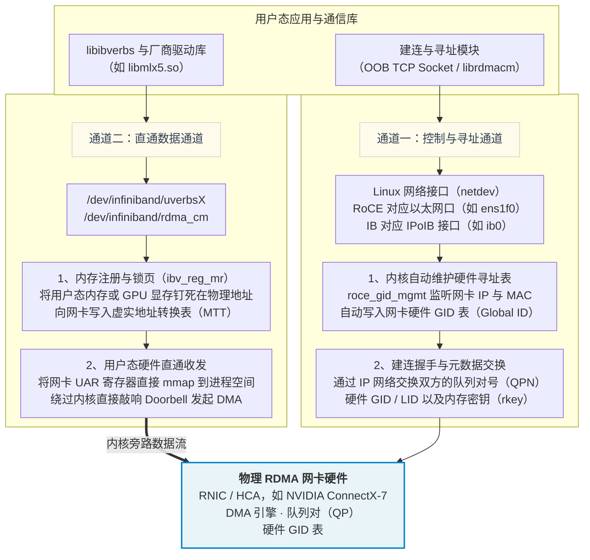

如上图所示，这两条通道各自承担着不可替代的职责：

1. **通道一：控制与寻址通道（依赖`Linux`网络接口`netdev`与`IP`地址）**
   - **建连握手（`OOB`或`rdma_cm`）**：数据传输前，通信双方需先通过常规`IP`网络（带外`TCP Socket`或`rdma_cm`）交换各自的队列对编号（`QPN`）、端口寻址标识（`LID`/`GID`）及远端内存访问密钥（`rkey`）。
   - **硬件`GID`寻址表映射**：在`RoCEv2`中，内核`roce_gid_mgmt`模块会实时监听`RDMA`设备（如`mlx5_0`）关联的网络接口（如`ens1f0`），将其`IP`与`MAC`地址编码为`128`位全局标识符（**`GID`**）写入网卡**硬件`GID`表**，供网卡硬件在内核旁路发送时直接封装`UDP/IP`报文头。
2. **通道二：直通数据通道（依赖`/dev/infiniband/*`字符设备与内存锁定）**
   - **硬件上下文与内存锁页**：用户态程序通过`libibverbs`打开`/dev/infiniband/uverbsX`创建队列对（`QP`），并调用`ibv_reg_mr()`将通信内存或`GPU`显存钉死（`Pin`/`Lock`）在物理地址上，防止`DMA`期间发生内核换页（`Swap`），同时向网卡写入虚实地址映射表。
   - **用户态硬件直通收发**：内核驱动将网卡硬件门铃寄存器（`UAR`）通过`mmap`直接映射到进程虚拟地址空间；应用发送数据时无需发起系统调用或陷入内核，直接写入工作请求并敲响门铃（`Doorbell`）即可触发硬件`DMA`收发。

### 标准Kubernetes容器环境面临的四道隔离高墙

理解了上述“双通道模型”后，我们再来看当一个应用被放进标准的`Kubernetes Pod`中时，会发生什么。

为了保障多租户安全与资源隔离，`Kubernetes`与底层容器运行时（如`containerd`）默认使用`Linux Namespace`、`Cgroups`和`Capabilities`机制为每个`Pod`构建了一个严密的“沙箱”。在普通的微服务场景下，这套沙箱完美运作；但对于需要同时打通“控制寻址通道”与“直通数据通道”的`RDMA`应用而言，**默认的容器沙箱恰恰竖起了四道高墙，将两条通道彻底截断**：

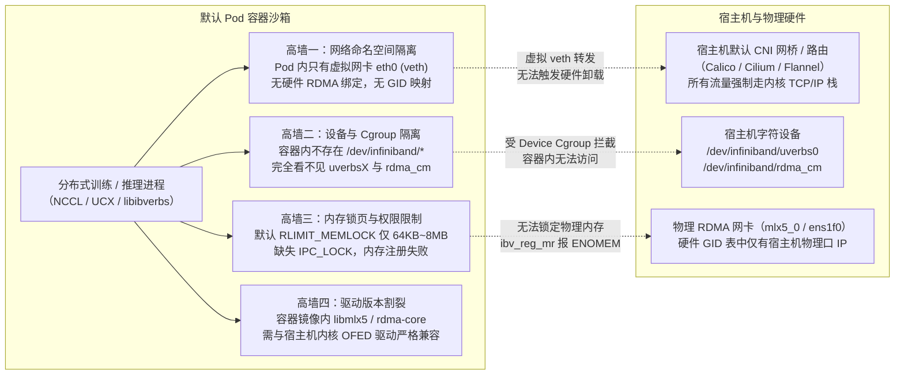

我们可以逐一拆解这四道隔离高墙带来的具体阻碍：

| 隔离维度 | `Kubernetes`默认行为 | 对`RDMA`通信造成的核心阻碍 | 需要引入的云原生解决思路 |
| :--- | :--- | :--- | :--- |
| **高墙一：网络命名空间（`NetNS`）与`CNI`虚拟化** | `Calico`、`Cilium`等默认`CNI`插件通过纯软件虚拟的`veth pair`连接`Pod`与宿主机，数据包必须经过宿主机内核协议栈路由或`Overlay`隧道封装 | 虚拟网卡`veth`背后没有绑定任何`RDMA`硬件加速引擎；宿主机物理`RDMA`网卡的硬件`GID`表中也没有`Pod`的`IP`地址，导致**通道一（寻址与`GID`映射）彻底失效** | 引入`Multus CNI`多网络平面，配合`SR-IOV`、`Macvlan`、`IPoIB`或`Host-Device`插件，将具备硬件`RDMA`关联能力的网络接口直接送入`Pod NetNS` |
| **高墙二：设备文件隔离与`Device Cgroup`拦截** | 容器运行时默认只向容器内挂载`/dev/null`、`/dev/random`等基础虚拟设备，`Device Cgroup`禁止非特权容器访问宿主机硬件设备节点 | 容器内根本不存在`/dev/infiniband/uverbsX`和`/dev/infiniband/rdma_cm`设备文件，`ibv_get_device_list()`返回空列表，导致**通道二（直通数据通道）无法打开** | 引入`Kubernetes Device Plugin`（如`RDMA Shared Device Plugin`或`SR-IOV Device Plugin`）及`CDI`机制，按需将指定的`/dev/infiniband/*`安全挂载进容器 |
| **高墙三：锁页内存配额（`MEMLOCK`）与能力裁剪** | `containerd`默认将容器进程的`RLIMIT_MEMLOCK`（最大可锁定物理内存）限制为`64KB`或`8MB`，且默认剥夺`CAP_IPC_LOCK`内核特权能力 | `RDMA`注册数百`MB`至数十`GB`通信缓冲区或显存时，`ibv_reg_mr()`因无法锁定物理内存而直接报错`ENOMEM`（`Cannot allocate memory`） | 调整宿主机`containerd`的`LimitMEMLOCK`与`base_runtime_spec`基础运行时规范，并为容器按需配置`IPC_LOCK`安全上下文 |
| **高墙四：驱动栈跨容器边界分裂（`Split Driver`）** | 容器仅打包用户态文件系统，共享宿主机`Linux`内核，不具备独立内核模块加载能力 | `RDMA`依赖**容器内的用户态驱动库**（`libibverbs`、`libmlx5`）与**宿主机内核态驱动模块**（`mlx5_core`、`mlx5_ib`、`nvidia-peermem`）直接通信，版本或接口不匹配将导致通信异常 | 通过`NVIDIA Network Operator`统一纳管宿主机`DOCA-OFED`内核驱动生命周期，并规范业务容器镜像内的`rdma-core`/`MOFED`用户态库版本 |

看清了这四道高墙，接下来我们解决问题的脉络就变得异常清晰：**只要我们自底向上依次拆掉这四道阻碍——配齐内核驱动与命名空间模式、打通`RDMA`网络接口与设备文件挂载、理顺`RoCE`/`IB`协议寻址、放开容器运行时内存锁页限制，`Pod`之间的`RDMA`通信就能水到渠成**。

## 驱动与内核底座：打通跨容器边界的软硬件协同


在动手配置`Kubernetes`网络插件之前，首先必须确保宿主机操作系统内核与容器镜像内部的驱动底座能够无缝咬合。如果底层驱动与内核模式没有配对，上层网络插件无论如何编排都无法生效。

### RDMA“用户态+内核态”分离式驱动架构

为什么我们常说`RDMA`的驱动管理比普通以太网卡复杂得多？

普通`TCP/IP`网卡的数据包收发全部在操作系统内核中完成，容器里的应用程序只需要调用标准的`POSIX Socket API`（如`send()`、`recv()`），容器镜像里根本不需要安装任何网卡厂商的专用驱动。但`RDMA`为了实现“内核旁路（`Kernel Bypass`）”，让容器内的用户态进程能够直接操作网卡硬件上的队列寄存器（`QP`/`CQ`/`Doorbell`），就必须在**容器用户态**也植入一套了解网卡硬件寄存器布局的专用驱动库。

这就构成了`RDMA`标志性的**分离式驱动架构（`Split Driver Model`）**：

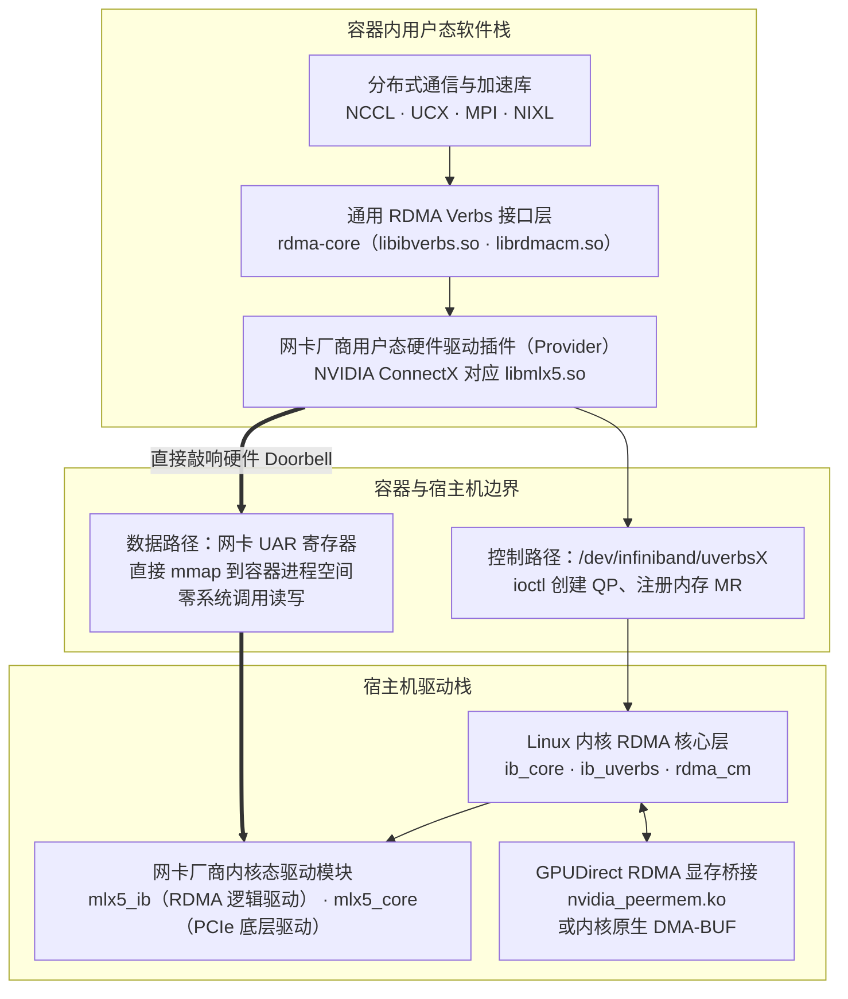

在云原生环境下维护这套分离式驱动，需要重点把握以下三个工程原则：

1. **用户态驱动库直接预装在容器镜像内，无需从宿主机挂载**：
   不同于`NVIDIA GPU`需要将宿主机`libcuda.so`挂载进容器以严格对齐驱动版本，`Linux`内核`RDMA`子系统（`ib_uverbs`）在用户态`rdma-core`与内核驱动之间提供了**向后兼容的稳定二进制接口（`ABI`）**。因此，只需在业务镜像中预装用户态驱动库（如`rdma-core`、`libibverbs1`、`ibverbs-providers`、`librdmacm1`），运行时仅将`/dev/infiniband/*`字符设备挂载进容器即可。
2. **宿主机内核驱动选型与容器化托管**：
   以主流的`NVIDIA ConnectX`系列网卡为例，宿主机可使用高版本`Linux`内核自带的开源驱动（`Inbox Driver`），但生产集群通常推荐使用包含完整硬件卸载特性与`nvidia-peermem`模块的 **`NVIDIA DOCA-OFED`** （原`MLNX_OFED`）驱动栈。在`Kubernetes`中，可通过`NVIDIA Network Operator`以特权驱动容器（`ofedDriver DaemonSet`）的形式自动完成节点驱动加载与版本管理。
3. **宿主机必须加载的核心内核模块清单**：
   宿主机需确保以下内核模块已正常加载（可通过`lsmod | grep -E "mlx5|ib_|rdma"`核查）：

| 内核模块名称 | 所属层级 | 核心功能说明 |
| :--- | :--- | :--- |
| `mlx5_core`/`mlx5_ib` | 厂商硬件驱动层 | `NVIDIA ConnectX`系列网卡的底层`PCIe`驱动与`InfiniBand`/`RoCE`核心逻辑驱动 |
| `ib_core` | 内核`RDMA`核心层 | 提供`RDMA`设备注册、`GID`表管理（`roce_gid_mgmt`）及内核通用`Verbs`抽象 |
| `ib_uverbs` | 用户态直通接口层 | 负责在`/dev/infiniband/`下生成`uverbsX`字符设备，处理容器内`libibverbs`的控制指令 |
| `rdma_cm`/`rdma_ucm` | 连接管理层 | 提供与协议无关的`RDMA`建连管理，并暴露`/dev/infiniband/rdma_cm`供用户态调用 |
| `ib_umad` | 子网管理报文层 | 暴露`/dev/infiniband/umadX`，供`InfiniBand`诊断工具与子网管理代理收发管理报文（`MAD`） |
| `ib_ipoib` | `IB`网络适配层 | 在`InfiniBand`场景下提供`IP over InfiniBand`能力，将`IB`端口封装为标准网络接口（如`ib0`） |
| `nvidia_peermem` | 异构显存直通层 | 打通`NVIDIA GPU`驱动与`ib_core`的`PeerDirect`接口，支撑传统模式的`GPUDirect RDMA` |

### 内核RDMA子系统的两种命名空间模式：shared与exclusive

当宿主机上跑起多个`Pod`时，`Linux`内核中的`RDMA`设备（如`mlx5_0`、`mlx5_1`）应该如何与各个`Pod`独立的 **网络命名空间（`Network Namespace`，简称`netns`）** 打交道？

自`Linux Kernel 5.2`起，内核`RDMA`子系统专门引入了网络命名空间隔离机制，允许通过`iproute2`工具包中的`rdma`命令查看和切换全局工作模式：

```bash
# 查看当前宿主机 RDMA 子系统的网络命名空间模式
rdma system show
# 输出示例：netns shared （默认值为 shared，可切换为 exclusive）
```

**`shared`（共享模式）** 与 **`exclusive`（独占模式）** 直接决定了上层`Kubernetes`网络插件与设备插件的架构选型，理解两者的底层差异至关重要：

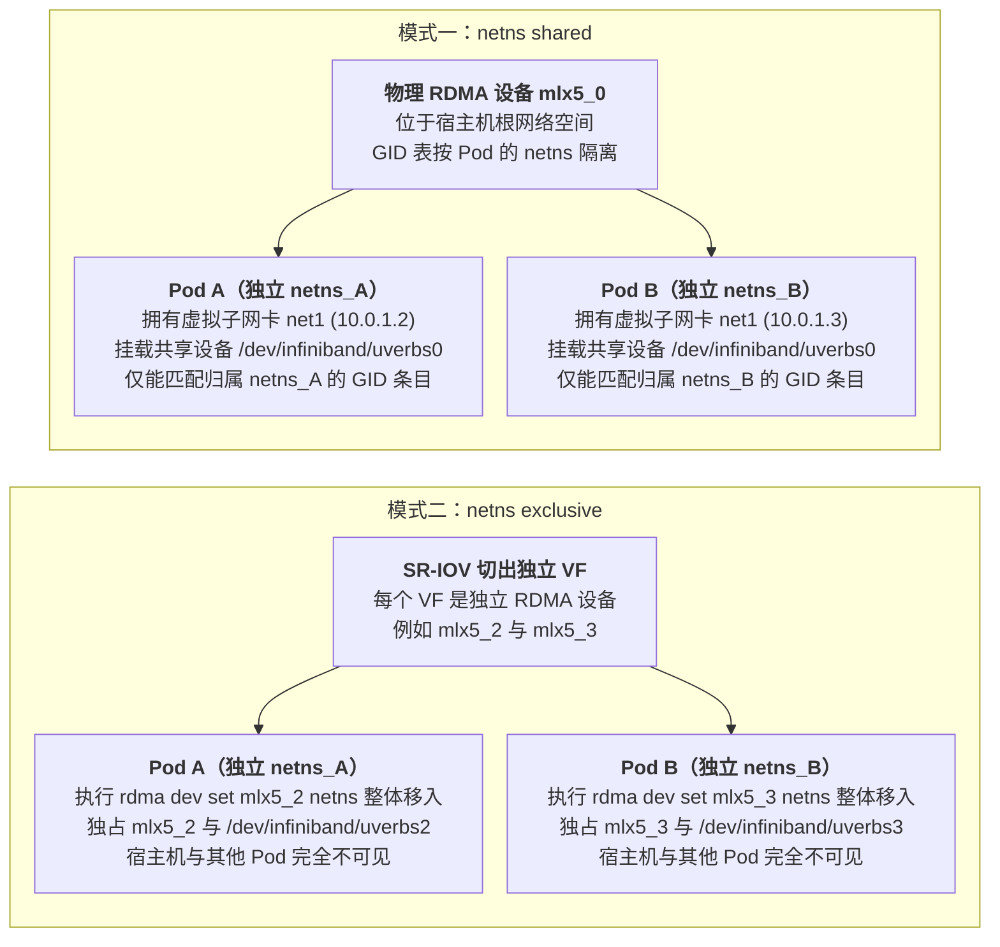

两种模式的核心运行机制与对比如下表所示：

| 对比维度 | `shared`共享模式（`rdma system set netns shared`） | `exclusive`独占模式（`rdma system set netns exclusive`） |
| :--- | :--- | :--- |
| **底层可见性机制** | 所有的`RDMA`设备（`mlx5_0`等）在所有网络命名空间中**全局可见**。多个`Pod`可以同时打开同一个`/dev/infiniband/uverbs0`字符设备 | 每个`RDMA`设备在同一时刻**只能存在于某一个特定的网络命名空间中**。当把`mlx5_2`移入`Pod A`的`netns`后，宿主机和`Pod B`中将彻底看不到`mlx5_2` |
| **多`Pod`寻址如何隔离** | 虽然共享`mlx5_0`，但每个`Pod`拥有独立的虚拟子接口（如`Macvlan`或`IPoIB`子接口）。内核`roce_gid_mgmt`在往`mlx5_0`硬件`GID`表写条目时，会记录该条目所属的`Pod netns`，确保`Pod A`只使用自己的`IP/GID`发包 | 每个`Pod`独占一个独立的`RDMA`设备（通常是`SR-IOV`切分出的`VF`虚拟网卡，或整张物理卡），各自拥有完全物理隔离的硬件`GID`表和硬件队列 |
| **匹配的云原生插件组合** | `Macvlan CNI`、`IPVLAN CNI`或`IPoIB CNI`配合 **`RDMA Shared Device Plugin`** | `SR-IOV CNI`、`IB-SRIOV CNI`或`Host-Device CNI`配合 **`SR-IOV Network Device Plugin`** |
| **核心优势与局限** | **优势**：无需开启硬件`SR-IOV`，单张物理网卡即可供数十个`Pod`并发共享，部署极简。<br/>**局限**：共享同一个`uverbs`字符设备，硬件级故障隔离与安全边界弱于独占模式 | **优势**：最强安全性与硬件级`QoS`隔离，`Pod`内看到的设备视图与独占裸机完全一致。<br/>**局限**：`Pod`并发数受限于物理网卡或硬件`VF`数量；切换模式时要求当前无活跃自定义`netns` |

### GPUDirect RDMA的内核桥梁：nvidia-peermem与DMA-BUF

在`AI`大模型集群中，单节点内（或多节点`NVLink`域内）的`GPU`间通信优先走带宽更高、延迟更低的`NVLink`/`NVSwitch`高速互联；而当跨节点`Pod`之间无法通过`NVLink`直连、必须借助`RDMA`网络通信时，核心优化目标是让`RDMA`网卡通过`PCIe`总线直接读写`GPU`显存（即 **`GPUDirect RDMA`** ，简称`GDR`），从而省去“显存↔宿主机内存”之间的两次多余拷贝。

:::info 延伸阅读
如果对`GPUDirect`的数据路径、它和普通`RDMA`的差别，以及`P2P`、`NVLink`、`NVSwitch`各自解决哪一段通信感兴趣，想再看细一些，可以查看我之前的文章：[GPU Direct通信技术](../300-NVIDIA/4250-GPU%20Direct通信技术.md)。
:::

要让容器内的通信库（如`NCCL`）在调用`RDMA`接口时能够直接注册`GPU`显存地址，宿主机内核必须提供一座连接`NVIDIA GPU`驱动与`RDMA`驱动的桥梁。目前业界存在两代并行的实现机制：

1. **传统`PeerDirect`桥接模块（`nvidia-peermem`）**：
   目前生产环境最常用的方案。宿主机加载`nvidia_peermem.ko`模块后，会在内核`RDMA`核心层（`ib_core`）与`NVIDIA GPU`驱动之间建立桥接：当容器内的`NCCL`调用`ibv_reg_mr()`注册显存地址时，`ib_core`通过`nvidia-peermem`直接获取该显存对应的`PCIe BAR1`物理地址并写入网卡硬件映射表。
2. **现代内核原生`DMA-BUF`机制（`Linux 5.12+`、`CUDA 11.7+`）**：
   无需依赖专有的`nvidia-peermem`桥接模块，但要求宿主机使用开源版`GPU`内核驱动（`nvidia-open`）。容器内的`CUDA`与`NCCL`将`GPU`显存导出为标准的`Linux dma-buf`文件描述符，直接通过`ibv_reg_dmabuf_mr()`交由内核标准接口完成跨设备`PCIe P2P`映射。

> **工程避坑提示**：在`Kubernetes`节点上，如果只打通了`Pod`间的普通主机内存`RDMA`，但宿主机未加载`nvidia_peermem`（或未启用开源`GPU`驱动的`DMA-BUF`支持），`NCCL`并不会报错停止，而是会悄悄回退到“先把数据从`GPU`显存经`PCIe`拷回宿主机`CPU`内存，再由`RDMA`网卡从`CPU`内存发出”的降级路径，导致跨机多卡通信带宽暴跌`50%`以上。

## 网络与设备插件层：云原生Pod间RDMA的四大主流架构


打通了底层驱动与内核命名空间模式后，我们来到云原生架构设计中最核心的一环：**如何让处于隔离沙箱中的`Pod`既能正常接入`Kubernetes`集群的业务管理网络，又能同时打通前文所述的“控制寻址通道（网络接口`netdev`）”与“直通数据通道（字符设备`/dev/infiniband/*`）”**？

### 为什么云原生RDMA普遍采用“双平面多网卡”架构

在生产级智算集群中，几乎所有服务器都配备了两套物理上完全独立的网络：一套是千兆或万兆的**通用管理/存储以太网**，另一套是`100Gbps`/`200Gbps`/`400Gbps`的**高速参数交换网络（`InfiniBand`或`RoCEv2`专网）**。

与之对应，运行在`Kubernetes`中的`AI`训练或推理`Pod`也需要同时接入这两套网络，这就催生了云原生高性能计算的事实标准——**基于`Multus CNI`与`Device Plugin`的双平面多网卡（`Multi-Homing`）架构**：

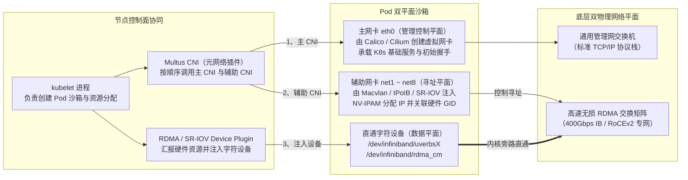

:::info 延伸阅读
如果对默认`Pod`网络为什么带不动训练流量，以及`Flannel`、`Calico`、`Cilium`和几类高性能方案如何取舍感兴趣，想再看细一些，可以查看我之前的文章：[云原生 Kubernetes 大模型训练集群 CNI 组件选型调研](./4000-云原生K8S大模型训练集群CNI组件选型调研.md)。
:::

在这套双平面架构中，四大核心云原生组件各司其职，缺一不可：

1. **默认主网络插件（`Calico`/`Cilium`/`Flannel`）——负责`eth0`管理平面**：
   为`Pod`创建默认虚拟网卡`eth0`并保留默认路由，承载健康检查探针、`CoreDNS`解析、监控指标抓取以及分布式训练初始会合（`Rendezvous`）流量，避免管理流量干扰高速训练专网。
2. **多网络编排元插件（`Multus CNI`）——负责注入高速辅助网卡**：
   作为编排插件（`Meta-Plugin`），在默认`CNI`创建完`eth0`后，根据`Pod`的`k8s.v1.cni.cncf.io/networks`注解查找对应的`NetworkAttachmentDefinition`（`NAD`），调用辅助`CNI`插件（`Macvlan`、`IPoIB`、`SR-IOV`或`Host-Device`）将关联物理`RDMA`的接口`net1`（多卡节点常为`net1`~`net8`）注入`Pod`网络命名空间。
3. **高性能专网地址管理插件（`NV-IPAM`或`Whereabouts`）——负责分配`RDMA`网段`IP`**：
   为`Pod`内的`net1`分配独立专网`IP`以生成硬件`GID`并完成建连握手。大规模集群推荐使用`NVIDIA`开源的 **`NV-IPAM`** ，它通过“控制器按节点预分块+本机无锁分配”机制替代传统`Whereabouts`的分布式锁，支持高并发秒级分配与多轨道（`Multi-Rail`）子网规划。
4. **硬件设备插件（`Device Plugin`与`CDI`）——负责上报配额与挂载`/dev/infiniband/*`**：
   弥补`CNI`插件无法操作容器设备白名单的边界。通过节点上的`k8s-rdma-shared-dev-plugin`或`sriov-network-device-plugin`向`kubelet`上报`RDMA`可调度资源（如`rdma/rdma_shared_device_a`），并在容器启动时将对应的`/dev/infiniband/uverbsX`和`rdma_cm`安全注入容器。

:::info 延伸阅读
如果对`Device Plugin`向`kubelet`注册、`ListAndWatch`与`Allocate`的机制感兴趣，想再看细一些，可以查看我之前的文章：[Kubernetes Device Plugin](../../../2000-云原生/200-Kubernetes/2000-Decvice%20Plugin.md)。
:::

### 四大云原生Pod间RDMA通信方案深度拆解

明确了组件分工后，在实际搭建集群时，辅助`CNI`插件与`Device Plugin`究竟该如何组合？根据业务对**多租户隔离强度、单卡多`Pod`共享能力以及硬件`SR-IOV`依赖程度**的不同需求，业界演进出了四种主流实现方案。下面按由共享到独占的架构演进顺序逐一剖析。

:::info 延伸阅读
如果对`Multus`、`SR-IOV Network Device Plugin`、`SR-IOV CNI`、地址分配，以及共享`HCA`与独占`VF`的对比感兴趣，想再看细一些，可以查看我之前的文章：[云原生Kubernetes训练集群Multus、SR-IOV与RDMA技术方案](./5000-云原生K8S训练集群Multus-SR-IOV-RDMA技术方案.md)。
:::

#### 方案一：宿主机网络直通方案（HostNetwork与RDMA Shared Device Plugin）

这是最简单、最原始的过渡方案。在`Pod`的声明配置中直接开启`hostNetwork: true`，此时`Pod`不再创建独立的网络命名空间，而是直接复用宿主机的根网络命名空间（`Host NetNS`）。

- **工作机制**：因为直接处于宿主机网络命名空间中，`Pod`内天生就能看到宿主机上的所有物理`RoCE`网卡（如`ens1f0`）或`InfiniBand`网卡（如`ib0`），完全不需要`Multus CNI`和`IPAM`插件参与。只需部署`k8s-rdma-shared-dev-plugin`（或粗暴开启`privileged: true`特权模式），将`/dev/infiniband/*`字符设备挂载进容器，`Pod`就能以宿主机物理网卡的`IP`地址发起`RDMA`通信。
- **适用场景与致命局限**：该方案配置成本极低，在单租户独占整机（例如一个训练`Pod`直接申请整台节点的全部`8`张`GPU`和`8`张`RDMA`网卡）的早期集群中较为常见。但它的弊端极其明显：**完全丧失了容器网络隔离性**，同一节点上如果调度两个属于不同任务的`Pod`极易发生**端口冲突**；同时`Pod IP`与宿主机`IP`混为一谈，破坏了`Kubernetes`的网络安全策略（`NetworkPolicy`）与服务治理体系。

#### 方案二：基于共享模式的虚拟子接口方案（Macvlan/IPVLAN/IPoIB与RDMA Shared Device Plugin）

如果希望每个`Pod`拥有独立的网络命名空间和专属`IP`地址，同时允许**同一台节点上的多个`Pod`共享同一张物理`RDMA`网卡**（且不需要在主板`BIOS`和网卡固件中折腾复杂的`SR-IOV`硬件虚拟化），那么方案二就是目前云原生环境下性价比最高、应用最广泛的架构。

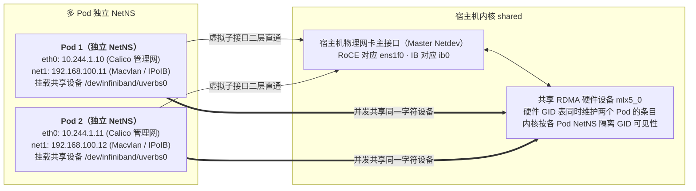

- **工作机制**：
  1. 宿主机内核保持默认的`rdma system set netns shared`共享模式。
  2. **针对`RoCEv2`以太网环境**：通过`Multus`调用 **`Macvlan CNI`**（或`IPVLAN L2`）。`Macvlan`会在宿主机物理`RoCE`网口（如`ens1f0`）上派生出一个拥有独立`MAC`地址的轻量级虚拟子接口（`net1`），将其移入`Pod`的独立`netns`并赋予专属`IP`。由于`Macvlan`子接口在内核设备树中直接挂载于物理网卡`ens1f0`之下，内核`roce_gid_mgmt`模块会自动识别该子接口的`IP`与`MAC`，并在底层`mlx5_0`网卡的硬件`GID`表中为该`Pod`生成专属的`RoCEv2 GID`条目。
  3. **针对`InfiniBand`环境**：由于`InfiniBand`链路层没有以太网`MAC`地址概念，不能使用`Macvlan`，此时只需将辅助插件替换为 **`IPoIB CNI`（`ipoib-cni`）**。它会在宿主机`ib0`接口上创建出`IPoIB`虚拟子接口并移入`Pod netns`，实现完全相同的共享效果。
  4. 与此同时，**`RDMA Shared Device Plugin`** 将宿主机的`/dev/infiniband/uverbs0`和`rdma_cm`同时挂载给这两个`Pod`。默认情况下，该插件会在单张网卡上虚拟出`63`个可分配资源配额（`hcaHandles`），最多允许`63`个`Pod`并发共享同一张物理`RDMA`网卡。
- **适用场景与优缺点**：非常适合单机只有`1~2`张高速网卡但需要运行多个微调/推理`Pod`、或者切分`GPU`（如`MIG`/单卡`Pod`）共享网络的场景。缺点在于多个`Pod`底层共享同一个硬件`HCA`上下文与`uverbs`设备，无法在网卡硬件层面限制单个`Pod`消耗的队列对（`QP`）数量或精确隔离硬件级`QoS`带宽。

#### 方案三：基于硬件虚拟化的SR-IOV独占方案（SR-IOV CNI/IB-SRIOV CNI与SR-IOV Device Plugin）

在多租户公有云、智算云平台或对安全性与性能隔离有严苛要求的生产集群中，不同租户的`Pod`绝不能共享同一个`/dev/infiniband/uverbs0`字符设备。此时就需要启用网卡的硬件级虚拟化技术——**`SR-IOV`（`Single Root I/O Virtualization`，单根`I/O`虚拟化）**。

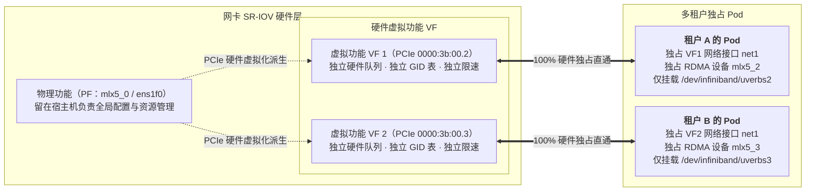

- **工作机制**：
  1. 在服务器`BIOS`中开启`VT-d`/`AMD-Vi`与`SR-IOV`支持后，通过网卡驱动或`SR-IOV Network Operator`将一张物理网卡（物理功能`PF`，如`mlx5_0`）在`PCIe`硬件层面切分成多个**虚拟功能网卡（`VF`，`Virtual Function`）**。
  2. 每个`VF`在`Linux`内核看来都是一张拥有独立`PCIe`总线地址（如`0000:3b:00.2`）、独立网络接口（如`ens1f0v0`）以及 **独立`RDMA`设备实例（如`mlx5_2`、对应`/dev/infiniband/uverbs2`）** 的完整网卡。
  3. 当`Pod`被调度到节点上时，**`SR-IOV Network Device Plugin`** 从空闲池中挑出一个`VF`分配给该`Pod`，仅将该`VF`专属的`/dev/infiniband/uverbs2`挂载进容器；同时`Multus`调用 **`SR-IOV CNI`** （`RoCE`场景）或 **`IB-SRIOV CNI`** （`InfiniBand`场景），将该`VF`的网络接口直接移入`Pod`的`netns`。若宿主机开启了`rdma system set netns exclusive`独占模式，连同`mlx5_2`这个`RDMA`设备本身也会被彻底移入`Pod`命名空间，实现与宿主机及其他租户的`100%`物理级隔离。
- **适用场景与优缺点**：不仅性能逼近裸金属，而且支持在硬件层面为每个`Pod`（`VF`）单独配置`VLAN`（`RoCE`场景）、`PKey`分区（`IB`场景）以及最小/最大带宽保证（`QoS Rate Limiting`），是多租户智算云的标配方案。其代价是需要维护`BIOS`与网卡固件的`SR-IOV`配置，且在结合`GPUDirect RDMA`时需要重点处理`PCIe ACS`与`IOMMU`透传配置。

#### 方案四：物理网卡整卡直通与轨道优化方案（Host-Device CNI与Device Plugin）

在当前最主流的千卡/万卡大模型预训练集群中，单台计算节点普遍采用类似`NVIDIA HGX H100/H200`的 **`8 GPU + 8 RDMA NIC`（一卡配一网）轨道优化（`Rail-Optimized`）架构**。在这种场景下，一张物理`400Gbps`网卡本身就只服务于紧挨着它的那`1`张`GPU`，根本不需要用`SR-IOV`切分给多个`Pod`共享，但团队又不想使用破坏网络隔离的`hostNetwork: true`。

- **工作机制**：此时可以采用`CNI`官方标准插件中的 **`Host-Device CNI`** （在`NVIDIA Network Operator`中对应`HostDeviceNetwork CRD`）配合`sriov-network-device-plugin`（将物理`PF`作为整卡资源上报）。当`Pod`启动时，`Host-Device CNI`会直接把宿主机上的**物理网卡主接口（如`ens1f0`）连根拔起，整体移入`Pod`的网络命名空间中**；当`Pod`销毁时，再自动将该物理网卡移回宿主机根命名空间。
- **适用场景与优缺点**：既有独立`Pod NetNS`的干净隔离，又彻底省去了`SR-IOV`虚拟化层或`Macvlan`子接口转发层，是整机`8`卡训练或按“`1卡GPU+1张物理网卡`”整数倍切分算力时的极致性能方案。注意一旦物理网卡被移入`Pod`，宿主机上基于该网口的监控脚本将暂时看不到该接口，直到`Pod`退出。

### 四大云原生RDMA网络架构全景对比

为了便于架构师在实际项目中按需选型，我们将上述四种方案的核心技术指标汇总对比如下：

| 评估维度 | 方案一：`HostNetwork`直通 | 方案二：`Macvlan`/`IPoIB`共享 | 方案三：`SR-IOV`硬件虚拟化 | 方案四：`Host-Device`整卡独占 |
| :--- | :--- | :--- | :--- | :--- |
| **`Pod`网络命名空间** | 与宿主机共享（无隔离） | 独立`Pod NetNS` | 独立`Pod NetNS` | 独立`Pod NetNS` |
| **内核`RDMA`模式** | `shared` | `shared` | `exclusive`（推荐）或`shared` | `exclusive`或`shared` |
| **辅助`CNI`插件** | 无需辅助`CNI` | `macvlan`、`ipvlan`或`ipoib` | `sriov-cni`或`ib-sriov-cni` | `host-device` |
| **设备插件（`Device Plugin`）** | `k8s-rdma-shared-dev-plugin` | `k8s-rdma-shared-dev-plugin` | `sriov-network-device-plugin` | `sriov-network-device-plugin` |
| **单张物理网卡多`Pod`共享** | 支持（共享宿主机`IP`） | **支持**（每个`Pod`独立`IP`） | **支持**（每个`Pod`独占一个硬件`VF`） | **不支持**（单`Pod`独占整张物理卡） |
| **硬件级安全与`QoS`隔离** | 无 | 弱（共享同一`uverbs`设备） | **极强**（独立`uverbs`、`VLAN`/`PKey`、限速） | **极强**（物理整卡独占） |
| **是否需要开启硬件`SR-IOV`** | 否 | **否** | **是**（需`BIOS`与固件开启`VF`） | 否 |
| **典型生产适用场景** | 早期单租户整机独占训练、快速概念验证（`PoC`） | 推理服务、微调任务、少网卡节点的多`Pod`共享集群 | 多租户智算云平台、需要严格安全隔离与带宽保障的集群 | `8GPU+8NIC`轨道路由（`Rail-Optimized`）大规模分布式训练集群 |

## 协议差异深潜：RoCEv2与InfiniBand在Pod通信中的底层机制


虽然在上层应用看来，无论是`RoCEv2`还是`InfiniBand`，容器里的`NCCL`或`UCX`调用的都是同一套`libibverbs`接口；但在底层链路层与控制平面上，`RoCEv2`构建于**分布式以太网与`UDP/IP`**之上，而`InfiniBand`构建于**集中式子网管理器（`SM`）与原生`IB`链路层**之上。这种基因差异导致两者在`Kubernetes Pod`通信时的寻址、隔离与调优细节截然不同。

:::info 延伸阅读
如果对`InfiniBand`与`RoCE`在无损传输、拥塞控制和组网形态上的差别感兴趣，想再看细一些，可以查看我之前的文章：[RDMA: InfiniBand vs RoCE](./2000-RDMA:%20InfiniBand%20vs%20RoCE.md)。
:::

### RoCEv2在Pod间的通信链路与核心工程细节

#### 从Pod IP到网卡硬件GID表的动态映射全流程

在前面讲“双通道模型”时我们提到，`RoCEv2`网卡硬件在发送数据包时，必须查阅内部的硬件`GID`（`Global Identifier`）表来填充`UDP/IP`和以太网`MAC`报文头。那么，在采用`Macvlan`或`SR-IOV`的云原生环境下，一个刚刚由`Kubernetes`动态分配给`Pod`的`IP`地址，究竟是如何一步步变成网卡硬件寄存器里的`GID`条目，并被容器内的`NCCL`准确选中的呢？

其底层完整闭环如下图所示：

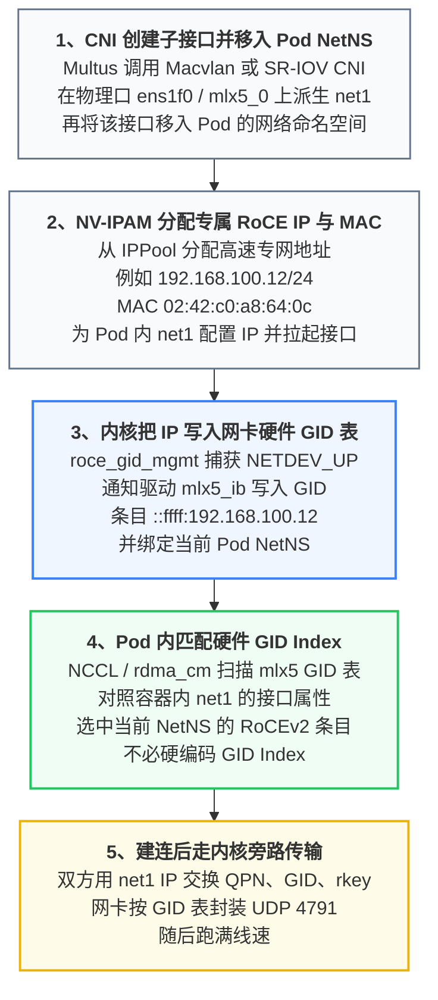

理解了这条链路，我们就能立刻明白在`Kubernetes`下部署`RoCEv2`时最容易踩坑的三个核心工程细节：

1. **共享模式下切勿硬编码`NCCL_IB_GID_INDEX=3`**：
   裸机或独占模式（`SR-IOV exclusive`/`Host-Device`）下网卡拥有独立`GID`表，`IPv4 RoCEv2 GID`固定在`Index 3`。但在`Macvlan`多`Pod`共享网卡模式下，内核会在同一张物理网卡的硬件`GID`表中按`Pod`创建顺序动态追加条目（如`Index 5`、`Index 7`）。此时切勿硬编码`NCCL_IB_GID_INDEX=3`，应交由`rdma_cm`或`NCCL`根据当前`Pod NetNS`内的网卡自动匹配对应的`RoCEv2 GID Index`。
2. **容器内无损流控优先级（`PFC`/`DSCP`）透传**：
   `RoCEv2`依赖无损以太网（`PFC`与`ECN`/`DCQCN`），且数据面绕过内核协议栈，宿主机`tc`/`iptables`打标对其无效。除在宿主机网卡配置`Trust DSCP`与`cma_roce_tos`外，还需在`Pod`内注入`NCCL_IB_TC`（如`106`，对应`DSCP 26`）和`NCCL_IB_SL`（如`3`）环境变量，让网卡硬件封装报文时直接打上匹配交换机无损队列的标签。
3. **多网卡同子网下的`ARP`串扰（`ARP Flux`）防护**：
   单节点存在多张同子网`RoCE`网卡或多个`Macvlan`接口时，`Linux`默认弱主机模型会导致跨网卡代答`ARP`，造成源`MAC`与`GID`错配并引发传输超时（`transport retry counter exceeded`）。需在宿主机及容器网络中配置`sysctl`参数：`net.ipv4.conf.all.arp_ignore=2`、`net.ipv4.conf.all.arp_announce=2`及`net.ipv4.conf.all.rp_filter=0`。

### InfiniBand在Pod间的通信链路与分区隔离机制

与`RoCEv2`相比，原生`InfiniBand`（`IB`）网络有着完全不同的寻址与管理逻辑：它天然具备基于信用（`Credit-Based`）的链路层无损流控，不需要配置复杂的`PFC`/`ECN`；它的二层转发不看以太网`MAC`地址，而是看由集中式**子网管理器（`Subnet Manager`，简称`SM`，如`OpenSM`或商业版`NVIDIA UFM`）**统一分配的`16`位本地标识符（**`LID`**），设备的唯一身份标识则是`64`位的全局唯一标识符（**`GUID`**）。

那么，当我们将`InfiniBand`引入`Kubernetes Pod`时，需要重点解决哪两个核心问题？

#### 为什么InfiniBand下的Pod仍然需要配置IPoIB分配IP地址

很多初次接触`InfiniBand`容器化的工程师都会困惑：“既然`InfiniBand`交换机是根据`LID`转发`RDMA`数据包的，根本不用`IP`协议，那为什么在`Kubernetes`里还要用`ipoib-cni`或`ib-sriov-cni`配合`NV-IPAM`给每个`Pod`的`IB`网口分配一个`IP`地址？”

原因就在于前文所述的 **“通道一（建连握手）”** ：

1. 当两个`Pod`准备通过原生`InfiniBand Verbs`建立高速队列对（`QP`）连接之前，它们必须先通过一个可达的通信渠道交换彼此的`LID`、`QP Number`、`GUID`等元数据。
2. 无论是`rdma_cm`连接管理器，还是`NCCL`/`UCX`/`MPI`的带外引导（`OOB Bootstrap`），都是基于标准的`IP`地址来寻址对端并完成初始握手的。
3. **`IPoIB`（`IP over InfiniBand`）**正是`Linux`内核（`ib_ipoib`模块）提供的一层封装适配层：它在`InfiniBand`硬件端口之上虚拟出一个标准的`Linux`网络接口（如`ib0`），使得标准的`TCP/IP`协议能够跑在`InfiniBand`物理链路上。一旦双方`Pod`通过`IPoIB`接口的`IP`地址完成了毫秒级的建连握手，后续真正的大规模张量数据传输就会立刻切换到**不经过`IPoIB`、不经过内核的纯原生`InfiniBand RDMA Verbs`通道**，跑满`400Gbps`线速。

#### InfiniBand下的两种容器网络模式：IPoIB共享与IB-SRIOV动态分区

在`Kubernetes`集群中落地`InfiniBand`，同样对应着“共享”与“硬件虚拟化独占”两条技术路线，但其中的底层协同逻辑与`RoCE`有显著区别：

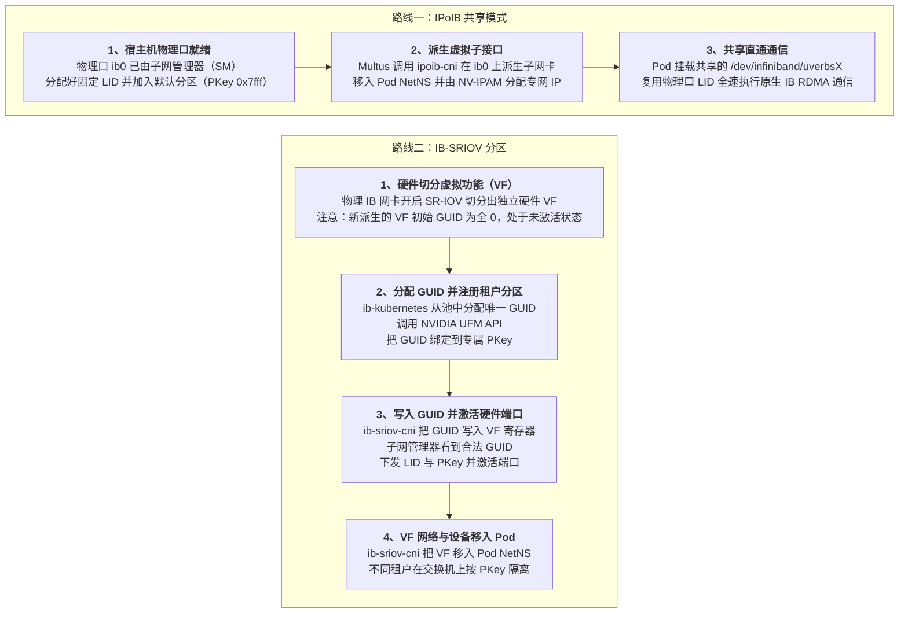

如上图所示，在选型`InfiniBand`方案时需特别注意以下核心事实：

- **路线一（`IPoIB CNI`共享模式）**：在企业内部自建的大模型训练集群（单租户或内部多团队共享）中，最省心、最稳定的方式是使用`ipoib-cni`配合`RDMA Shared Device Plugin`（或整卡直通）。因为宿主机的物理`IB`端口（`PF`）在开机时就已经由交换机或节点上的`OpenSM`分配好了`LID`，`ipoib-cni`只需在宿主机`ib0`接口上创建虚拟子接口塞进`Pod`即可，完全不需要对子网管理器（`SM`）做任何动态接口改造。
- **路线二（`IB-SRIOV CNI`多租户`PKey`隔离模式）**：如果要在`InfiniBand`网络上开启`SR-IOV`把`VF`分给不同租户的`Pod`，不能像以太网那样直接把`VF`塞进容器完事！
  因为在`InfiniBand`规范中，新创建出来的`SR-IOV VF`默认节点与端口`GUID`全部是全零（`00:00:00:00:00:00:00:00`），为了安全，子网管理器（`SM`）会拒绝为全零`GUID`的`VF`分配`LID`，此时端口状态永远是`PORT_DOWN`或`PORT_INITIALIZING`。
  因此，**必须**额外部署`NVIDIA`提供的 **`ib-kubernetes`** 控制器并与 **`NVIDIA UFM`（`Unified Fabric Manager`，企业级子网管理平台）** 联动：当`Pod`启动时，`ib-kubernetes`自动从地址池中为该`Pod`抽取一个合法的`64`位`GUID`，由`ib-sriov-cni`写入`VF`，同时通过`REST API`通知`UFM`将该`GUID`加入租户指定的**分区键（`PKey`，`Partition Key`，相当于`InfiniBand`硬件层的`VLAN`）**，唯有在同一`PKey`分区内的`Pod`才能在`IB`交换机层面互相通信。

### RoCEv2与InfiniBand在云原生Pod环境下的全景对比

为了清晰展现两类网络在`Kubernetes`落地时的异同，我们将关键技术要素对照如下：

| 对比维度 | `RoCEv2`（基于无损以太网的`RDMA`） | `InfiniBand`（原生无限带宽网络） |
| :--- | :--- | :--- |
| **底层传输与寻址标识** | `UDP/IP/Ethernet`封装（端口`4791`）；依靠`128`位`GID`（内嵌`Pod IP`）与二层`MAC`寻址 | 原生`IB`链路层与传输层封装；依靠子网管理器分配的`16`位`LID`与`64`位`GUID`寻址 |
| **`Pod`内网络接口的作用** | 既用于建连握手，又由内核`roce_gid_mgmt`将其`IP`/`MAC`直接映射为硬件`RoCEv2 GID` | 通过`IPoIB`协议提供`TCP/IP`连通性，用于`OOB`带外建连或`rdma_cm`握手交换`LID`/`QPN` |
| **共享模式辅助`CNI`插件** | `Macvlan CNI`或`IPVLAN CNI`（对应`MacvlanNetwork CRD`） | `IPoIB CNI`（对应`IPoIBNetwork CRD`） |
| **`SR-IOV`独占模式辅助`CNI`** | `SR-IOV CNI`（对应`SriovNetwork CRD`） | `IB-SRIOV CNI`（对应`SriovIBNetwork CRD`） |
| **多租户网络硬件隔离机制** | 标准以太网`VLAN ID`隔离（在交换机与`SR-IOV VF`上直接打标） | `InfiniBand PKey`（分区键）隔离，需子网管理器（`OpenSM`/`UFM`）授权下发 |
| **外部控制面依赖** | 全分布式控制面（交换机运行`BGP`/`PFC`/`ECN`，无需中心控制器参与`Pod`生命周期） | 集中式控制面（强依赖子网管理器`SM`；若使用`IB-SRIOV`动态分区，还需部署`ib-kubernetes`对接`UFM`） |
| **容器与节点调优重心** | 必须确保`GID Index`正确匹配、容器内配置`NCCL_IB_TC`/`SL`对齐交换机无损队列、关闭`ARP`串扰 | 链路层天生基于信用流控无损传输，无需配置`PFC`/`ECN`，重心在于`SM`状态与`IPoIB`接口连通性 |

## 容器运行时与节点级调优：解锁内存锁页、CDI与拓扑亲和


即便我们已经通过`Multus CNI`和`Device Plugin`把网络接口`net1`与字符设备`/dev/infiniband/uverbsX`双双送进了`Pod`，如果直接启动分布式训练容器，往往还会撞上最后两道隐蔽的关卡：
- 一是容器在调用`ibv_reg_mr()`注册内存时直接报错`Cannot allocate memory (ENOMEM)`崩溃；
- 二是虽然`RDMA`能跑通，但跨机带宽只有理论值的一半不到。

这两类问题分别指向了**容器运行时（`containerd`）的内存锁页限制**与**节点级的`PCIe`/`NUMA`硬件拓扑亲和配置**。

### 突破锁页内存配额（RLIMIT_MEMLOCK）与权限壁垒

#### 为什么容器内注册RDMA内存会报ENOMEM错误

如前文所述，`RDMA`网卡要绕过内核直接对应用内存或`GPU`显存执行`DMA`读写，必须先调用`ibv_reg_mr()`把这些页钉死（`Pin`/`Lock`）在物理页帧上，并把虚拟地址到物理页的映射写入网卡地址转换表（`MTT`）。普通`TCP/IP`发送时，内核会先把数据拷进已经常驻物理内存的套接字缓冲区（`sk_buff`），网卡`DMA`的是这块内核内存。`RDMA`数据面没有这次拷贝：门铃触发后，网卡按`MTT`中记录的物理地址直接读写，标准注册路径不处理缺页。页一旦被换出（`Swap`）或迁移，网卡仍会访问原来的物理页帧，读到无关数据或写坏其他内存。因此注册前必须锁页，容器里要提高的是`RLIMIT_MEMLOCK`允许锁住的字节数上限。

在`Linux`系统中，为了防止普通用户进程恶意锁死全部物理内存导致操作系统崩溃，内核通过进程资源限制参数 **`RLIMIT_MEMLOCK`** （在终端中可通过`ulimit -l`查看）严格限制单个进程允许锁定的最大物理内存字节数。

默认的`64KB`或`8MB`只覆盖普通进程锁住的少量页面。`ibv_reg_mr()`记入`RLIMIT_MEMLOCK`的是整块内存区域的长度，从注册成功一直占到`ibv_dereg_mr()`，不是单个报文的大小。队列和完成队列通常只有几十到几百`KB`，`64KB`至多完成一次很小的连通性测试。`NCCL`默认每块网络缓冲`NCCL_BUFFSIZE`为`4MiB`（`4194304`字节），单这一块就是`64KB`的`64`倍；通信器按通道和网卡为发送、接收各保留多块，两块`4MiB`就用尽`8MB`。用户缓冲注册（`ncclCommRegister`）或分离式推理把梯度、参数分片、`KV Cache`整段登记给网卡时，单块常见为数百`MB`到数`GB`，按显存池注册可以到数十`GB`。

在默认的`Kubernetes`与`containerd`环境中，存在着**三层锁页内存拦截机制**：

1. **第一层（`systemd`服务级限制）**：宿主机上的`containerd.service`守护进程默认受到`systemd`的限制，其`LimitMEMLOCK`通常仅为`8MB`（`8192 KB`）或`64KB`。
2. **第二层（`OCI`容器规范级限制）**：`containerd`在创建容器时生成的默认`OCI Runtime Spec`（`config.json`）会继承或设置较低的`RLIMIT_MEMLOCK`配额。注册上面这些网络缓冲或显存时，`ibv_reg_mr()`会立刻超过该配额并抛出`ibv_reg_mr failed: Cannot allocate memory`错误。
3. **第三层（`CAP_IPC_LOCK`权限与非`root`容器陷阱）**：许多教程会建议在`Pod`的`securityContext.capabilities.add`中添加`IPC_LOCK`能力（拥有`CAP_IPC_LOCK`特权的进程可以无视`RLIMIT_MEMLOCK`上限）。**但这里有一个极易踩中的工程陷阱**：在`Linux`内核的能力模型与`Kubernetes`实现中，`securityContext.capabilities.add`配置的权能 **仅对以`root`用户（`UID 0`）** 运行的容器进程生效！如果企业安全规范要求训练或推理容器以普通非`root`用户（例如`runAsUser: 1000`）启动，内核在执行`execve`时会清空非`root`进程的有效能力集（`Effective Capabilities`），导致`IPC_LOCK`形同虚设，容器内的`ulimit -l`依然被死死卡在`64KB`或`8MB`。

#### 生产级containerd运行时配置方案（含RLIMIT_MEMLOCK与CDI支持）

为了彻底解决无论是`root`还是非`root`容器的锁页内存限制，并同时开启现代设备插件所需的 **`CDI`（`Container Device Interface`，容器设备接口）** 动态注入能力，最稳妥的生产实践是在宿主机`containerd`层面统一放开`RLIMIT_MEMLOCK`：

**第一步：放开`systemd`中`containerd`服务的锁页限制**

在宿主机上创建或修改`/etc/systemd/system/containerd.service.d/override.conf`：

```ini
[Service]
LimitMEMLOCK=infinity
```

**第二步：生成并修改`containerd`的基础`OCI`运行时模板（`base_runtime_spec`）**

使用`containerd`命令导出默认`OCI`规范文件，并将其中的`RLIMIT_MEMLOCK`软硬限制均设为无限制（在`64`位系统中用无符号`64`位整数最大值`18446744073709551615`表示`RLIM_INFINITY`）：

```bash
# 导出默认 OCI 运行时规范模板
containerd oci spec > /etc/containerd/cri-base.json
```

编辑`/etc/containerd/cri-base.json`，确保在`process.rlimits`数组中包含如下`RLIMIT_MEMLOCK`配置：

```json
{
  "ociVersion": "1.1.0",
  "process": {
    "rlimits": [
      {
        "type": "RLIMIT_NOFILE",
        "hard": 1048576,
        "soft": 1048576
      },
      {
        "type": "RLIMIT_MEMLOCK",
        "hard": 18446744073709551615,
        "soft": 18446744073709551615
      }
    ]
  }
}
```

**第三步：在`/etc/containerd/config.toml`中引用基础模板并启用`CDI`**

```toml
# 适用于 containerd 1.7.x（若为 containerd 2.x，插件路径为 io.containerd.cri.v1.runtime）
version = 2

[plugins."io.containerd.grpc.v1.cri"]
  # 启用 CDI（容器设备接口），支持 NVIDIA GPU Operator 与 RDMA 插件按标准规范注入设备
  enable_cdi = true
  cdi_spec_dirs = ["/etc/cdi", "/var/run/cdi"]

  [plugins."io.containerd.grpc.v1.cri".containerd.runtimes.runc]
    runtime_type = "io.containerd.runc.v2"
    # 指定使用包含无限制 RLIMIT_MEMLOCK 的基础 OCI 规范文件
    base_runtime_spec = "/etc/containerd/cri-base.json"
```

执行`systemctl daemon-reload && systemctl restart containerd`后，节点上所有新创建的`Pod`（无论是否使用`root`账号）在容器内执行`ulimit -l`均会显示为`unlimited`。此外，在`Pod YAML`中还要记得通过内存型`emptyDir`挂载`/dev/shm`（因为容器默认`/dev/shm`仅有`64MB`，会导致`NCCL`同节点卡间共享内存通信失败）。

### 单节点内PCIe与NUMA拓扑亲和配置

在解决了“能不能通”的问题后，接下来必须解决“能不能跑满线速”的问题。

:::info 延伸阅读
如果对`kubelet`里`Topology Manager`、`CPU Manager`、`Memory Manager`的策略和配置感兴趣，想再看细一些，可以查看我之前的文章：[Kubernetes CPU&NUMA亲和性调度](../../../2000-云原生/200-Kubernetes/5000-Kubernetes%20CPU&NUMA亲和性调度.md)。
:::

在一台典型的`8`卡`GPU`服务器中，通常包含`2`颗`CPU`（对应`NUMA Node 0`和`NUMA Node 1`）以及多颗`PCIe Switch`芯片。每`1`张或`2`张`GPU`会与`1`张`RDMA`网卡挂载在同一颗`PCIe Switch`下，从而允许网卡与显存之间直接走`PCIe P2P`（点对点直通）完成`GPUDirect RDMA`。

如果`Kubernetes`在调度一个申请了“`2`张`GPU`与`1`张`RDMA`网卡”的`Pod`时，`GPU Device Plugin`分配了位于`NUMA 0`下的`GPU 0`和`GPU 1`，而`RDMA Device Plugin`却随手分配了一张位于`NUMA 1`下的网卡`mlx5_6`，会发生什么？此时网卡与`GPU`之间的每一字节数据都不得不跨越两颗`CPU`之间的内部互联总线（如`Intel UPI`或`AMD Infinity Fabric`），不仅`PCIe P2P`可能直接被芯片组阻断，跨机`RDMA`吞吐量更会直接腰斩！

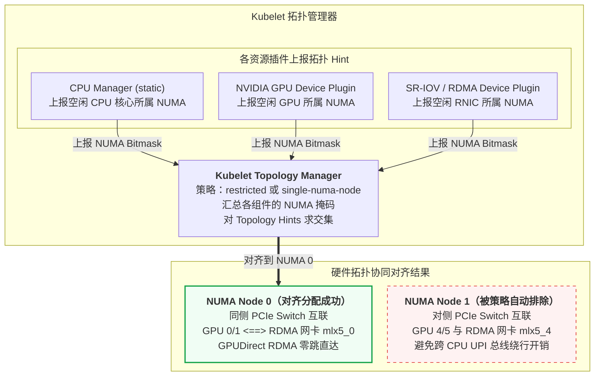

为了让云原生节点上的`Pod`始终获得最优的`GPUDirect RDMA`硬件路径，需要在节点层面落实以下三项配置：

| 调优层级 | 关键配置项 | 推荐值与底层作用说明 |
| :--- | :--- | :--- |
| **`kubelet`拓扑管理器** | `--topology-manager-policy`<br/>`--topology-manager-scope` | 设置策略为`restricted`（或整块单`NUMA`任务设为`single-numa-node`），作用域设为`pod`，并开启`CPU Manager`的`static`策略。确保分配给同一个`Pod`的`CPU`、`GPU`和`RDMA`网卡严格位于同一`NUMA`节点下 |
| **主板`BIOS`设置** | `PCIe ACS`（访问控制服务） | **必须关闭（`Disable ACS`）**。若开启`ACS`，`PCIe Switch`会强制把所有点对点（`P2P`）流量重定向到`CPU Root Complex`绕一圈，导致`GPUDirect RDMA`延迟飙升甚至完全失效 |
| **宿主机内核启动参数** | `/etc/default/grub`中的`GRUB_CMDLINE_LINUX` | 添加`iommu=pt`（`Pass-Through`透传模式）。既保留了`SR-IOV`所需的`IOMMU`中断重映射能力，又避免了每次`RDMA DMA`操作都触发高昂的`IOMMU`页表转换开销 |

## 生产级实战：基于NVIDIA Network Operator落地与验证


通过前面的层层剖析，我们已经看到：要在`Kubernetes`集群中实现生产级的`Pod`间`RDMA`通信，涉及到宿主机`DOCA-OFED`驱动、`nvidia-peermem`模块、`Multus CNI`、辅助`CNI`插件（`Macvlan`/`IPoIB`/`SR-IOV`/`Host-Device`）、`NV-IPAM`地址池管理以及`RDMA/SR-IOV Device Plugin`等十余个组件的协同安装与配置。

如果靠运维工程师在几百台节点上手工维护这些碎片化组件，极易出现版本冲突或配置漂移。为此，云原生社区与`NVIDIA`推出了统一做声明式生命周期管理的`Operator`——**`NVIDIA Network Operator`**，源码见 [GitHub 仓库 `Mellanox/network-operator`](https://github.com/Mellanox/network-operator)。

### NVIDIA Network Operator全局架构与核心CRD

与大家熟知的`GPU Operator`类似，`NVIDIA Network Operator`依托节点特征发现组件（`NFD`，自动识别带有`feature.node.kubernetes.io/pci-15b3.present=true`标签的`Mellanox/NVIDIA`网卡节点），只需要管理员提交一份名为 **`NicClusterPolicy`** 的核心自定义资源（`CRD`）以及对应的二层/三层网络定义，就能以`DaemonSet`容器化的方式全自动完成从底层驱动到上层插件的部署闭环：

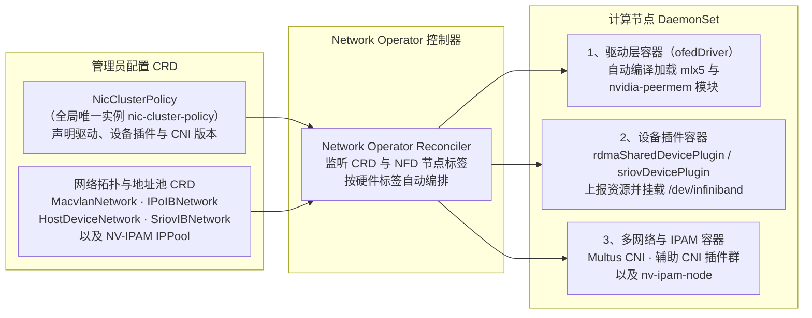

下面我们给出可直接用于生产环境参考的完整配置链路。

### 第一步：编写NicClusterPolicy统一拉起驱动、插件与多网络底座

以下`NicClusterPolicy`配置展示了如何让`Network Operator`自动在节点上部署容器化`DOCA-OFED`驱动（自动开启`nvidia-peermem`）、`Multus`与标准辅助`CNI`插件包、`NV-IPAM`地址管理插件，以及分别按网卡名称暴露资源的`RDMA Shared Device Plugin`：

```yaml
apiVersion: mellanox.com/v1alpha1
kind: NicClusterPolicy
metadata:
  name: nic-cluster-policy
spec:
  # 1. 容器化自动安装与管理宿主机 DOCA-OFED 驱动及 GPUDirect 桥接模块
  ofedDriver:
    image: doca-driver
    repository: nvcr.io/nvidia/mellanox
    version: doca3.5.0-26.07-0-ubuntu22.04
    livenessProbe:
      initialDelaySeconds: 30
      periodSeconds: 30
    readinessProbe:
      initialDelaySeconds: 10
      periodSeconds: 30

  # 2. 部署 RDMA 共享设备插件，将物理网卡暴露为 K8s 可调度资源
  rdmaSharedDevicePlugin:
    image: k8s-rdma-shared-dev-plugin
    repository: ghcr.io/mellanox
    version: v1.5.2
    config: |
      {
        "periodicUpdateInterval": 300,
        "configList": [
          {
            "resourceName": "rdma_shared_device_a",
            "rdmaHcaMax": 63,
            "selectors": {
              "vendors": ["15b3"],
              "ifNames": ["ens1f0", "ibs1f0"]
            }
          }
        ]
      }

  # 3. 部署高性能 NV-IPAM 插件，负责为 Pod 的 RDMA 网卡极速分配 IP
  nvIpam:
    image: kubernetes-ipam
    repository: ghcr.io/mellanox
    version: v0.3.4
    enableWebhook: false

  # 4. 部署 Multus 元网络插件以及包含 macvlan / ipoib / host-device 的 CNI 二进制包
  secondaryNetwork:
    cniPlugins:
      image: container-networking-plugins
      repository: ghcr.io/mellanox
      version: v1.5.0
    multus:
      image: multus-cni
      repository: ghcr.io/k8snetworkplumbingwg
      version: v4.1.0
    ipoib:
      image: ipoib-cni
      repository: ghcr.io/mellanox
      version: v1.2.0
```

> **多网卡轨道优化（`Rail-Optimized`）扩展提示**：如果节点配有`8`张高速网卡（例如`eth1` ~ `eth8`或`ib0` ~ `ib7`），只需在`rdmaSharedDevicePlugin.config.configList`（或`sriovDevicePlugin`）中定义`rdma_shared_device_0`至`rdma_shared_device_7`共`8`个独立资源项，分别绑定对应的单张物理网卡名即可。

### 第二步：按底层协议创建NV-IPAM地址池与辅助网络CRD

当`NicClusterPolicy`就绪后，我们首先创建一个由`NV-IPAM`管理的`RDMA`专网地址池（`IPPool`），然后根据集群物理交换机是 **`RoCEv2`** 还是 **`InfiniBand`** ，选择创建对应的网络自定义资源（`Network Operator`会自动将其翻译为`Multus`所需的`NetworkAttachmentDefinition`）：

```yaml
# 1. 定义 RDMA 高速专网 IP 地址池（每个节点预分配 32 个 IP，支持零锁竞争极速分配）
apiVersion: nv-ipam.nvidia.com/v1alpha1
kind: IPPool
metadata:
  name: rdma-fabric-pool
  namespace: nvidia-network-operator
spec:
  subnet: 192.168.100.0/18
  perNodeBlockSize: 32
  gateway: 192.168.100.1
```

接下来，根据物理网络类型二选一应用以下网络定义：

```yaml
# 【场景 A：RoCEv2 以太网集群】创建 MacvlanNetwork（绑定宿主机 RoCE 物理口 ens1f0）
apiVersion: mellanox.com/v1alpha1
kind: MacvlanNetwork
metadata:
  name: roce-macvlan-net
spec:
  networkNamespace: "default"
  master: "ens1f0"
  mode: "bridge"
  mtu: 4200
  ipam: |
    {
      "type": "nv-ipam",
      "poolName": "rdma-fabric-pool"
    }
```

```yaml
# 【场景 B：InfiniBand 集群】创建 IPoIBNetwork（绑定宿主机 IB 物理口 ibs1f0）
apiVersion: mellanox.com/v1alpha1
kind: IPoIBNetwork
metadata:
  name: ib-ipoib-net
spec:
  networkNamespace: "default"
  master: "ibs1f0"
  ipam: |
    {
      "type": "nv-ipam",
      "poolName": "rdma-fabric-pool"
    }
```

### 第三步：部署启用RDMA与GPUDirect的业务训练Pod

一切底层设施就绪后，容器要接上`RDMA`与`GPUDirect`，需要落实三件事：**添加`k8s.v1.cni.cncf.io/networks`注解声明接入上面创建的辅助网络**、**在`resources.limits`中申请`rdma/rdma_shared_device_a`资源**、**配置大尺寸`/dev/shm`与`NCCL`环境变量**。

:::info 生产部署
生产级集群里，训练和推理任务通常交给`Volcano`这类调度器创建。调度器负责拉起一组`Pod`，并完成整组调度。下面的`Pod YAML`是简化的版本，仅用来说明原理。
:::

```yaml
apiVersion: v1
kind: Pod
metadata:
  name: llm-rdma-trainer-0
  namespace: default
  annotations:
    # 通知 Multus CNI 为 Pod 挂载名为 roce-macvlan-net（IB 环境则填 ib-ipoib-net）的辅助网卡，命名为 net1
    k8s.v1.cni.cncf.io/networks: |
      [
        {
          "name": "roce-macvlan-net",
          "interface": "net1"
        }
      ]
spec:
  containers:
    - name: pytorch-trainer
      image: nvcr.io/nvidia/pytorch:25.02-py3
      command: ["sleep", "infinity"]
      securityContext:
        capabilities:
          # 若以 root 运行，添加 IPC_LOCK 确保锁页权限；配合宿主机 containerd cri-base.json 兼容非 root
          add: ["IPC_LOCK"]
      env:
        - name: NCCL_DEBUG
          value: "INFO"
        # 显式启用 InfiniBand / RoCE Verbs 通信，禁止退化为纯 TCP
        - name: NCCL_IB_DISABLE
          value: "0"
        # 指定带外（OOB）握手使用辅助网卡 net1（或主网卡 eth0）
        - name: NCCL_SOCKET_IFNAME
          value: "net1"
        # 指定使用的 RDMA HCA 设备前缀
        - name: NCCL_IB_HCA
          value: "mlx5"
        # RoCEv2 场景下对齐交换机无损队列优先级（DSCP 26 -> TC 106，PFC Priority 3）
        - name: NCCL_IB_TC
          value: "106"
        - name: NCCL_IB_SL
          value: "3"
      resources:
        requests:
          nvidia.com/gpu: "1"
          rdma/rdma_shared_device_a: "1"
        limits:
          nvidia.com/gpu: "1"
          rdma/rdma_shared_device_a: "1"
      volumeMounts:
        - name: dshm
          mountPath: /dev/shm
  volumes:
    # 为 NCCL 提供充足的共享内存空间，避免容器默认 64MB /dev/shm 耗尽
    - name: dshm
      emptyDir:
        medium: Memory
        sizeLimit: 32Gi
```

### Pod内RDMA连通性验证与常见故障排查手册

当两个测试`Pod`（例如分别调度在两台不同物理节点上的`llm-rdma-trainer-0`与`llm-rdma-trainer-1`）启动后，千万不要直接跑大模型训练脚本来“盲测”，而应当按照**自底向上的四步验证法**逐层确认每道关卡均已打通：

#### 四步标准化验证流程

:::info 延伸阅读
如果对`ibv_devinfo`字段、`PCI`地址以及`InfiniBand`/`RoCE`拓扑的查看方法感兴趣，想再看细一些，可以查看我之前的文章：[RDMA硬件管理及网络拓扑信息查看](./3000-RDMA硬件管理及网络拓扑信息查看.md)。
:::

```bash
# 【第 1 步】进入 Pod 容器，检查字符设备注入与锁页内存限制是否解除
kubectl exec -it llm-rdma-trainer-0 -- bash
ls -l /dev/infiniband/
# 预期输出：必须能看到 rdma_cm 以及 uverbs0（或对应 VF 的 uverbsX）
ulimit -l
# 预期输出：unlimited

# 【第 2 步】检查辅助网卡 net1 的 IP 以及 RDMA 硬件端口状态
ip -4 addr show dev net1
# 预期输出：成功获取到 192.168.100.x 网段的专属 IP
ibv_devinfo -d mlx5_0
# 预期输出：state 为 PORT_ACTIVE (4)，link_layer 为 Ethernet（RoCE）或 InfiniBand

# 【第 3 步】使用 perftest 工具包执行跨节点 Pod 间 RDMA 硬件微基准压测
# 在 Pod 0（服务端，假设 net1 IP 为 192.168.100.11）中启动 RDMA Write 带宽测试（-R 表示使用 rdma_cm 自动建连并匹配 GID）：
ib_write_bw -d mlx5_0 -R -F --report_gbits

# 在 Pod 1（客户端）中连接 Pod 0 的 net1 IP 发起压测：
ib_write_bw -d mlx5_0 -R -F --report_gbits 192.168.100.11
# 预期输出：400Gbps 网卡下 BW average 应接近 380~395 Gb/sec，证明纯硬件 RDMA 通道完全打通！
```

在第`4`步运行`nccl-tests`（如`all_reduce_perf`）或实际训练任务时，重点观察`NCCL_DEBUG=INFO`输出的初始化日志。只有看到类似如下带有 **`NET/IB`** 以及 **`GDRDMA`** 字样的日志，才标志着`Pod`间的`RDMA`与`GPUDirect RDMA`真正大功告成。

:::info 延伸阅读
如果对`nccl-tests`的编译、参数和结果解读感兴趣，想再看细一些，可以查看我之前的文章：[NVIDIA NCCL Tests：GPU通信性能与正确性测试实践](../../850-可观测性/100-故障检测/4000-NVIDIA%20NCCL%20Tests.md)。
:::

```text
NCCL INFO NET/IB : Using [0]mlx5_0:1/RoCE [RO]; OOB net1:192.168.100.11<0>
NCCL INFO Channel 00/02 : 0[0] -> 1[0] [receive] via NET/IB/0/GDRDMA
NCCL INFO Channel 00/02 : 0[0] -> 1[0] [send] via NET/IB/0/GDRDMA
```

#### 云原生Pod间RDMA常见故障速查表

如果在上述验证过程中遇到异常，可对照下表快速定位根因：

| 故障现象或报错信息 | 底层根因剖析 | 工程解决措施 |
| :--- | :--- | :--- |
| 容器内执行`ibv_devinfo`提示`No IB devices found` | 一是`Pod`未申请`rdma/*`或`nvidia.com/*`扩展资源，未触发设备插件挂载`/dev/infiniband/*`；<br/>二是容器镜像内缺失用户态驱动库`libmlx5`或`rdma-core` | 核查`Pod`的`resources.limits`是否声明了`Device Plugin`对应的资源名，并用`ls /dev/infiniband`确认设备存在；在镜像内安装`ibverbs-providers`与`rdma-core` |
| 报错`ibv_reg_mr failed: Cannot allocate memory`或`ENOMEM` | 容器进程的锁页内存配额（`RLIMIT_MEMLOCK`）不足（常见于非`root`容器即使加了`IPC_LOCK`仍受限于`64KB`/`8MB`） | 在宿主机`containerd`中配置`LimitMEMLOCK=infinity`并通过`base_runtime_spec`将默认`RLIMIT_MEMLOCK`设为无限制 |
| `NCCL`未报错但跨机训练极慢，日志显示`Using [0]eth0`且走`NET/Socket` | 一是`Pod`内未能成功将`mlx5_X`的`GID`表与容器当前`NetNS`下的网络接口匹配上；<br/>二是误将`NCCL_IB_GID_INDEX`硬编码成了错误的序号 | 检查`Multus`是否成功注入`net1`且其父接口与`mlx5_X`对应；移除硬编码的`NCCL_IB_GID_INDEX`（或通过`rdma_cm`自动匹配），设置`NCCL_IB_DISABLE=0` |
| `RoCEv2`下建连成功但收发大包卡死，报`transport retry counter exceeded (synd 0x81)` | 一是宿主机多网卡同网段发生`ARP`串扰，导致对端解析出错误的`MAC`/`GID`；<br/>二是容器未指定`NCCL_IB_TC`，流量掉入交换机有损队列发生丢包；<br/>三是`Pod`与交换机端口`MTU`不匹配 | 宿主机设置`arp_ignore=2`与`arp_announce=2`；根据交换机`DSCP`/`PFC`配置正确注入`NCCL_IB_TC`与`NCCL_IB_SL`；检查`MacvlanNetwork`的`mtu`与交换机一致 |
| `InfiniBand SR-IOV`下容器内`ibv_devinfo`显示端口状态为`PORT_DOWN` | `IB SR-IOV`切分出的`VF`初始`GUID`全为`0`，未被子网管理器（`SM`/`UFM`）分配`LID`与`PKey`授权 | 若无需多租户硬件隔离，优先改用`IPoIB CNI`共享模式；若必须使用`IB-SRIOV`，需部署`ib-kubernetes`对接`UFM`或手动为宿主机`VF`配置非零`GUID` |
| `NCCL`日志中出现`NET/IB/0`但没有`GDRDMA`后缀，且带宽减半 | `GPUDirect RDMA`未生效，数据经由宿主机`CPU`内存中转：宿主机未加载`nvidia_peermem`模块，或`GPU`与`RDMA`网卡跨了`NUMA`节点、开启了`PCIe ACS` | 宿主机执行`modprobe nvidia_peermem`；检查`nvidia-smi topo -m`确保分配的`GPU`与网卡同属一个`NUMA`/`PIX`域；在`BIOS`中关闭`ACS`并设置内核`iommu=pt` |

## 总结

在云原生`Kubernetes`集群下打通`Pod`间的`RDMA`高速通信，本质上是在 **“容器沙箱的安全隔离”** 与 **“硬件卸载的直通诉求”** 之间做一场精密的外科手术。回顾全文，只要抓住了以下五条核心主线，整套看似庞杂的技术栈便能一目了然：

1. **看懂双通道模型**：任何一次`RDMA`通信都同时依赖“控制寻址通道（`Linux`网络接口`netdev`与`IP`/`GID`映射）”和“直通数据通道（`/dev/infiniband/*`字符设备与用户态硬件寄存器映射）”。
2. **对齐分离式驱动**：宿主机内核态（`mlx5_core`/`mlx5_ib`及`nvidia-peermem`/`DMA-BUF`）与容器镜像内的用户态库（`rdma-core`/`libmlx5`）共同组成完整驱动链，并由内核`rdma system netns`的`shared`（共享）或`exclusive`（独占）模式决定多`Pod`隔离边界。
3. **构建双平面网络**：借助`Multus CNI`保留`eth0`负责云原生控制管理面，同时按场景从**`Macvlan`/`IPoIB`共享模式**（轻量灵活，单卡多`Pod`共享）、**`SR-IOV`硬件虚拟化模式**（多租户硬件级强隔离）或**`Host-Device`整卡直通模式**（`8GPU+8NIC`轨道优化极致性能）中选择合适的辅助网络与`Device Plugin`组合。
4. **区分`RoCEv2`与`IB`基因**：`RoCEv2`的核心在于内核`roce_gid_mgmt`的`Pod IP→GID`自动映射、无损队列优先级（`DSCP`/`PFC`）透传与`ARP`防串扰；`InfiniBand`的核心则在于通过`IPoIB`完成握手以及与子网管理器（`SM`/`UFM`）协同完成`LID`与`PKey`分区管理。
5. **压实容器运行时与拓扑**：通过`containerd`的`base_runtime_spec`彻底解除`RLIMIT_MEMLOCK`锁页内存桎梏，并借助`kubelet Topology Manager`将`CPU`、`GPU`与`RDMA`网卡锁定在同一`NUMA`与`PCIe Switch`域内，方能释放`GPUDirect RDMA`的线速潜能。

## 参考资料

- [NVIDIA Network Operator Official Documentation](https://docs.nvidia.com/networking/display/kubernetes)
- [Mellanox k8s-rdma-shared-dev-plugin GitHub Repository](https://github.com/Mellanox/k8s-rdma-shared-dev-plugin)
- [Mellanox ib-kubernetes & InfiniBand SR-IOV CNI Architecture](https://github.com/Mellanox/ib-kubernetes)
- [NVIDIA GPUDirect RDMA & DMA-BUF Kernel Documentation](https://docs.nvidia.com/cuda/gpudirect-rdma/)
- [NCCL Environment Variables Official Reference](https://docs.nvidia.com/deeplearning/nccl/user-guide/docs/env.html)
- [Linux Kernel RDMA Subsystem & Network Namespace Isolation (`rdma-system`)](https://man7.org/linux/man-pages/man8/rdma-system.8.html)
