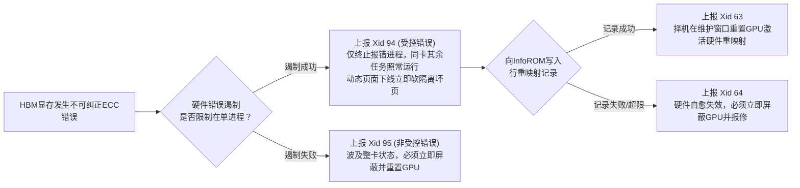
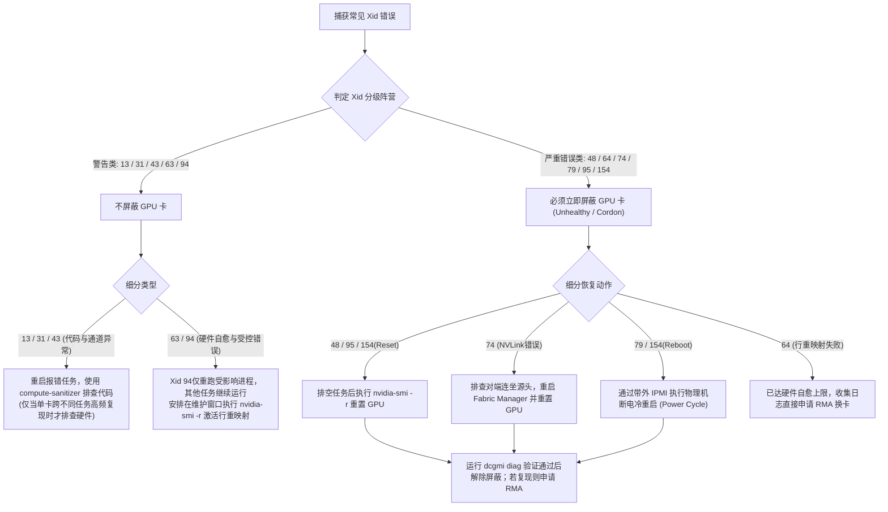

## 前言


在大模型训练与高并发推理集群中，任务中断时最核心的排障问题是：**究竟是业务代码存在越界与指针`Bug`，还是底层物理显卡发生了硬件损坏**？

- **过度反应（误杀好卡）**：将业务代码越界或硬件已自愈的轻微事件当作硬件损坏，盲目封禁节点（`Cordon`/`Taint`）或重启服务器，导致同机健康任务被中断。
- **响应不足（算力黑洞）**：当`GPU`发生不可纠正的显存损坏、`NVLink`断链或`PCIe`掉卡时未及时屏蔽。由于坏卡上的任务会立即报错退出并释放资源，调度器会误判该卡“空闲”并持续把新作业调度上去，短时间内吞噬大量任务。

`Xid`（`Xid Error Messages`）是`NVIDIA`内核驱动（`NVRM`）在检测到硬件、固件或应用异常时向系统内核日志打印的标准诊断代码，同一`Xid`编号在不同驱动版本中含义保持一致。通过以下命令即可在宿主机检索`Xid`日志：

```bash
# 查看带时间戳的内核 Xid 日志（含 GPU PCI 地址与 UUID 映射前导行）
sudo dmesg -T | grep -iE "NVRM: GPU at|NVRM: Xid"
```

典型日志结构如下：

```text
[Thu Oct 29 14:22:05 2026] NVRM: GPU at PCI:0000:65:00: GPU-1f027ee8-6e1e-2b8c-0108-3d370e5f0418
[Thu Oct 29 14:22:05 2026] NVRM: Xid (PCI:0000:65:00): 94, pid=7062, name=python3, Contained: CE User Channel (0x9). RST: No, D-RST: No
```

其中`PCI:0000:65:00`为物理插槽总线地址，`GPU-1f027ee8-...`为跨重启不变的显卡`UUID`，冒号后的`94`即为`Xid`编号，`pid`标识触发进程，`RST: Yes/No`与`D-RST: Yes/No`指示是否需要立即重置`GPU`或排空作业后重置。若需向厂商报修，可执行`sudo nvidia-bug-report.sh`（掉卡卡死时加`--safe-mode --extra-system-data`）收集诊断包。

> `NVIDIA`官方`Xid`手册地址：https://docs.nvidia.com/deploy/xid-errors/index.html

## 核心前置概念速览

在查阅具体`Xid`编号前，先理解以下几个高频出现的硬件与驱动底层概念，有助于明白各个`Xid`的触发原理与恢复要求：

| 核心概念 | 通俗类比 | 技术原理与关联`Xid` |
|:---:|---|---|
| <span style={{whiteSpace: 'nowrap'}}><strong>`Channel`与`GR`引擎</strong></span> | 业务窗口与计算车间 | 驱动为每个`GPU`上下文分配独立的硬件通道（`Channel`），将算子交由`GR`计算引擎（含`SM`流式多处理器）执行。代码算子越界会报`Xid 13`；进程崩溃导致通道被驱动强制回收会报`Xid 43`。 |
| <span style={{whiteSpace: 'nowrap'}}><strong>`MMU`（内存管理单元）</strong></span> | 显存地址翻译官 | 负责将程序中的虚拟显存地址翻译为`HBM`物理显存地址。若程序访问空指针、越界地址或已释放显存，`MMU`会触发缺页异常（`Xid 31`，相当于`CPU`的段错误`SIGSEGV`）。 |
| <span style={{whiteSpace: 'nowrap'}}><strong>`ECC`（`SBE`与`DBE`）</strong></span> | 显存纠错码 | **单比特翻转（`SBE`）** 由硬件自动纠错，业务无感；**双比特或多比特翻转（`DBE`）** 硬件无法自动修复，称为不可纠正错误（`UCE`），会触发`Xid 48`、`94`或`95`。 |
| <span style={{whiteSpace: 'nowrap'}}><strong>`InfoROM`</strong></span> | 板载非易失病历本 | `GPU`板卡上的持久只读存储器，断电不丢失，用于存储设备`UUID`、历史`ECC`统计及显存坏块隔离记录。 |
| <span style={{whiteSpace: 'nowrap'}}><strong>页面退役与行重映射</strong></span> | 显存坏块隔离机制 | `V100`及更早架构采用**动态页面退役（`Page Retirement`）**（软件层屏蔽坏页，上限`64`页）；`A100`/`H100`/`B100`等采用硬件**行重映射（`Row Remapping`）**（每个显存`Bank`预留硬件备用行，在`GPU Reset`时透明替换坏行，整卡上限`512`行）。记录写入`InfoROM`成功报`Xid 63`，写入失败或备用行耗尽报`Xid 64`。 |
| <span style={{whiteSpace: 'nowrap'}}><strong>动态页面下线</strong></span> | 在线实时软隔离 | `Ampere`（`A100`）起引入。发生显存错误时，驱动立即在软件层将坏页标记为不可用（`Dynamic Page Offlining`），无需立刻重置`GPU`，新老任务均不会再分配到该坏页。 |
| <span style={{whiteSpace: 'nowrap'}}><strong>错误遏制机制</strong></span> | 故障防扩散隔离舱 | `Ampere`（`A100`）起引入（`Error Containment`）。当发生不可纠正`ECC`错误时，若硬件成功将损坏限制在触发错误的单个进程内，报**受控错误`Xid 94`**（同卡其他任务不受影响）；若错误扩散至共享缓存/全局结构无法隔离，则报**非受控错误`Xid 95`**（必须重置整张`GPU`）。 |

从`Ampere`架构开始，显存发生不可纠正`ECC`错误时的硬件自愈与`Xid`触发关系如下：



## 常见`Xid`分级总览与处置决策

围绕生产环境中最常见的`11`个`Xid`代码，我们根据“故障是否破坏`GPU`全局可用性”将其划分为两大阵营：

- **警告类`Xid`（通常无需屏蔽`GPU`卡）：`13`、`31`、`43`、`63`、`94`**。此类错误源于用户代码缺陷（`13`、`31`、`43`），或硬件已完成在线坏块隔离与记录（`63`、`94`），`GPU`依然具备正常服务能力，切忌盲目封卡。
- **严重错误类`Xid`（必须立即屏蔽`GPU`卡）：`48`、`64`、`74`、`79`、`95`、`154`**。此类错误意味着显存发生不可遏制损坏、重映射失效、`NVLink`断链、`PCIe`掉卡或驱动强制要求重置/重启，必须立即将该`GPU`卡（或所在节点）从调度池屏蔽。



### 警告类`Xid`详解与处理建议（`13`、`31`、`43`、`63`、`94`）

以下`Xid`在生产集群中通常作为**警告事件**处理，**无需立即屏蔽`GPU`卡**。各错误码的官方定义、触发原理、实际案例与处理建议汇总如下表：

| `Xid` | 官方名称与触发机制 | 实际案例与典型日志特征 | 官方处理建议与排障要点 |
|:---:|---|---|---|
| **`13`** | **`Graphics Engine Exception`**<br/>（图形/计算引擎异常）<br/>`SM`计算单元在执行`CUDA Kernel`时遇到数组越界读写（`Out Of Range Address`）、非法指令（`Illegal Instruction`）、地址未对齐或非法寄存器访问。 | **案例**：自定义`Triton`/`CUDA`算子在特定`Batch`下数组下标越界，训练抛出`illegal memory access`并退出。<br/>**日志特征**：含`Graphics SM Warp Exception on (GPC x, TPC y, SM z)`。 | **官方动作：`RESTART_APP`**<br/>1. **不屏蔽卡**，驱动会自动回收崩溃进程上下文。<br/>2. 使用`compute-sanitizer --tool memcheck`或设置`CUDA_DEVICE_WAITS_ON_EXCEPTION=1`配合`cuda-gdb`定位越界代码行。<br/>3. 仅当同一物理卡在运行不同正常作业时始终在同一`GPC/TPC/SM`报错，才需运行`dcgmi diag -r 3`排查硬件。 |
| **`31`** | **`GPU Memory Page Fault`**<br/>（`GPU`显存缺页中断）<br/>相当于`GPU`上的段错误（`SIGSEGV`）。计算或拷贝单元访问了未映射的虚拟地址、空指针或已提前释放的显存，被`MMU`硬件拦截。 | **案例**：推理服务开启`CUDA Graph`后，图内引用的临时张量被提前释放，重放时触发缺页中断。<br/>**日志特征**：含`MMU Fault: ENGINE ... faulted @ 0x... FAULT_PDE ACCESS_TYPE_VIRT_READ`。 | **官方动作：`RESTART_APP`**<br/>1. **不屏蔽卡**，`MMU`拦截后`GPU`本身完全健康。<br/>2. 重跑任务若“跟任务走”，属代码指针或显存生命周期`Bug`，用`compute-sanitizer`排查。<br/>3. 仅当同一`UUID`显卡跨不同作业高频复现`Xid 31`时，才排查显存硬件。 |
| **`43`** | **`GPU Stopped Processing`**<br/>（通道重置校验错误）<br/>用户程序因软件异常、核函数死锁超时或被外部信号（如`SIGKILL`/`Ctrl-C`）强杀，驱动强制终止并回收其`Channel`。官方文档明确指出**此时`GPU`保持健康**。 | **案例**：分布式训练中某`Rank`因数据加载卡死被框架看门狗超时`Kill`，内核打印`Xid 43`并伴随清理事件`Xid 45`。<br/>**日志特征**：含`pid=xxx, name=python3, Ch 00000010`。 | **官方动作：`IGNORE`**<br/>1. **严禁因此屏蔽卡**，这只是软件异常退出后的正常通道清理动作（常与`Xid 45`成对出现）。<br/>2. 检查`Xid 43`前序日志是否有其他核心`Xid`、宿主机`OOM Killer`记录或业务侧死锁超时日志。 |
| **`63`** | **`Row Remapping / Page Retirement Event`**<br/>（显存行重映射/页退役记录成功）<br/>发生`ECC`错误后，驱动成功将待退役页（`V100`及以前）或待重映射行（`A100`及以后）写入板载`InfoROM`。 | **案例**：`A800`节点因单比特`ECC`累积或伴随`Xid 94`触发行重映射登记，业务容器正常运行。<br/>**日志特征**：含`Row Remapper: New row marked for remapping, reset gpu to activate`。 | **官方动作：`IGNORE`**<br/>1. **无需立即屏蔽卡**，`Xid 63`代表硬件自愈记录成功，且坏页已被动态下线隔离。<br/>2. 若单独出现或伴随`Xid 94`出现，存量任务继续运行，只需在**维护窗口择机执行`nvidia-smi -r`重置`GPU`**激活硬件重映射。<br/>3. 若紧跟在严重错误`Xid 48`/`95`后出现，则按`48`/`95`流程排空重置。 |
| **`94`** | **`Contained Memory Error`**<br/>（受控的显存`ECC`错误）<br/>适用`A100`/`H100`/`B100`等架构。发生不可纠正`ECC`错误，但硬件**错误遏制机制**成功将其限制在单个进程内，并通过动态页面下线隔离了坏页。 | **案例**：一张运行多个推理容器的`A100`偶发宇宙射线导致`ECC`翻转，仅1个容器报错退出，其余容器无损运行。<br/>**日志特征**：含`Contained: ... RST: No, D-RST: No`（无需立即重置）。 | **官方动作：`RESTART_APP`**<br/>1. **单次偶发无需屏蔽整卡**，仅重启报错的单个进程/容器，同卡其他任务不受影响，择机在维护窗口重置`GPU`。<br/>2. 注意在`k8s-device-plugin`中将`94`与`63`加入忽略列表以防误封卡。<br/>3. 若同一张卡短时间内高频触发`Xid 94`，说明显存颗粒持续劣化，需转入屏蔽报修。 |

#### 警告类`Xid`常用排查命令

针对`Xid 13`/`31`的代码排查与`Xid 63`/`94`的重映射状态检查，常用命令如下：

```bash
# 1. 针对 Xid 13 / 31：使用官方 Compute Sanitizer 定位算子越界或非法指针的具体代码行
compute-sanitizer --tool memcheck python3 train.py

# 2. 针对 Xid 63 / 94：查看显存行重映射计数、待生效状态（Pending）与失败标志（Failure）
nvidia-smi -q -d ROW_REMAPER
```

### 严重错误类`Xid`详解与处理建议（`48`、`64`、`74`、`79`、`95`、`154`）

当检测到以下`6`类严重`Xid`时，表明`GPU`硬件、互联链路或全局上下文已处于不可用状态，**必须第一时间屏蔽故障`GPU`卡（或隔离节点）**，禁止新任务调度。详细机制、案例与处置建议如下表所示：

| `Xid` | 官方名称与为什么必须屏蔽`GPU`卡 | 实际案例与典型日志特征 | 官方恢复流程与`RMA`报修判定标准 |
|:---:|---|---|---|
| **`48`** | **`Double Bit ECC Error (DBE)`**<br/>（双比特不可纠正`ECC`错误）<br/>显存（`DRAM`，新驱动伴随`Xid 171`）或片上缓存（`SRAM`/`L2`，新驱动伴随`Xid 172`）发生硬件无法修复的多比特错误。未重置前继续调度会导致任务立即崩溃或计算出错。 | **案例**：大模型训练突然中断并抛出`cudaErrorECCUncorrectable`，内核报`Xid 48`。<br/>**日志特征**：含`An uncorrectable double bit error (DBE) has been detected on GPU`。 | **官方动作：`WORKFLOW_XID_48`（排空并重置）**<br/>1. **立即屏蔽该卡**，排空同节点任务后执行`sudo nvidia-smi -i <id> -r`重置`GPU`或重启节点。<br/>2. 执行`nvidia-smi -q -d ECC`检查：若发生在`SRAM`且触发`SRAM Threshold Exceeded`标志（同一`Bank`超过`2`次`SECDED`或`4`次`Parity`不可纠正错误），或重置后仍复现`Xid 48`，直接下线运行`Field Diagnostics`并申请`RMA`换卡。 |
| **`64`** | **`Row Remapping / Page Retirement Failure`**<br/>（显存行重映射/页退役记录失败）<br/>驱动尝试向`InfoROM`记录坏块失败，或硬件备用行已耗尽。此时**`GPU`已彻底丧失隔离坏显存的自愈能力**，坏块直接暴露给应用。 | **案例**：某老旧`A100`多次出现显存错误后报`Xid 64`，同时监控指标`DCGM_FI_DEV_ROW_REMAP_FAILURE`变为`1`。<br/>**日志特征**：含`Row Remapper: Failed to record row remapping event to infoROM`。 | **官方动作：`RESET_GPU`与`CONTACT_SUPPORT`**<br/>1. **立即屏蔽该卡**并尝试重置`GPU`/重启节点。<br/>2. **官方`DRAM RMA`标准**：单`Bank`已重映射满`8`行后再出错、已重映射行二次出错、整卡累计重映射达到**`512`行上限**，均会置位`Row Remapper Failure : Yes`。一旦置位或重启后仍报`Xid 64`，直接下线走`RMA`换卡。 |
| **`74`** | **`NVLink Error`**<br/>（`NVLink`高速互联错误）<br/>`GPU`间或与`NVSwitch`间的高速链路发生物理错误、子链路断开或校验超限（`Blackwell`架构细化为`Xid 144~150`）。在完成重置或重启前链路无法恢复，会导致多卡`NCCL`通信直接卡死。 | **案例**：8卡`H800`训练中断，多张卡同时报`Xid 74`。排查发现是`GPU 0`先发生`Xid 79`掉卡，导致与之互联的对端卡被动报`Xid 74`。<br/>**日志特征**：含`NVLink: fatal error detected on link x(0x..., ...)`。 | **官方动作：`WORKFLOW_NVLINK_ERR`**<br/>1. **立即屏蔽相关卡/节点**。<br/>2. **先查“连坐效应”（`Sympathetic Error`）**：按时间戳对比整机`Xid`与`Fabric Manager`的`SXid`日志，若因对端掉卡引发，优先处理源头卡。<br/>3. 用`nvidia-smi nvlink -s/-e`查链路状态，看日志首寄存器：`Bit 4/5`置位（`ECC/Parity`故障）在同一链路超`2`次则报修；`Bit 8,9,12,16,17,21,22,24,28`置位则检查`SXM`底座或线缆连接。<br/>4. 重启`Fabric Manager`并重置`GPU`（或重启整机），用`nccl-tests`验证。 |
| **`79`** | **`GPU has fallen off the bus`**<br/>（`GPU`从`PCIe`总线上脱落/掉卡）<br/>驱动通过`PCIe`总线访问`GPU`时完全无响应。此时`nvidia-smi`报错失联且软重置无效，任何分配上去的容器都会初始化失败。 | **案例**：满载训练瞬态功耗飙升或散热不良，导致显卡触发保护从`PCIe`总线掉线，8卡节点变成7卡。<br/>**日志特征**：含`GPU has fallen off the bus`。 | **官方动作：`RESTART_BM`（物理机重启）**<br/>1. **立即屏蔽整台节点**。<br/>2. 通过`dmesg | grep -iE "pcie|aer"`和带外`ipmitool sel elist`排查四大诱因：**电源供电瞬态跌落/线缆松动、过温保护、主板`PCIe`插槽/`Riser`卡接触不良、显卡硬件击穿**。<br/>3. 软重启通常无效，必须通过`IPMI`执行**断电冷重启（`ipmitool chassis power cycle`）**。恢复后跑`dcgmi diag -r 4`压测，复现则报修。 |
| **`95`** | **`Uncontained Memory Error`**<br/>（非受控的显存`ECC`错误）<br/>发生不可纠正`ECC`错误且波及二级缓存标签（`LTC TAG`）等跨进程共享结构，**硬件错误遏制失败**。在重置`GPU`前，任何新`CUDA`应用均无法启动。 | **案例**：`A100`节点日志打印`Xid 95`，卡上所有容器同时崩溃，后续新调度上去的`Pod`全部报错退出。<br/>**日志特征**：含`Uncontained: LTC TAG ... RST: Yes, D-RST: No`（强制要求重置）。 | **官方动作：`RESET_GPU`**<br/>1. **立即屏蔽该卡**。<br/>2. 若开启了`MIG`，先排空该物理卡上其余`MIG`实例的任务再执行`GPU Reset`；若未开启`MIG`，立即清理残留进程执行`sudo nvidia-smi -i <id> -r`重置或重启节点。<br/>3. 重置后检查`Row Remapper Failure`与`SRAM`阈值，频繁复现则申请`RMA`。 |
| **`154`** | **`GPU Recovery Action Changed`**<br/>（`GPU`恢复动作状态变更）<br/>`CUDA 12.7`/`R565+`引入的**汇总型元错误码**，伴随其他底层严重`Xid`（如`48,64,74,79,95`等）出现，直接给出驱动要求系统执行的恢复动作级别。 | **案例**：发生`Xid 79`或`Xid 95`后，紧接着打印一条`Xid 154`指明恢复动作。<br/>**日志特征**：含`GPU recovery action changed from 0x0 (None) to 0x2 (Node Reboot Required)`。 | **官方动作：严格遵循`Xid 154`指示的状态码**<br/>1. 只要目标状态从`0x0 (None)`变为非零状态（`0x1`~`0x4`），**必须立即屏蔽该`GPU`卡**。<br/>2. 回溯紧邻的前一条原始`Xid`定位根因，并按下方状态表执行重置或重启。 |

#### `Xid 154`的五种标准恢复动作状态表

当捕获到`Xid 154`时，可根据日志中的目标状态值（对应`NVML`的`nvmlDeviceGetGpuRecoveryAction`）直接执行自动化处置：

| 状态值与名称 | 是否屏蔽卡 | 状态含义与生产执行动作 |
|---|:---:|---|
| `0x0 (None)` | **否** | 无需恢复操作，`GPU`处于健康可用状态，可正常接收新进程。 |
| `0x1 (GPU Reset Required)` | **是** | **立即屏蔽该卡**，终止卡上所有进程，执行`sudo nvidia-smi -i <id> -r`重置后方可重新启用。 |
| `0x2 (Node Reboot Required)` | **是** | **立即屏蔽整台节点**，故障已导致系统或总线状态不一致，排空任务后重启物理节点（必要时断电冷重启）。 |
| `0x3 (Drain P2P)` | **是** | **立即屏蔽该卡**，终止所有使用`P2P`点对点通信的进程并关闭`UVM`持久模式，随后再次查询下一步恢复状态。 |
| `0x4 (Drain and Reset)` | **是** | **立即屏蔽新任务调度**，允许卡上未受影响的存量任务继续运行至结束或`Checkpoint`，全部排空后执行`nvidia-smi -r`。 |

## 故障`GPU`卡屏蔽与集群自动化实践

明确了`13, 31, 43, 63, 94`仅需告警、`48, 64, 74, 79, 95, 154`必须屏蔽卡的分级原则后，可在单机环境与`Kubernetes`集群中按以下方式落地执行。

### 单机与裸金属环境下的重置与屏蔽操作

在裸金属服务器上处置严重`Xid`时，可通过以下命令完成单卡重置或强制屏蔽：

```bash
# 1. 尝试软重置故障卡（以 GPU 3 为例，重置前需确保无进程占用 /dev/nvidia3）
sudo fuser -k -9 /dev/nvidia3
sudo nvidia-smi -i 3 -r

# 2. 驱动级强制屏蔽：若坏卡无法立即更换，将其计算模式设为 PROHIBITED（禁止任何进程创建 CUDA 上下文）
sudo nvidia-smi -i 3 -c PROHIBITED
# 待日后硬件修复后恢复默认模式：sudo nvidia-smi -i 3 -c DEFAULT

# 3. 业务级环境变量屏蔽：使用健康卡的 UUID 列表（避免掉卡后数字索引偏移）
export CUDA_VISIBLE_DEVICES=GPU-1f027ee8-6e1e-2b8c-0108-3d370e5f0418,GPU-9e5b8fec-61bf-5124-a0a9-079af1b65cc6
```

> **注意**：在配备`NVSwitch`的`Ampere`架构（如`DGX/HGX A100`）裸金属节点上，必须确保`nvidia-fabricmanager`服务处于运行状态，才能使用`nvidia-smi -i <id> -r`单独重置单张`GPU`；而在`Hopper`（`H100`/`H800`）及更新架构上，无论`Fabric Manager`状态如何均支持单卡独立重置。

### `Kubernetes`集群下的单卡自动屏蔽与告警配置

#### 配置`NVIDIA k8s-device-plugin`精准屏蔽严重`Xid`

`NVIDIA k8s-device-plugin`通过`NVML`监听`Xid`事件，一旦捕获未忽略的`Xid`，会自动将该卡标记为`Unhealthy`并上报`Kubelet`，将其从节点可分配容量（`Allocatable`）中扣除。

但其源码（`internal/rm/health.go`）默认仅忽略了`13, 31, 43, 45, 68, 109`，**默认未忽略`63`和`94`**，容易导致`A100`/`H100`偶发受控错误时被误封整卡。生产环境可通过环境变量`DP_DISABLE_HEALTHCHECKS`与`DP_ENABLE_HEALTHCHECKS`调整：

```yaml
# 方式一：在内置忽略列表(13,31,43,45,68,109)基础上，追加忽略 63 和 94（推荐）
env:
  - name: DP_DISABLE_HEALTHCHECKS
    value: "63,94"

# 方式二：白名单模式，仅当出现指定的严重 Xid 时才将 GPU 标记为 Unhealthy 屏蔽
env:
  - name: DP_DISABLE_HEALTHCHECKS
    value: "xids"
  - name: DP_ENABLE_HEALTHCHECKS
    value: "48,64,74,79,95,154"
```

当故障卡完成`nvidia-smi -r`重置并通过`dcgmi diag -r 2`验证后，删除该节点上的`nvidia-device-plugin`实例`Pod`使其重建，即可解除`Unhealthy`屏蔽状态。对于多机8卡分布式训练场景，还可配合`Node Problem Detector (NPD)`监听`/dev/kmsg`中的`48|64|74|79|95|154`正则，直接对整机节点执行`Cordon`隔离。

#### 配置`DCGM-Exporter`与`Prometheus`分级告警规则

基于[DCGM Exporter](./2000-DCGM%20Exporter.md)采集的`DCGM_FI_DEV_XID_ERRORS`与`DCGM_FI_DEV_ROW_REMAP_FAILURE`指标，在`Prometheus`中配置区分**警告级**与**严重屏蔽级**的告警规则（注意`DCGM_FI_DEV_XID_ERRORS`仅保留最近一次`Xid`值，生产环境建议同时采集宿主机`dmesg`日志以防连续报错被覆盖）：

```yaml
groups:
  - name: gpu-xid-tiered-alerts
    rules:
      # 1. 警告类 Xid (13, 31, 43, 63, 94)：无需立即屏蔽 GPU 卡
      - alert: GPUXidWarningEvent
        expr: DCGM_FI_DEV_XID_ERRORS == 13 or DCGM_FI_DEV_XID_ERRORS == 31 or DCGM_FI_DEV_XID_ERRORS == 43 or DCGM_FI_DEV_XID_ERRORS == 63 or DCGM_FI_DEV_XID_ERRORS == 94
        for: 0m
        labels:
          severity: warning
        annotations:
          summary: "节点 {{ $labels.hostname }} GPU {{ $labels.gpu }} 触发警告类 Xid ({{ $value }})"
          description: "GPU UUID={{ $labels.UUID }} 报告警告级 Xid {{ $value }}。若为 13/31/43 请排查业务 Pod ({{ $labels.exported_pod }}) 代码；若为 63/94 说明硬件已动态隔离坏页，建议在维护窗口重置 GPU。"

      # 2. 严重错误类 Xid (48, 64, 74, 79, 95, 154) 及行重映射失败：必须立即屏蔽 GPU 卡
      - alert: GPUXidCriticalIsolationRequired
        expr: DCGM_FI_DEV_XID_ERRORS == 48 or DCGM_FI_DEV_XID_ERRORS == 64 or DCGM_FI_DEV_XID_ERRORS == 74 or DCGM_FI_DEV_XID_ERRORS == 79 or DCGM_FI_DEV_XID_ERRORS == 95 or DCGM_FI_DEV_XID_ERRORS == 154 or DCGM_FI_DEV_ROW_REMAP_FAILURE > 0
        for: 0m
        labels:
          severity: critical
        annotations:
          summary: "节点 {{ $labels.hostname }} GPU {{ $labels.gpu }} 触发致命异常，必须立即屏蔽！"
          description: "GPU UUID={{ $labels.UUID }} 触发严重错误（Xid={{ $value }}），请立即确认该卡已标记为 Unhealthy 或节点已 Cordon，并结合 dmesg 执行重置、冷重启或 RMA 报修。"
```
